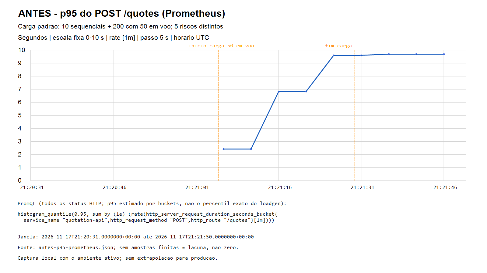
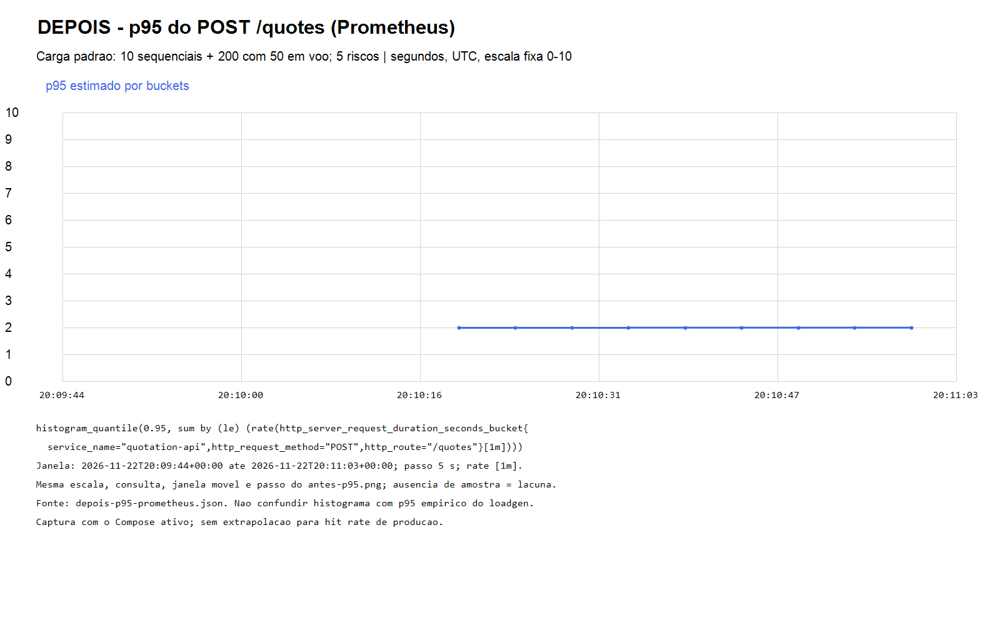
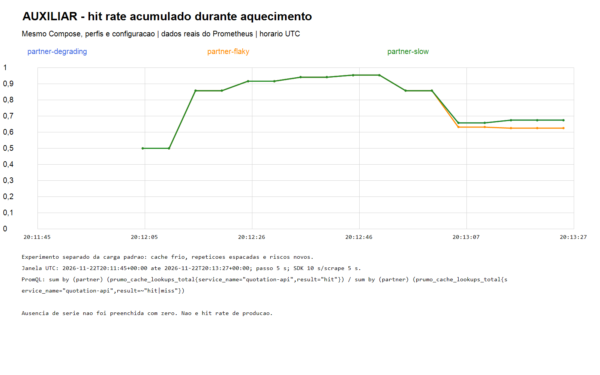
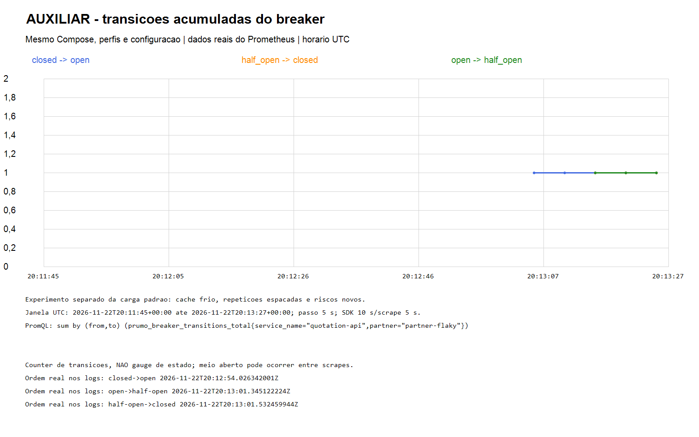
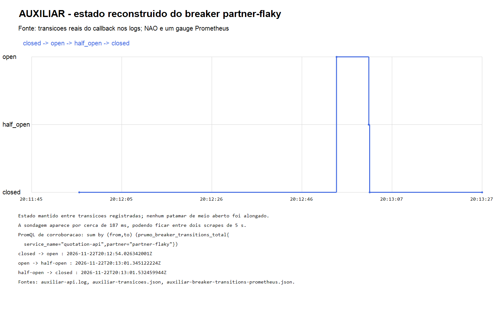

# Evidências - antes da intervenção

Execução própria em **17/11/2026**, na `main`, commit `cbc3c1ee7f595d066d44fa2825c019c74da8bc6d`. Nenhum código, perfil de parceira ou parâmetro de carga foi alterado. Este conjunto registra somente o **antes**; a comparação com a solução será acrescentada após sua implementação.

## Comando, configuração e janela

Na raiz do repositório, com Go, Make e Docker disponíveis:

```powershell
make down
make reproduce
```

O primeiro comando remove o ambiente e seus volumes; o segundo executa `docker compose up -d --build --wait` e o gerador de carga padrão. Não executar novamente antes de exportar as evidências de uma sessão: Jaeger e Prometheus são efêmeros.

Configuração: 10 requisições sequenciais, seguidas de 200 com 50 em voo; cinco riscos distintos; tenant `corretora-a`; timeout do gerador de 30 s; limite da execução da carga de 2 min; nenhum `ARGS`. Esse timeout pertence ao gerador, **não** ao cliente HTTP das parceiras, que continua sem timeout na base.

Ambiente: Windows amd64, Go 1.25.14, Docker Engine 28.4.0 e Compose 2.39.4-desktop.1. As sementes, taxas de falha e latências das parceiras são os defaults do Compose, preservados no snapshot abaixo.

| Intervalo em 17/11/2026 | UTC | Horário local UTC-03 |
| --- | --- | --- |
| Comandos, incluindo reset e builds | 21:19:18 a 21:21:30 | 18:19:18 a 18:21:30 |
| Fase sequencial do gerador | 21:20:46 a 21:21:05 | 18:20:46 a 18:21:05 |
| Fase de carga | 21:21:05 a 21:21:29 | 18:21:05 a 18:21:29 |
| Janela dos exports e do gráfico | 21:20:31 a 21:21:50 | 18:20:31 a 18:21:50 |

O gráfico foi exportado às 21:23:17 UTC, com o ambiente ainda ativo e os dados da execução ainda retidos. O horário exato de cada span está nos JSONs.

## Medições para a coluna "hoje" dos RNFs

Resultados do [relatório completo](antes-reproduce.txt), medidos pelo gerador do próprio repositório:

| Indicador candidato a RNF | Fase sequencial: 10 / 1 em voo | Carga: 200 / 50 em voo | Unidade e método |
| --- | --- | --- | --- |
| Latência p95 de `POST /quotes` | 2,03 | 8,01 | Segundos; percentil empírico nearest-rank das durações observadas pelo loadgen, incluindo erros |
| Taxa de sucesso HTTP | 50%: 5/10 | 60%: 120/200 | Percentual de respostas bem-sucedidas entre as requisições completadas pelo loadgen |
| Vazão total | 0,5 | 8,1 | Requisições/s; requisições completadas, incluindo erros, divididas pela duração da fase |

A fase sequencial durou 18,77 s; a carga durou 24,81 s. Houve cinco respostas 502 na primeira fase e 80 na segunda, todas atribuídas à `partner-flaky`. Sob carga, p50 foi 6,13 s, p99 foi 8,03 s e o máximo foi 8,05 s.

Esses valores são medições, não metas. A escolha de alvos e sua justificativa pertencem ao SAD. Vazão total não significa vazão de cotações bem-sucedidas. O aumento aparente de sucesso entre fases não indica melhora causada pela concorrência: as amostras têm tamanhos diferentes.

Os 210 traces exportados confirmam o total de **125 respostas 200 e 85 respostas 502**; as métricas brutas também totalizam 210 observações no histograma HTTP de entrada.

## Gráfico de p95 do POST /quotes



**Legenda:** o p95 estimado pelo histograma aumenta ao longo da carga; as linhas tracejadas marcam seu início e fim. A figura foi renderizada a partir da resposta real da API do Prometheus, sem inventar pontos.

Consulta, incluindo todos os status HTTP:

```promql
histogram_quantile(
  0.95,
  sum by (le) (
    rate(http_server_request_duration_seconds_bucket{
      service_name="quotation-api",
      http_request_method="POST",
      http_route="/quotes"
    }[1m])
  )
)
```

Parâmetros fixos para a comparação futura: janela móvel `[1m]`, passo de **5 s**, eixo Y de **0 a 10 s**, eixo X em UTC. A janela desta captura é `2026-11-17T21:20:31Z` a `2026-11-17T21:21:50Z`. Na captura do depois, conservar escala, passo e janela móvel, deslocando o intervalo absoluto para a nova execução.

A interpolação dos buckets do histograma chegou a **9,702 s** nesta janela. Isso **não** substitui os **8,01 s** do relatório: são métodos diferentes, um histograma com buckets amplos e janela móvel versus um percentil empírico da fase inteira. O intervalo entre os buckets relevantes é 7,5 a 10 s. Os atrasos de exportação OTel e de scrape também deslocam a observação; não há amostra finita de p95 antes de 21:21:06 nesta série. A ausência foi deixada como lacuna, não como zero nem como medição reconstruída.

Consulta HTTP equivalente, cuja resposta foi preservada em [JSON](antes-p95-prometheus.json):

```powershell
$query = 'histogram_quantile(0.95, sum by (le) (rate(http_server_request_duration_seconds_bucket{service_name="quotation-api",http_request_method="POST",http_route="/quotes"}[1m])))'
$url = 'http://127.0.0.1:9090/api/v1/query_range?query=' +
    [Uri]::EscapeDataString($query) + '&start=1794950431&end=1794950510&step=5'
Invoke-WebRequest -Uri $url -NoProxy -OutFile 'docs\evidencias\antes-p95-prometheus.json'
```

Os dados persistidos continuam verificáveis depois que a retenção de uma hora expirar. Reconsultar o Prometheus após esse prazo ou após `make down` não recupera a sessão antiga.

## Trace lento: agregação em série

Artefato: [antes-trace-lento.json](antes-trace-lento.json). Trace ID: `47f8c1a200576948664cbce2c2b8ecc5`.

**Legenda:** resposta HTTP 200 em 8.049,881 ms; três chamadas externas em cascata, sem sobreposição.

| Parceira | Início relativo ao span servidor (ms) | Duração (ms) | Intervalo após a chamada anterior (ms) | Status |
| --- | --- | --- | --- | --- |
| partner-slow | 0,067 | 1.699,726 | Não se aplica | 200 |
| partner-flaky | 1.699,850 | 200,977 | 0,057 | 200 |
| partner-degrading | 1.900,857 | 6.148,984 | 0,030 | 200 |

Os intervalos positivos demonstram a execução sequencial. A parceira degradante domina o tempo da requisição sob concorrência, mesmo respondendo com sucesso.

## Trace com erro: terceira parceira não chamada

Artefato: [antes-trace-erro.json](antes-trace-erro.json). Trace ID: `b090e0b0cf0fe47a2d653775cfd1f486`.

**Legenda:** resposta HTTP 502 em 1.666,985 ms após a `partner-flaky` responder 503; não existe span cliente para a `partner-degrading`.

| Parceira | Início relativo ao span servidor (ms) | Duração (ms) | Status |
| --- | --- | --- | --- |
| partner-slow | 0,069 | 1.507,596 | 200 |
| partner-flaky | 1.507,691 | 159,245 | 503 |
| partner-degrading | Não chamada | Não se aplica | Não se aplica |

A resposta da primeira parceira foi descartada pelo fluxo tudo-ou-nada. O JSON tem três spans: servidor e duas chamadas externas; o trace lento tem quatro.

Para inspecionar na sessão ativa do Jaeger: serviço `quotation-api`, operação `POST /quotes`, intervalo UTC acima, ou abrir `/trace/<trace-id>` na UI. Os JSONs selecionados são exports completos, não apenas resumos das tabelas.

## Índice dos artefatos e origem

| Artefato | Comando ou consulta de origem | Legenda |
| --- | --- | --- |
| [antes-reproduce.txt](antes-reproduce.txt) | `make down` seguido de `make reproduce`, stdout e stderr completos | Reset, builds, inicialização e resultados próprios com carga padrão |
| [antes-contexto.json](antes-contexto.json) | `git rev-parse HEAD`, `git branch --show-current`, `go version`, versões Docker/Compose e relógio UTC | Commit, ferramentas, carga e horário dos comandos |
| [antes-compose.json](antes-compose.json) | `docker compose config --format json`, antes da execução | Configuração efetiva preservando os perfis padrão |
| [antes-metricas.prom](antes-metricas.prom) | `GET http://127.0.0.1:8889/metrics`, após a carga | Snapshot textual das métricas genéricas emitidas pela base |
| [antes-p95-prometheus.json](antes-p95-prometheus.json) | `query_range` e PromQL da seção do gráfico | Amostras originais, inclusive o valor `NaN` |
| [antes-p95.png](antes-p95.png) | Renderização da série da consulta PromQL acima | p95 estimado, com escala, janela e consulta na própria imagem |
| [antes-traces.json](antes-traces.json) | `GET /api/traces?service=quotation-api&operation=POST%20%2Fquotes&limit=300&start=1794950431000000&end=1794950510000000` no Jaeger | Os 210 traces completos da execução |
| [antes-trace-lento.json](antes-trace-lento.json) | Seleção do trace HTTP 200 de maior duração no export completo | Cascata de três chamadas sequenciais |
| [antes-trace-erro.json](antes-trace-erro.json) | Seleção pelo trace ID `b090e0b0cf0fe47a2d653775cfd1f486` no export completo | Erro com ausência da terceira chamada |
| [antes-captura.json](antes-captura.json) | Inspeção dos spans por `span.kind`, `server.address` e `http.response.status_code` e da resposta `query_range` | Janela, contagens, parâmetros do gráfico e cronologia dos traces selecionados |

Comando para exportar o conjunto de traces da janela:

```powershell
$url = 'http://127.0.0.1:16686/api/traces?service=quotation-api&operation=POST%20%2Fquotes&limit=300&start=1794950431000000&end=1794950510000000'
Invoke-WebRequest -Uri $url -NoProxy -OutFile 'docs\evidencias\antes-traces.json'
```

Seleção de um trace completo a partir desse arquivo, preservando o envelope de exportação:

```powershell
$all = Get-Content 'docs\evidencias\antes-traces.json' -Raw | ConvertFrom-Json -Depth 50
$trace = $all.data | Where-Object traceID -EQ '47f8c1a200576948664cbce2c2b8ecc5'
@{ data = @($trace); total = 1; limit = 1; offset = 0; errors = $null } |
    ConvertTo-Json -Depth 50 |
    Set-Content 'docs\evidencias\antes-trace-lento.json' -Encoding utf8
```

Para o trace com erro, substituir o ID e o nome do arquivo pelos indicados na tabela. A consulta deve ser executada com o ambiente ativo; após o reset, usar os arquivos já exportados.

Nenhum teste ou mecanismo novo foi introduzido nesta etapa. Não há evidência de breaker, cache ou fallback, pois eles ainda não existem. O hit rate de produção e os alvos de RNF não são inferidos desta carga sintética.

## Depois da intervenção

O conteúdo acima permanece o registro histórico do **antes**. A execução do **depois**, em **22/11/2026**, usa o commit `c6c4c27c85608b252017cc4041ec93756e1d1133`, sem alterações de código nesta coleta. Docker Engine 28.4.0, Compose 2.39.4 e Go 1.25.14/windows-amd64, no mesmo host do baseline. O Docker voltou a responder; esta coleta usa **o Compose real**, não os processos isolados da conferência anterior de instrumentação.

Comandos executados, sem `ARGS` nem overrides de timeout, breaker, TTL, sementes ou carga:

```powershell
make down
make reproduce
```

O reset afetou somente o projeto Compose deste desafio. Foram preservados os defaults: **10 sequenciais + 200 com 50 em voo, cinco riscos, `corretora-a`, timeout 30 s, limite 2 min**. As configurações efetivas das três parceiras foram comparadas ao [snapshot do antes](antes-compose.json); fontes dos mocks/loadgen continuam iguais à base oficial. [Contexto e hashes anteriores](depois-contexto.json) e [Compose efetivo](depois-compose.json).

### Comparação padrão antes/depois

| Fase / indicador | Antes, 17/11 | Depois, 22/11 | Leitura |
| --- | --- | --- | --- |
| Sequencial: sucesso | 5/10 = 50% | 10/10 = 100% | Aquecimento com cinco riscos repetidos |
| Sequencial: p95 | 2,03 s | 2,04 s | O caminho frio serial não ficou mais rápido |
| Sequencial: vazão | 0,5 req/s | 1,0 req/s | 18,77 s contra 10,02 s na fase |
| Carga: sucesso útil | 120/200 = 60% | 200/200 = 100% | +40 pontos percentuais, sob a hipótese de uma proposta válida ser útil |
| Carga: p95 empírico | 8,01 s | 1,70 s | Redução de aproximadamente 78,8% |
| Carga: p50 / p99 / máximo | 6,13 / 8,03 / 8,05 s | 2 ms / 1,75 / 1,75 s | Não misturar milissegundos com segundos |
| Carga: vazão total | 8,1 req/s | 114,1 req/s | Aproximadamente 14,1 vezes; fase de apenas 1,75 s, não capacidade sustentada |

Fontes: [relatório antes](antes-reproduce.txt), [relatório depois completo](depois-reproduce.txt) e [comparação estruturada](depois-comparacao.json). O texto `baseline → load` impresso pelo gerador compara **duas fases da mesma execução**; não é a comparação entre versões desta tabela.

Os **210 traces** do depois confirmam 210 respostas 200, contra 125 respostas 200 e 85 respostas 502 no antes. A fase de carga contém 189 respostas completas e 11 parciais; a sequencial, sete completas e três parciais. Essa classificação é reconstruída contando, por trace, eventos `quotation.cache_hit` após a composição e chamadas HTTP 200 dos mocks: três propostas indicam completa; uma ou duas, parcial. Todas as 200 requisições da carga têm ao menos uma proposta válida rastreável, sob a validade de 300 s e duração curta da execução. **O loadgen original não captura corpos**; o contrato sem 200 vazio e a validade também são comprovados pelos testes da implementação, não por uma captura fictícia de payloads.

RNF-01 (p95 ≤4 s), RNF-02 (≥190/200 úteis) e RNF-03 (≥16,2 req/s) foram atingidos **nesta execução**. Isso não é SLA de produção, repetição estatística nem prova de tráfego com riscos sempre novos. O cache já é aquecido pela fase sequencial; não houve paralelização das chamadas por requisição. As datas diferem e o uso de recursos por outros processos do host não foi controlado.

### As sete evidências

| Categoria | Artefato e origem | Legenda |
| --- | --- | --- |
| Relatório antes/depois | [Antes](antes-reproduce.txt), [depois](depois-reproduce.txt): stdout/stderr de `make down; make reproduce`; [comparação](depois-comparacao.json) | Mesmos defaults e perfis, com p95, sucesso e vazão comparados acima |
| Suíte completa | [make test](202611221600-make-test.txt), [contexto](202611221600-contexto.json), [preservação](202611221600-preservacao-testes.json) | 96 testes principais/262 testes e subtestes, sem falhas/skips e sem cache; nenhum fonte Go ou dependência mudou desde a validação |
| Breaker aberto | [Trace JSON padrão](depois-trace-breaker.json), selecionado do [export de 210 traces](depois-traces.json) | `partner.short_circuit`, duas propostas de cache, 0,832 ms no span servidor e zero spans HTTP de saída |
| Resposta de cache | [Trace JSON padrão](depois-trace-cache.json), selecionado do mesmo export | Três eventos `quotation.cache_hit`, 0,589 ms no servidor e zero spans HTTP de saída |
| Ciclo do breaker | [Estado reconstruído dos logs](auxiliar-breaker-state.png), [contagens por direção](auxiliar-breaker-transitions.png), [PromQL/valores](auxiliar-breaker-transitions-prometheus.json), [logs com timestamps](auxiliar-api.log), [transições](auxiliar-transicoes.json) | Transições reais fechado → aberto → meio aberto → fechado; sem fabricar gauge ou alongar o meio aberto |
| Aquecimento do cache | [Gráfico acumulado auxiliar](auxiliar-cache-hit-rate.png), [PromQL/valores acumulados](auxiliar-cache-hit-rate-cumulative-prometheus.json), [taxa móvel](auxiliar-cache-hit-rate-prometheus.json), [contadores](auxiliar-cache-lookups-prometheus.json) | Repetições espaçadas mostram reuso; erros separados do denominador e sem extrapolação para produção |
| p95 do POST /quotes | [Antes PNG](antes-p95.png), [depois PNG](depois-p95.png), [antes JSON](antes-p95-prometheus.json), [depois JSON](depois-p95-prometheus.json) | Mesma PromQL, rate `[1m]`, passo 5 s, escala 0–10 s e intervalos absolutos de 79 s, deslocados entre execuções |



Os traces padrão selecionados são `ca7b560f8029866827ebe3a707198736` (breaker) e `1ba14dbb3dd98293dc0b7a151285097e` (cache). No Jaeger, abrir `/trace/<id>` enquanto a sessão original existir; depois do reset, usar o JSON exportado. Ambos retornam 200; o bloqueio não precisa descartar as outras propostas. Não há spans HTTP de chamadas evitadas.

### Janelas, consultas e captura padrão

| Intervalo do depois, 22/11/2026 | UTC |
| --- | --- |
| Sequencial | 20:09:59,130 a 20:10:09,142 |
| Carga | 20:10:09,142 a 20:10:10,894 |
| Gráficos Prometheus | 20:09:44 a 20:11:03 |
| Export consolidado, com Compose ativo | 20:11:15 |

Os horários completos, parâmetros e URLs estão em [depois-captura.json](depois-captura.json). O pico estimado do histograma foi **2,007 s**, não os **1,70 s** empíricos do relatório. No antes, a mesma distinção era 9,702 s contra 8,01 s. Não preencher `NaN`, série ausente ou intervalo anterior à primeira amostra como zero. SDK a cada 10 s e scrape a cada 5 s limitam a resolução, especialmente na fase de carga de 1,75 s.

```promql
histogram_quantile(0.95, sum by (le) (
  rate(http_server_request_duration_seconds_bucket{
    service_name="quotation-api",http_request_method="POST",http_route="/quotes"
  }[1m])
))
```

Para repetir o export da série em sessão ainda retida:

```powershell
$query = 'histogram_quantile(0.95, sum by (le) (rate(http_server_request_duration_seconds_bucket{service_name="quotation-api",http_request_method="POST",http_route="/quotes"}[1m])))'
$url = 'http://127.0.0.1:9090/api/v1/query_range?query=' +
    [Uri]::EscapeDataString($query) + '&start=1795378184&end=1795378263&step=5'
Invoke-WebRequest -Uri $url -NoProxy -OutFile 'depois-p95-novo-export.json'
```

Os 210 traces foram obtidos com `GET /api/traces?service=quotation-api&operation=POST%20%2Fquotes&limit=500&start=1795378010491707&end=1795378227701190` no Jaeger. [Métricas brutas](depois-metricas.prom), [log da API](depois-api.log), [serviços ativos](depois-servicos.jsonl), séries de [cache](depois-cache-lookups-prometheus.json), [hit rate](depois-cache-hit-rate-prometheus.json) e [transições](depois-breaker-transitions-prometheus.json) foram exportados **antes** de reiniciar o cenário para o auxiliar.

Na execução padrão houve **561 hits, 38 misses e 31 erros de GET** em 630 oportunidades, sem erro de SET nos traces. O hit rate de leituras sem erro é **93,66%**; a fração efetivamente atendida por cache sobre todas as oportunidades é **89,05%**. Excluir erros muda o denominador e não autoriza esconder a indisponibilidade observada no prazo Redis de 20 ms. Os traces mostram 67 chamadas HTTP reais às parceiras e dois curtos-circuitos; 153 requisições foram inteiramente atendidas pelo cache.

### Experimento auxiliar, separado da comparação padrão

Só depois de exportar e renderizar a coleta padrão foram executados `docker compose down -v` e `docker compose up -d --wait`, **sem alterar perfis ou configuração**. [Saída dos comandos](auxiliar-comandos.txt). O estímulo repetiu o mesmo risco 25 vezes, espaçando as requisições em 2 s; depois enviou lotes de três riscos novos em paralelo até observar `circuit_open` da `partner-flaky`. Repetiu um desses riscos para aproveitar o cache das outras parceiras, esperou pelo menos 5,3 s para uma sondagem real e verificou o fechamento. Não houve falha fabricada, mudança de seed ou alongamento do meio aberto.

O [registro de requisições](auxiliar-requisicoes.json) contém fase, índice do risco, trace ID, duração, status, fontes e ausências; não copia CPF, placa ou identificadores de proposta. [Metadados e URLs](auxiliar-captura.json), [todos os traces](auxiliar-traces.json), [bloqueio selecionado](auxiliar-trace-breaker.json), [cache selecionado](auxiliar-trace-cache.json) e [sondagem bem-sucedida](auxiliar-trace-recuperacao.json) permitem cruzar os estímulos com os sinais.

Foram **40 requisições** em um cenário novo. O aquecimento ocorreu de **20:11:55,785 a 20:12:48,034 UTC**. A janela dos gráficos é **20:11:45–20:13:27 UTC**, passo 5 s; os exports ocorreram com o Compose ativo. O hit rate acumulado observado sobe de 50% na primeira amostra para 95,45% por parceira antes da onda de riscos novos; depois cai, como esperado. A primeira amostra não é o instante do primeiro miss: o export periódico explica a lacuna. A consulta móvel por `rate` só ficou finita após o aquecimento inicial; por isso seu JSON é preservado, mas o gráfico de aquecimento usa a razão **acumulada desde o reset**, sem alegar uma taxa móvel diferente.



Consulta do gráfico acumulado:

```promql
sum by (partner) (prumo_cache_lookups_total{service_name="quotation-api",result="hit"})
/
sum by (partner) (prumo_cache_lookups_total{service_name="quotation-api",result=~"hit|miss"})
```

Consulta operacional móvel, também exportada:

```promql
sum by (partner) (rate(prumo_cache_lookups_total{service_name="quotation-api",result="hit"}[1m]))
/
sum by (partner) (rate(prumo_cache_lookups_total{service_name="quotation-api",result=~"hit|miss"}[1m]))
```

```promql
sum by (partner) (rate(prumo_cache_lookups_total{service_name="quotation-api",result="error"}[1m]))
```



```promql
sum by (from,to) (
  prumo_breaker_transitions_total{service_name="quotation-api",partner="partner-flaky"}
)
```

O último gráfico mostra **contagens acumuladas por direção**, não um gauge amostrado de estado. A ordem e os instantes exatos estão nos logs e em `auxiliar-transicoes.json`; meio aberto e fechamento podem cair no mesmo export de 10 s. Os pontos ausentes antes da primeira emissão não são zeros inventados. O arquivo [auxiliar-captura.json](auxiliar-captura.json) declara a janela absoluta própria e o passo de 5 s; **essa janela e essa carga não substituem a execução padrão**.



O [JSON da reconstrução](auxiliar-breaker-state.json) mantém a origem de cada transição. O estado fechado inicial é conhecido pela inicialização do breaker e ausência de transições anteriores nos logs; o estado permanece entre callbacks. Abertura: **20:12:54,026342 UTC**; meio aberto: **20:13:01,345122 UTC**; fechamento: **20:13:01,532460 UTC**. A sondagem dura cerca de **187 ms**, sem alongamento para aparecer no gráfico. O log tem timestamp de registro do callback, não é uma medição de gauge. O Counter Prometheus corrobora uma ocorrência de cada direção.

O trace auxiliar de bloqueio `695a1453b33f4f9a8e8f593d0f5098be` tem **1,379 ms e zero spans HTTP cliente**; o de cache `0803862db26b43b0aed636516d7a4cb6`, **0,982 ms e zero spans cliente**. A recuperação `3fb27f2a605a44a9a910f2500888042e` tem **189,236 ms e uma chamada HTTP**, à `partner-flaky` admitida como sondagem. Os traces completos e os contadores permanecem verificáveis depois do encerramento do ambiente.

### Reprodução do estímulo auxiliar

Exportar a execução padrão **antes** do reset. Em seguida, executar `docker compose down -v` e `docker compose up -d --wait` no projeto deste desafio, sem overrides. O trecho abaixo reproduz a sequência de pedidos sintéticos usando apenas a biblioteca padrão do Python; não modifica mocks ou a aplicação. O segundo argumento identifica o risco, reutilizado nas tentativas bloqueada e de recuperação.

```powershell
@'
import concurrent.futures, json, time, urllib.error, urllib.request, uuid
http = urllib.request.build_opener(urllib.request.ProxyHandler({}))
def post(phase, index):
    trace = uuid.uuid4().hex
    body = {"driver":{"document":"12345678900","birth_year":1988},
            "vehicle":{"plate":"AUX0001","model":"aux-warm" if phase=="warm" else f"aux-risk-{index}",
                       "year":2020,"value_cents":8500000},"coverage":"comprehensive"}
    request = urllib.request.Request("http://127.0.0.1:8080/quotes", data=json.dumps(body).encode(),
        headers={"Content-Type":"application/json","X-Tenant-Id":"corretora-a",
                 "traceparent":"00-"+trace+"-"+uuid.uuid4().hex[:16]+"-01"})
    try:
        response = http.open(request, timeout=15)
    except urllib.error.HTTPError as error:
        response = error
    with response:
        result = json.load(response)
        assert response.status == 200 and result["quotes"]
    print(phase, index, trace, result["status"], result["unavailable_partners"], flush=True)
    return index, result
def blocked(result):
    return any(p["partner"]=="partner-flaky" and p["reason"]=="circuit_open"
               for p in result["unavailable_partners"])
for _ in range(25):
    post("warm", 0)
    time.sleep(2)
selected = None
with concurrent.futures.ThreadPoolExecutor(max_workers=3) as executor:
    for wave in range(10):
        batch = list(executor.map(lambda n: post("new-risk", n), range(wave*3+1, wave*3+4)))
        selected = next((index for index, result in batch if blocked(result)), None)
        if selected is not None:
            break
assert selected is not None, "Abertura nao observada; nao declarar sucesso."
assert blocked(post("blocked-repeat", selected)[1])
for _ in range(6):
    time.sleep(5.3)
    result = post("probe", selected)[1]
    if any(q["partner"]=="partner-flaky" and q["source"]=="partner" for q in result["quotes"]):
        break
else:
    raise RuntimeError("Recuperacao nao observada.")
post("recovered-hit", selected)
'@ | python -
```

Após aguardar export/scrape, consultar Prometheus com as PromQL acima, serviço `quotation-api`, e a janela absoluta dessa nova execução. Exportar os traces pelos IDs impressos, logs com `docker compose logs --no-color --timestamps quotation-api` e métricas com `GET http://127.0.0.1:8889/metrics`. A concorrência e a disponibilidade dos recursos do host podem alterar a ordem e o número de pedidos necessários; registrar o observado em vez de copiar os números desta sessão. Salvar tudo antes de novo `down -v`.

### Integridade e encerramento

O [registro de integridade](depois-integridade.json) relaciona SHA-256 dos novos artefatos e as verificações de sete categorias, 210 traces padrão, 40 auxiliares, propostas úteis e ausência de chamadas evitadas. Os hashes dos artefatos anteriores estão em `depois-contexto.json`; todos permaneceram idênticos, com a única exceção deste índice, que recebeu somente o apêndice do depois. Código Go, dependências, Makefile, Compose, perfis, mocks e gerador não foram alterados.

Todos os exports e gráficos foram persistidos e conferidos **antes do encerramento**. Em seguida foi executado `make down` somente neste projeto; [saída e confirmação de nenhum container remanescente do projeto](depois-encerramento.txt). O [snapshot auxiliar dos serviços](auxiliar-servicos.jsonl) e o snapshot padrão preservam a prova de que a captura ocorreu com os serviços ativos. Nenhuma limpeza global, reinício do Docker ou alteração de recursos de outros projetos foi realizada. As evidências em arquivo continuam verificáveis sem a retenção efêmera do Prometheus/Jaeger.

## Bônus paralelo

Nova coleta de **22/11/2026**, independente dos artefatos acima. D-05 do [SAD](../sad.md#49-d-05--agregação-paralela-no-caminho-resiliente) registra a decisão antes da implementação: um worker por parceira, cache → breaker → HTTP, slots exclusivos e junção antes de validade/ordenação/fallback. Não há retry, bulkhead, fila ou limite global de HTTP. Erro de parceira não cancela irmãs; cancelamento do consumidor alcança todos os workers, aguardados antes do retorno, sem desfazer consultas já admitidas.

**Identidade e execução.** [Contexto](paralelo/contexto.json), [patch das fontes](paralelo/implementacao.patch), [Compose efetivo](paralelo/compose.json) e [saída integral](paralelo/reproduce.txt). HEAD `5209e410db1d9200b6fcc1472384b0be4505506a` não contém o bônus sozinho: aplicar o patch ao HEAD e conferir os hashes das fontes. Mesmo `make down; make reproduce`, sem overrides, dez pedidos sequenciais e depois 200/50, cinco riscos, timeouts/seeds/perfis/gerador preservados. Os hashes anteriores foram registrados antes da coleta; este índice recebe somente o apêndice.

| Indicador | Original | Resiliente serial F-09 | Paralelo F-10 |
| --- | --- | --- | --- |
| Sequencial, úteis | 5/10 | 10/10 | 10/10 |
| Sequencial, p95 empírico | 2,03 s | 2,04 s | **1,68 s** |
| Carga, úteis | 120/200 | 200/200 | **200/200** |
| Carga, p95 empírico | 8,01 s | 1,70 s | **1,71 s** |
| Carga, vazão/duração | 8,1 req/s / 24,81 s | 114,1 req/s / 1,75 s | **98,0 req/s / 2,04 s** |
| Carga, completas/parciais inferidas | Contrato antigo tudo-ou-nada | 189/11 | **160/40** |
| HTTP efetivos, ambas as fases | Não usado nesta comparação de custo | 67 | **123** |
| Cache hits/misses/GET erros, ambas as fases | Sem integração | 561/38/31 | **503/30/97** |
| Erros SET | Sem integração | 0 | **3** |

O ganho de **17,65%** é do p95 da fase sequencial que começa com cache frio, não de uma carga composta só de misses: são dez pedidos para cinco riscos. A carga aquecida **não melhorou**; houve menor vazão, mais parciais e mais HTTP. RNF-01 a RNF-03 continuam atendidos nesta amostra sob P-02, não representam SLA. Host compartilhado, horários diferentes e curta duração impedem atribuir cada variação exclusivamente ao código. Não se afinou prazo/carga para favorecer o bônus.

**Sobreposição comprovada.** [Trace frio JSON](paralelo/trace-paralelo.json), [tempos derivados](paralelo/sobreposicao.json) e [export completo dos 210 traces](paralelo/traces.json). Trace `f5637da2d247b8ed020c6fed5618a2f3`:

| Parceira | Início relativo ao servidor | Duração HTTP |
| --- | --- | --- |
| slow | 8,240 ms | 1.628,885 ms |
| flaky | 8,419 ms | 187,547 ms |
| degrading | 11,927 ms | 148,114 ms |

As três se sobrepõem por **148,114 ms**. Servidor: **1.638,574 ms**; soma dos clientes: **1.964,546 ms**. Há 25 traces com interseção dos três spans; isso prova concorrência independentemente da oscilação do p95. [Trace de cache](paralelo/trace-cache.json) e [trace com bloqueio](paralelo/trace-breaker.json) também foram preservados nesta execução.

**Resultados e sinais.** [Comparação derivada](paralelo/comparacao.json), [metadados/consultas/URLs](paralelo/captura.json), [snapshot Prometheus](paralelo/metricas.prom), [lookups](paralelo/cache-lookups-prometheus.json), [hit rate](paralelo/cache-hit-rate-prometheus.json), [transições](paralelo/breaker-transitions-prometheus.json), [logs API](paralelo/api.txt) e [serviços ativos](paralelo/servicos.jsonl). O contador registra 630 oportunidades, hits/(hits+misses)=**94,37%**, mas hits/todas=**79,84%**; excluir 97 erros da conta comercial seria enganoso. Três erros SET mantiveram propostas frescas válidas, sem contar lookup extra. Foram 167 completas/43 parciais no total (7/3 sequencial, 160/40 carga), 151 traces sem HTTP com cache e quatro com curto-circuito. Classificação usa hits sobreviventes + HTTP 200 dos mocks válidos dentro do TTL; não é captura de corpos pelo loadgen.

**p95 comparável.** [PNG](paralelo/p95.png) e [amostras JSON](paralelo/p95-prometheus.json). Janela UTC **23:23:52–23:25:11**, mesmos 79 s, rate de 1 min, passo de 5 s e eixo Y 0–10 s. Pico estimado do histograma: **2,157 s**, não os 1,71 s empíricos; lacunas/NaN não foram preenchidos como zero. PromQL idêntica à do antes e do serial:

```promql
histogram_quantile(0.95, sum by (le) (rate(http_server_request_duration_seconds_bucket{service_name="quotation-api",http_request_method="POST",http_route="/quotes"}[1m])))
```

**Verificações novas, não reutilização da suíte antiga.** [Cinco comandos e suíte sem cache](paralelo/checks.txt), [hashes das fontes](paralelo/checks.json), [64 testes originais por AST](paralelo/preservacao-testes.json), [race detector completo](paralelo/race.txt) e [Dockerfile do teste isolado](paralelo/Dockerfile.race). Foram 98 testes principais/264 com subtestes, sete pacotes, sem falhas/skips/cache na suíte final. Os testes novos provam 3/1/2 s sobrepostos em 3 s, origem/tenant/ordenação e cancelamento anterior sem trabalho; testes existentes ajustados usam doubles seguros e falhas por identidade, não ordem de execução. No Windows, `-race` não pôde rodar sem CGO/compilador C; executou-se em Linux com `CGO_ENABLED=1 go test -race -count=1 -timeout=180s ./...`. Para reproduzir esse teste, com espaço e uso do Docker autorizados:

```powershell
docker build --progress plain --file docs\evidencias\paralelo\Dockerfile.race --tag prumo-task16-race:local .
```

**Custo e operação.** As 123 tentativas representariam R$ 4,92 a R$ 0,04/HTTP, contra R$ 2,68 seriais: **R$ 2,24 adicionais**, se todas faturadas. Não é fatura nem economia. P-01/h=20%/40%, validade, TCO e preços permanecem condicionais; paralelismo não reduz automaticamente consultas, faturabilidade ou investimento. A menor cobertura pode importar comercialmente apesar de 100% de respostas úteis sob P-02.

**Incidente de coleta e encerramento.** Duas tentativas pararam antes de subir serviços ou executar carga, com disco C: cheio e banco de metadados Docker em erro de I/O: [primeiro log](paralelo/tentativa-bloqueada-reproduce.txt), [contexto](paralelo/tentativa-bloqueada-contexto.json), [segundo log](paralelo/tentativa-2-bloqueada-reproduce.txt), [contexto](paralelo/tentativa-2-bloqueada-contexto.json). A coleta só continuou após liberação de espaço e recuperação/reinício manual seguro do Docker compartilhado. Não foi feito a limpeza global/reinício; removido apenas sua imagem temporária de race depois da recuperação. Esses incidentes não foram apresentados como execuções de carga.

Exports, gráfico e snapshot ativo foram preservados antes de `make down` somente deste projeto; [confirmação de nenhum container do projeto remanescente](paralelo/encerramento.txt). [Integridade nova](paralelo/integridade.json) identifica bytes da captura, fontes, testes e preservação do acervo anterior, sem regravar manifests antigos. Normalização futura de LF/CRLF pelo Git pode mudar o hash bruto do checkout; não confundir com alteração dos valores medidos.