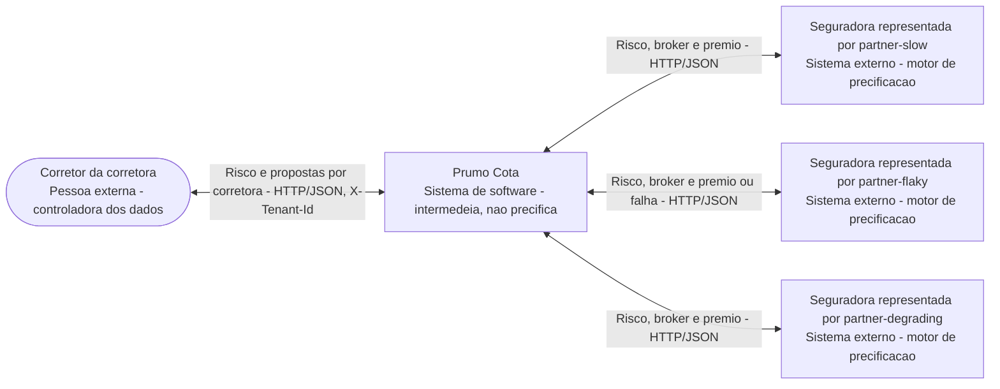
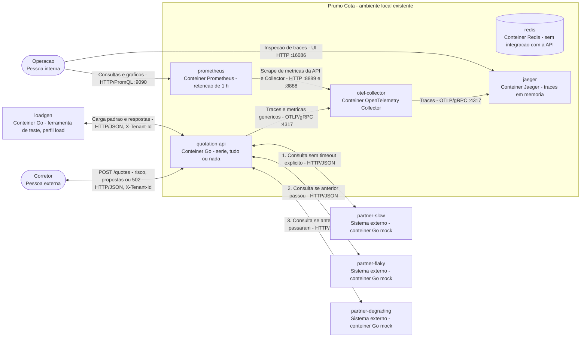

# SAD - Prumo Cota

**Solution Architecture Document | versão 0.1 | 22/11/2026**

**Estado:** seções 1 a 3 elaboradas; seções 4 a 8 reservadas para as próximas etapas. A arquitetura de destino é **proposta, ainda não implementada nem validada**. Somente o comportamento atual e as medições identificadas como baseline são fatos verificados. Este documento parcial não declara o desafio concluído.

## 1. Introdução

### 1.1 Propósito e leitores

O Prumo Cota, da empresa fictícia Prumo Tecnologia em Seguros, intermedeia cotações de seguro auto para corretoras. A Prumo não calcula prêmio, não assume risco e não emite apólices: encaminha o risco às três seguradoras e apresenta os valores recebidos. Condições comerciais variam por corretora; a mesma pessoa e o mesmo veículo não autorizam compartilhamento de respostas entre tenants.

Este SAD orienta a extensão da API existente na fronteira com as parceiras. Para o CTO, deve relacionar consultas evitadas a custo e investimento; para a operação, tornar observáveis a lentidão e o modo degradado; para o encarregado de dados, explicitar segregação, origem da cotação e limites da auditoria. As prioridades aparecem nos requisitos da seção 3 e deverão reaparecer nas decisões da seção 4, na operação da seção 6 e nos custos da seção 8.

### 1.2 Fontes e classificação das afirmações

| Referência | Fonte verificável | Uso neste documento |
| --- | --- | --- |
| F-01 | [Enunciado atual na raiz](../README.md), especialmente “As regras não negociáveis” e “O cenário: negócio, custo e regulação” | Restrições, valores comerciais e obrigações regulatórias do cenário |
| F-02 | [Guia das oito seções](guia-sad.md) | Estrutura e critérios do SAD |
| F-03 | `docker-compose.yml`, `internal\partner\client.go`, `internal\quotation\service.go`, `internal\quotation\handler.go` e `internal\quotation\request.go`, a partir da raiz | Topologia e contrato atuais |
| F-04 | [Índice das evidências próprias](evidencias/README.md) e [saída completa do reproduce](evidencias/antes-reproduce.txt) | Baseline medido em 17/11/2026 |
| F-05 | [Contexto da execução](evidencias/antes-contexto.json), [configuração efetiva](evidencias/antes-compose.json) e [metadados da captura](evidencias/antes-captura.json) | Commit, carga, ferramentas, horários e contagens |
| F-06 | `internal\platform\telemetry.go`, `deploy\otel\collector.yaml` e `deploy\prometheus\prometheus.yml` | Caminho real da telemetria, intervalos e destinos |

**Existente** significa conferido no código ou na configuração. **Medido** significa obtido na execução F-04, não copiado de exemplos do enunciado. **Pressuposto** é hipótese com consequência explícita na seção 1.5. **Proposto** é requisito ou desenho para implementação futura. As obrigações atribuídas a SUSEP e LGPD são as premissas fornecidas por F-01 para este exercício, não uma certificação jurídica independente.

O enunciado ainda está no README da raiz; sua futura organização em outro documento não é apresentada como arquivo já existente.

### 1.3 Escopo e fronteiras

O PoC proposto cobre timeout e circuit breaker na chamada às parceiras, cache Redis segregado por corretora, fallback explícito no contrato e instrumentação de negócio sobre OpenTelemetry. A seção 2 mostra essa mudança sem criar novos contêineres. O mapa detalhado e os parâmetros serão definidos na seção 4 antes da implementação.

O SAD também deverá projetar hospedagem, auditoria imutável, operação, recuperação e TCO. **Projetar auditoria não significa persistir registros no PoC**: cache efêmero e traces não cumprem retenção regulatória.

Não fazem parte da implementação: motores das seguradoras, integrações reais, interface do corretor, cadastro, cobrança, relatórios comerciais, persistência de auditoria, retry, bulkhead, rate limiting, filas, autenticação ou Kubernetes. Não serão resolvidas transações entre cache e parceira nem coordenação distribuída de breakers. A agregação paralela é bônus opcional, não premissa para cumprir os requisitos desta versão. Essas exclusões vêm de F-01 e deverão se tornar limites operacionais explícitos na seção 4.

### 1.4 Restrições impostas versus decisões abertas

| Restrição imposta por F-01 | Consequência para a solução |
| --- | --- |
| Go 1.25, Docker Compose v2 e a base existente | Estender a API e preservar os testes; não substituir o projeto |
| Redis e OpenTelemetry, com Jaeger e Prometheus via Collector | Integrar o Redis já disponível e reutilizar o SDK; não substituir o plumbing |
| Diagramas Mermaid no Markdown | Manter o desenho revisável junto ao texto |
| Três mocks e seus perfis padrão imutáveis na evidência; loadgen sem alterações | Demonstrar resiliência contra a falha, não reduzir artificialmente a carga ou a instabilidade |
| Tenant obrigatório na chave; prêmio somente de parceira ou cache rastreável | Nenhuma resposta cruzada entre corretoras e nenhum preço fabricado |
| Teto comercial de 24 h para reaproveitamento | Nunca estender a validade além de 86.400 s; decidir antes disso com justificativa |
| Auditoria de cada cotação apresentada por cinco anos, não regravável | Prever origem e custo inclusive de cache/fallback; implementação durável fica fora do PoC |
| Prumo operadora, corretora controladora; minimização e descarte | Separar cache descartável de auditoria e excluir CPF, placa e `quote_id` de atributos de spans/métricas |
| Ambiente local sem conta cloud e sem gasto obrigatório | Executar o PoC localmente; estimativas de produção não autorizam provisionamento |

Continuam **abertas**, para a seção 4: biblioteca e escopo do breaker; falhas e janela de abertura; cooldown e sondagens em meio aberto; timeout e sua contabilização; granularidade, chave literal, TTL e invalidação do cache; política e formato do fallback. A hospedagem de produção será decidida na seção 5 por retenção, residência, segregação e custo. Os números de aceitação da seção 3 são metas propostas, não valores já configurados nem um SLA vendido.

### 1.5 Pressupostos quantificados

As hipóteses abaixo não são medições de produção. Precisam ser validadas com produto, corretoras e operação antes de um compromisso comercial.

| ID | Pressuposto com valor | Origem e como validar | Consequência se falso |
| --- | --- | --- | --- |
| P-01 | Em produção, 20% das oportunidades de consulta a uma parceira, no cenário conservador, ou 40%, no favorável, repetem exatamente o mesmo risco normalizado **na mesma corretora e parceira** em até 300 s desde uma consulta original bem-sucedida | Hipótese de trabalho motivada pela recotação descrita em F-01; 300 s é a validade técnica padrão do mock, não o TTL decidido. Validar por estudo agregado das recotações, com minimização e sem incluir dados pessoais na telemetria | Se a repetição ocorrer depois do TTL escolhido, ou mudar corretora, risco ou parceira, ela não é elegível. A seção 8 deve reduzir o hit rate e recalcular economia/payback; não ampliar validade para salvar a conta |
| P-02 | Para o fluxo proposto, pelo menos **uma proposta válida dentre três** já tem utilidade comercial, desde que a corretora consiga identificar origem, ausências e degradação | Hipótese de produto, ainda sem aprovação externa; validar o contrato com representante da corretora antes da escolha do fallback na seção 4 | Se o produto exigir sempre três propostas, a disponibilidade útil do RNF-02 não pode contar resposta parcial. Revisar fallback e metas, sem mascarar recusas como sucesso |
| P-03 | O objetivo inicial de experiência é p95 de até **4 s** sob a carga padrão; a ambição de melhoria é reduzir aproximadamente pela metade os **8,01 s** medidos | Meta de engenharia proposta a partir de F-04, não pesquisa com usuários nem SLA contratual. O melhor caso sequencial observado foi 2,03 s de p95, portanto o alvo não exige paralelizar. Validar com produto e com a execução do depois | Se o negócio exigir menos que a soma saudável das parceiras em cache miss, proteção e cache podem não bastar. Rever escopo e decisões; não afirmar que o bônus de paralelização foi implementado |
| P-04 | A prova local usa **uma réplica da API, dois tenants permitidos e três parceiras** | Topologia e `TENANTS` de F-03; hipótese de representatividade limitada ao PoC, não descrição da escala de produção. Validar separadamente qualquer expansão | Com mais réplicas, breakers locais aprendem falhas separadamente; com mais tenants, há disputa de capacidade. A seção 7 e os custos da seção 8 não podem extrapolar os resultados linearmente |

Para P-01, a unidade é a oportunidade de consulta por parceira, não a cotação agregada. Em um modelo **condicional** com TTL efetivo de pelo menos 300 s, sem expulsão nem perda do Redis e com reutilização permitida, as frações elegíveis de 20% e 40% podem sustentar cenários de hit rate de até 20% e 40%. Não são garantias: falhas de preenchimento, validade restante, invalidação e granularidade podem reduzi-las. Se o cache escolhido for agregado, será necessário refazer a elegibilidade para respostas completas. A seção 4 deverá vincular TTL e validade; só então a seção 8 poderá adotar os hit rates.

A carga sintética repete cinco riscos em 210 requisições. Seu futuro hit rate serve para provar aquecimento e instrumentação, **não para substituir P-01** ou sustentar projeções próximas de 98% em produção.

### 1.6 Parâmetros de negócio fornecidos

F-01 fixa R$ 0,04 por consulta a uma parceira, três consultas potenciais por cotação, 120.000 cotações por dia útil, 22 dias úteis por mês e R$ 0,25 por cotação entregue. Como cenário de referência de **fan-out completo e zero cache**, isso representa 2.640.000 cotações/mês, 7.920.000 consultas/mês e R$ 316.800/mês de consultas, contra R$ 660.000 de receita se todas forem entregues e cobradas.

Essa referência não é uma extrapolação contábil do baseline: o código atual aborta antes da terceira chamada quando a segunda falha. A seção 8 precisará distinguir consultas potenciais de efetivamente compradas, sucesso técnico de entrega comercial e auditoria por cotação apresentada de consultas evitadas. A seção 3 exige preservar exatamente essas distinções.

## 2. Visão geral da arquitetura

### 2.1 Contexto - C4 nível 1

O contexto de negócio permanece o mesmo antes e depois. A corretora é representada pelo corretor que usa o sistema; o canal desenhado é o contrato HTTP existente, não uma interface web implementada. Seguradoras são sistemas externos à Prumo; no laboratório, são representadas pelos três mocks, sem conexão real.



O cabeçalho `X-Tenant-Id` pertence à entrada da API; o código atual envia a identificação às parceiras no campo JSON `broker`, construído em `internal\quotation\service.go`. Nenhum diagrama deve sugerir que a Prumo cria preços ou que o tenant pode ser omitido na reutilização.

### 2.2 Contêineres - C4 nível 2 do antes, existente

Os nomes são os serviços reais de `docker-compose.yml`. A fronteira Prumo contém API e infraestrutura local; os mocks executam na mesma rede Compose, mas continuam dependências externas do ponto de vista de domínio. O Redis está disponível e **não recebe chamadas da API**.



O `loadgen` é uma ferramenta efêmera do perfil `load`, não um nono serviço sempre ativo. A direção Prometheus → Collector representa o scrape HTTP, com as amostras retornando na resposta. A API não expõe um endpoint próprio de métricas.

F-04 mostra por que a intervenção se concentra nessa fronteira: no [trace lento](evidencias/antes-trace-lento.json), as três chamadas não se sobrepõem, e a `partner-degrading` ocupa 6.148,984 ms de uma resposta de 8.049,881 ms. No [trace com erro](evidencias/antes-trace-erro.json), a resposta 503 da segunda parceira vira 502 na API, e não há span da terceira.

### 2.3 Contêineres - C4 nível 2 do depois, proposto

**Todo comportamento de resiliência desenhado abaixo é proposta.** Os contêineres já existem; sua presença não comprova integração de cache, timeout, breaker, fallback ou novas métricas. A proposta mantém a agregação sequencial como ponto de partida, sem depender do bônus.


A auditoria durável de produção **não está representada como contêiner entregue**. Seu armazenamento, residência e imutabilidade ainda serão projetados nas seções 5, 7 e 8, para atender RF-10 e RNF-06. Jaeger, Prometheus e Redis não a substituem.

### 2.4 Delta proposto e destinatários

- **Acrescentar na API:** timeout, proteção de chamadas pelo breaker, integração Redis segregada e política explícita de fallback; nenhum novo serviço é necessário para esse recorte (RF-06 a RF-09).
- **Mudar o fluxo e o contrato:** consultar cache antes de comprar consultas elegíveis, impedir saída HTTP com circuito aberto e tornar degradação/origem visíveis; a escolha exata da resposta e da granularidade depende da seção 4.
- **Acrescentar observabilidade de negócio:** estado/transições do breaker, hit/miss e latência por parceira, mais marcações de cache e curto-circuito, sem atributos pessoais. Reutilizar o pipeline F-06.
- **Retirar o comportamento tudo-ou-nada como única saída:** oferecer a política defendida na seção 4, sem fabricar propostas. Não retirar as validações, a ordenação, o tenant nem os testes que não conflitem com a evolução intencional e documentada do contrato.
- **Preservar:** três parceiras, perfis, gerador, Compose e destinos de telemetria. Paralelização, auditoria persistida e controles de concorrência adicionais não entram silenciosamente no escopo.

O delta serve ao CTO por reduzir consultas pagas quando P-01 se sustentar, à operação por limitar espera e identificar o motivo da degradação e à corretora/encarregado por preservar isolamento e rastreabilidade. As metas da seção 3 deverão limitar o desenho detalhado da seção 4; o desenho não pode usar uma melhoria de latência para esconder ausência de propostas válidas.

## 3. Requisitos funcionais e não funcionais

### 3.1 Contrato de referência e método de aceite

O contrato atual está em `internal\quotation\handler.go` e `internal\quotation\request.go`: `POST /quotes` exige `X-Tenant-Id`; tenants conhecidos vêm da configuração; o corpo carrega motorista, veículo e cobertura. Cobertura vazia assume `comprehensive`; `third_party` também é aceita. `GET /healthz` retorna a saúde do processo e não garante disponibilidade das parceiras, do Redis ou do pipeline de auditoria.

Nos requisitos abaixo, “existente” é comportamento a preservar; “novo” é obrigação proposta para o PoC; “produção proposta” fica fora da implementação local. O contrato degradado ainda será especificado na seção 4, não é uma alteração já disponível para consumidores.

### 3.2 Requisitos funcionais

| ID | Requisito em forma verificável | Estado, origem e prova de aceite |
| --- | --- | --- |
| RF-01 | Rejeitar `POST /quotes` sem `X-Tenant-Id` com 400 e `X-Tenant-Id is required`, e tenant não habilitado com 403 e `broker not enabled on this platform`, sem chamar parceiras | Existente: `internal\quotation\handler.go` e `internal\quotation\handler_test.go`; preservar testes e verificar ausência de chamadas |
| RF-02 | Rejeitar JSON inválido, campos desconhecidos e campos obrigatórios inválidos com 400; normalizar espaços, placa em maiúsculas e cobertura vazia como `comprehensive`; aceitar somente `comprehensive` ou `third_party` | Existente: `internal\quotation\request.go`, `internal\quotation\request_test.go` e handler; verificar as entradas de teste e o corpo enviado às parceiras |
| RF-03 | Em requisição normal, obter as três propostas, devolver `tenant_id`, `quotes` e `elapsed_ms`, ordenar por `premium_cents` crescente e retornar `X-Tenant-Id` no cabeçalho de sucesso; manter ordenação nos resultados degradados que contenham propostas | Parte normal existente: serviço e handler; extensão degradada proposta. Comparar conteúdo e ordem da resposta com as propostas controladas nos testes |
| RF-04 | Toda proposta apresentada deve preservar seguradora, identificador e prêmio da resposta original de parceira, inclusive no cache/fallback; nenhum prêmio pode ser calculado pela plataforma | Fonte F-01 e estrutura `partner.Quote` em `internal\partner\client.go`; conferir resposta contra stub de parceira e, futuramente, entrada armazenada e sua origem |
| RF-05 | Encaminhar a corretora no campo `broker` da consulta à parceira e nunca reutilizar, para uma corretora, a entrada de cache de outra, mesmo para o mesmo risco | Encaminhamento existente em `internal\quotation\service.go`; isolamento de cache novo e obrigatório por F-01. Provar com duas corretoras e respostas distintas |
| RF-06 | Para risco normalizado e tenant elegíveis, reutilizar proposta rastreável no Redis dentro da validade decidida; em miss, obter dados de parceira conforme a política, sem registrar resposta inválida como cotação válida | **Novo da arquitetura**: cache ainda não integrado; testar hit, miss, expiração e isolamento. Chave literal, granularidade e TTL serão decididos na seção 4 |
| RF-07 | Bloquear chamadas externas abrangidas por um circuito aberto; tornar verificáveis fechado, aberto e meio aberto e limitar espera por timeout conforme parâmetros previamente defendidos | **Novo da arquitetura**: ausência de proteção em `internal\partner\client.go`; teste determinístico deve provar zero chamadas no estado aberto e transições sem depender de `sleep` |
| RF-08 | Ao ocorrer falha, timeout ou curto-circuito, devolver o resultado de negócio definido na seção 4 com degradação identificável pelo consumidor; se apresentar cache anterior, informar origem e idade; se apresentar resposta parcial, identificar ausentes; se recusar, devolver erro de negócio distinguível e orientação | **Novo da arquitetura**: hoje falha externa resulta em 502 genérico de parceira. Provar cenários controlados e documentar o contrato escolhido; log sozinho não atende |
| RF-09 | Expor sinais observáveis de estado/transição do breaker, hit/miss de cache e latência por parceira, e marcar no trace resposta de cache e requisição curto-circuitada | **Novo da arquitetura**: F-06 fornece apenas instrumentação genérica. Conferir emissão real, consulta PromQL e traces; nomes das novas métricas serão fixados na seção 4 e implementados antes de serem declarados existentes |
| RF-10 | Para cada cotação efetivamente apresentada, permitir reconstruir seguradora, prêmio, corretora e instante, ligando cache/fallback à consulta original, e prever registro durável imutável | **Produção proposta**, obrigação F-01; seção 5 deverá projetar o mecanismo, seção 7 a recuperação e seção 8 o custo. Aceite por desenho e dimensionamento; persistência regulatória não é alegada como entregue pelo PoC |

RF-06 a RF-09 foram introduzidos pela arquitetura de intervenção, não são capacidades atuais. RF-08 não autoriza chamar toda resposta 200 de sucesso de negócio: RNF-02 exige conteúdo útil e válido. RF-10 não autoriza introduzir CPF, placa ou identificadores de cotação na telemetria para simular auditoria.

### 3.3 Baseline próprio e condições de comparação

O baseline foi executado em 17/11/2026 no commit `cbc3c1ee7f595d066d44fa2825c019c74da8bc6d`, após `make down`, seguido de `make reproduce`, sem `ARGS` e com os perfis padrão. Foram dez requisições sequenciais e depois 200 com 50 em voo, cinco riscos distintos, limite de execução de 2 min e timeout **do loadgen** de 30 s. Este não é um timeout do cliente de parceiras.

| Fase medida | Janela UTC | p95 empírico | Sucesso | Vazão total |
| --- | --- | --- | --- | --- |
| Sequencial: 10 requisições, uma em voo | 21:20:46 a 21:21:05 | 2,03 s | 5/10 = 50% | 0,5 req/s |
| Carga: 200 requisições, 50 em voo | 21:21:05 a 21:21:29 | 8,01 s | 120/200 = 60% | 8,1 req/s |

Fonte: F-04. Os 210 traces preservados confirmam 125 respostas 200 e 85 respostas 502. A disponibilidade útil de produção **não** é inferida desses poucos segundos; “hoje” nos RNFs abaixo significa essa condição de laboratório.

O depois deverá usar a mesma carga, seeds, perfis e ambiente comparável, com reset antes da execução. `cmd\loadgen\report.go` calcula percentil por nearest-rank sobre todas as durações completadas e vazão por total completado/tempo da fase. Não misturar essas medidas com histogramas Prometheus nem com vazão somente de sucessos.

### 3.4 Requisitos não funcionais e origem dos alvos

Os alvos a seguir são **propostos, ainda não comprovados**. Não representam parâmetros de configuração, nem aprovações comerciais já obtidas.

| ID | Requisito e métrica | Hoje | Alvo e unidade | Método de medição/aceite | Origem do alvo e vínculo |
| --- | --- | --- | --- | --- | --- |
| RNF-01 | Latência da cotação: p95 empírico de `POST /quotes` na fase de carga | **8,01 s medidos**, F-04 | **≤ 4,00 s** | Mesmo `make reproduce`; p95 do relatório de 200 requisições, incluindo erros, validado em conjunto com RNF-02 | P-03: aproximadamente metade dos 8,01 s atuais, com margem sobre o melhor caso sequencial observado de 2,03 s; reduzir a espera causada pela terceira parceira, não impor paralelismo |
| RNF-02 | Disponibilidade útil sob a carga: respostas bem-sucedidas com pelo menos uma proposta válida / requisições completadas | **60% medidos: 120/200**, F-04; os sucessos atuais possuem as três propostas | **≥ 95%**, pelo menos **190/200** respostas úteis | Taxa de sucesso do mesmo relatório, mais inspeção dos corpos/traces e teste controlado que exclua 200 vazio, preço inválido e recusa de negócio do numerador | P-02 e instabilidade F-03: uma parceira saudável deve permitir entrega útil mesmo se outra falhar. Reserva de até dez falhas na amostra é um critério inicial de engenharia, não promessa de disponibilidade mensal |
| RNF-03 | Capacidade observada: vazão total sob 50 em voo | **8,1 req/s medidos**, F-04 | **≥ 16,2 req/s**, sem violar RNF-01 e RNF-02 | Requisições completadas / duração da fase de carga, no relatório padrão; não substituir por taxa instantânea PromQL | Meta de dobrar a referência própria, coerente com reduzir espera, via cache e chamadas evitadas. É objetivo a comprovar, não capacidade garantida por uma fórmula ou por P-01 |
| RNF-04 | Isolamento: reutilizações cruzadas de cache entre tenants | **Não medido; cache inexistente** | **0 respostas cruzadas** | Testes determinísticos com duas corretoras, mesmo risco e valores de parceira distintos; conferir retorno e chave efetiva sem expor dados em spans/métricas | F-01: contrato de operadora e preços específicos por corretora; falha não pode ser compensada por latência ou economia |
| RNF-05 | Minimização: atributos de span ou rótulos de métrica com CPF, placa ou `quote_id` | **Não aferido como inventário exaustivo nesta etapa** | **0 atributos proibidos** | Inspeção estática da instrumentação e busca nos exports de traces e séries emitidas nos cenários de RF-06 a RF-09; verificar chaves e valores, não só nomes de métricas | F-01: minimização e cardinalidade limitada. Identificadores podem integrar o dado de negócio/auditoria apropriado, mas não o canal de telemetria |
| RNF-06 | Retenção regulatória e imutabilidade do registro de cotação apresentada | **Não implementado; não medido**; cache e traces são efêmeros | **5 anos** de retenção e **0 sobrescritas** de registros no projeto de produção | Revisar política de retenção e bloqueio de alteração/exclusão antecipada, rastreabilidade de RF-10 e dimensionamento por cotação apresentada nos anos 1 e 5. Comprovação operacional dependerá da futura implantação, fora deste PoC | Obrigação do cenário F-01; requisitos de infraestrutura, recuperação e custo para seções 5, 7 e 8, não uma capacidade atribuída ao Redis/Jaeger |
| RNF-07 | Validade: idade máxima das propostas reutilizadas e violações da validade efetiva | **Não medido; cache inexistente** | **≤ 86.400 s** de idade e **0 propostas além da validade efetiva** | Testes com relógio controlado imediatamente antes/no vencimento; verificar origem e idade da entrada. A seção 4 deverá escolher TTL e eventual política de vencidos, sem ultrapassar validade comercial | Teto de 24 h de F-01. Os 300 s de `valid_for_seconds` são limite técnico a considerar explicitamente, não licença para tratar toda cotação como válida por 24 h |

Se a escolha futura for recusar propostas incompletas, a solução não satisfará automaticamente RNF-02: revisar P-02, a meta e as consequências de negócio no SAD antes de codificar. Da mesma forma, eventual uso de entrada tecnicamente vencida exige distinguir TTL de cache de validade comercial efetiva; nada nesta seção autoriza servir preço sem validade.

### 3.5 Medição operacional e limites da prova

O [gráfico preservado](evidencias/antes-p95.png) usa a métrica **já emitida** `http_server_request_duration_seconds_bucket`:

```promql
histogram_quantile(
  0.95,
  sum by (le) (
    rate(http_server_request_duration_seconds_bucket{
      service_name="quotation-api",
      http_request_method="POST",
      http_route="/quotes"
    }[1m])
  )
)
```

A janela absoluta foi `2026-11-17T21:20:31Z` a `2026-11-17T21:21:50Z`, com passo de 5 s e eixo Y de 0 a 10 s. O máximo estimado da série foi **9,702 s**, não os 8,01 s do RNF-01: histogramas interpolam buckets e a consulta usa janela móvel. Manter a mesma consulta e escala para o gráfico do depois; usar o relatório empírico como método de aceite do RNF-01.

O SDK exporta métricas a cada 10 s e o Prometheus raspa o Collector a cada 5 s (F-06); a carga é curta e há defasagem entre a requisição e sua observação. Não preencher lacunas como zero. Os arquivos exportados de F-04 permanecem a fonte do antes mesmo após expirar a retenção ou derrubar o Compose.

Ainda não há nomes de métricas de breaker/cache implementados a citar. A seção 4 deverá defini-los, a implementação emiti-los e a seção 6 associá-los a limiares e ações. Timeout, breaker e validade terão provas determinísticas próprias; não são demonstrados apenas por um p95 menor numa carga que repete riscos.

### 3.6 Rastreabilidade para as próximas seções

| Necessidade estabelecida | Decisão a desenvolver | Verificação e impacto a completar |
| --- | --- | --- |
| RF-01 a RF-05, RNF-04 e RNF-05 | Seção 4: chave, isolamento, contrato e minimização; seção 5: arquivos reais | Seção 6: diagnóstico sem dados pessoais; seção 8: custo de segregação e retenção |
| RF-06 a RF-09, RNF-01 a RNF-03 e RNF-07 | Seção 4: parâmetros e políticas; seção 5: composição e testes | Seção 6: alertas/runbook; seção 7: Redis perdido e parceira indisponível; seção 8: cenários condicionados a P-01 |
| RF-10 e RNF-06 | Seção 5: hospedagem e auditoria como proposta, fora do PoC | Seção 7: RTO/RPO por classe de dado; seção 8: acervo imutável por cotação apresentada |

## 4. Detalhamento da arquitetura

**Pendente.** Desenvolver contexto, opções, escolha e consequências de breaker, cache e fallback; justificar todos os parâmetros; escrever chave literal; explicitar limites conhecidos e criar C4 nível 3. Não há biblioteca, TTL, limiar ou política final aprovada nesta versão.

## 5. Implementação

**Pendente.** Após as decisões e o PoC, mapear mecanismos a arquivos realmente existentes, distinguir implementação de proposta e decidir hospedagem por compliance e custo. Nenhuma infraestrutura adicional é declarada entregue.

## 6. Operação e gestão de mudanças

**Pendente.** Usar métricas efetivamente emitidas para três alertas, runbook e mudança/reversão de TTL. Os limiares operacionais não estão definidos nesta etapa.

## 7. Recuperação de desastres

**Pendente.** Definir RTO/RPO por classe de dado e os cenários Redis perdido, parceira fora por seis horas e perda de site/região, com impacto no cliente, custo e recuperação. Não há metas de DR aprovadas nem recuperação multi-região implementada.

## 8. Tecnologias, custos e pessoal (TCO)

**Pendente.** Calcular consultas por cenário de hit rate coerente com P-01 e a futura seção 4; infraestrutura, pessoal, auditoria nos anos 1 e 5 e payback. Os valores de referência da seção 1.6 não são veredito de viabilidade nem economia realizada.