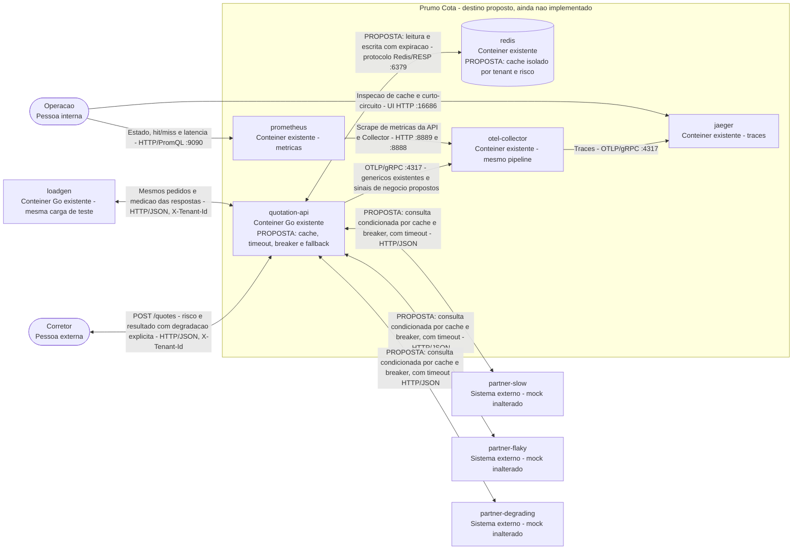
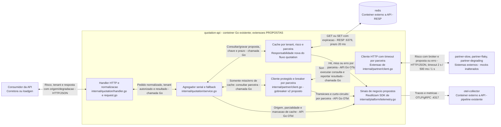

# SAD - Prumo Cota

**Solution Architecture Document | versão 0.2 | 22/11/2026**

**Estado:** seções 1 a 4 elaboradas; decisões da seção 4 fixadas para o PoC; seções 5 a 8 reservadas para as próximas etapas. A arquitetura de destino é **proposta, ainda não implementada nem validada**. Somente o comportamento atual, as fontes externas verificadas e as medições identificadas como baseline são fatos verificados. Este documento parcial não declara o desafio concluído.

## 1. Introdução

### 1.1 Propósito e leitores

O Prumo Cota, da empresa fictícia Prumo Tecnologia em Seguros, intermedeia cotações de seguro auto para corretoras. A Prumo não calcula prêmio, não assume risco e não emite apólices: encaminha o risco às três seguradoras e apresenta os valores recebidos. Condições comerciais variam por corretora; a mesma pessoa e o mesmo veículo não autorizam compartilhamento de respostas entre tenants.

Este SAD orienta a extensão da API existente na fronteira com as parceiras. Para o CTO, deve relacionar consultas evitadas a custo e investimento; para a operação, tornar observáveis a lentidão e o modo degradado; para o encarregado de dados, explicitar segregação, origem da cotação e limites da auditoria. As prioridades aparecem nos requisitos da seção 3 e deverão reaparecer nas decisões da seção 4, na operação da seção 6 e nos custos da seção 8.

### 1.2 Fontes e classificação das afirmações

| Referência | Fonte verificável | Uso neste documento |
| --- | --- | --- |
| F-01 | [Enunciado atual na raiz](../README.md), especialmente “As regras não negociáveis” e “O cenário: negócio, custo e regulação” | Restrições, valores comerciais e obrigações regulatórias do cenário |
| F-02 | [Guia das oito seções](guia-sad.md) | Estrutura e critérios do SAD |
| F-03 | `docker-compose.yml`, `internal\partner\client.go`, `internal\quotation\service.go`, `internal\quotation\handler.go` e `internal\quotation\request.go`, a partir da raiz | Topologia e contrato atuais |
| F-04 | [Índice das evidências próprias](evidencias/README.md) e [saída completa do reproduce](evidencias/antes-reproduce.txt) | Baseline medido em 17/11/2026 |
| F-05 | [Contexto da execução](evidencias/antes-contexto.json), [configuração efetiva](evidencias/antes-compose.json) e [metadados da captura](evidencias/antes-captura.json) | Commit, carga, ferramentas, horários e contagens |
| F-06 | `internal\platform\telemetry.go`, `deploy\otel\collector.yaml` e `deploy\prometheus\prometheus.yml` | Caminho real da telemetria, intervalos e destinos |
| F-07 | [gobreaker v2.4.0: código](https://github.com/sony/gobreaker/blob/0ae90251b774f890e7586c96ea82d61eb74d556d/v2/gobreaker.go) e [módulo](https://github.com/sony/gobreaker/blob/0ae90251b774f890e7586c96ea82d61eb74d556d/v2/go.mod), consultados em 22/11/2026 | API e semântica da biblioteca escolhida; dependência ainda não adicionada ao projeto |
| F-08 | `cmd\partner-mock\behavior.go`, `cmd\partner-mock\config.go`, `cmd\partner-mock\main.go` e `cmd\partner-mock\feasibility_test.go` | Latência efetiva, validade padrão, cancelamento e sequência determinística das parceiras |

**Existente** significa conferido no código ou na configuração. **Medido** significa obtido na execução F-04, não copiado de exemplos do enunciado. **Pressuposto** é hipótese com consequência explícita na seção 1.5. **Proposto** é requisito ou desenho para implementação futura. As obrigações atribuídas a SUSEP e LGPD são as premissas fornecidas por F-01 para este exercício, não uma certificação jurídica independente.

O enunciado ainda está no README da raiz; sua futura organização em outro documento não é apresentada como arquivo já existente.

### 1.3 Escopo e fronteiras

O PoC proposto cobre timeout e circuit breaker na chamada às parceiras, cache Redis segregado por corretora, fallback explícito no contrato e instrumentação de negócio sobre OpenTelemetry. A seção 2 mostra essa mudança sem criar novos contêineres. O mapa detalhado e os parâmetros estão decididos na seção 4, antes da implementação.

O SAD também deverá projetar hospedagem, auditoria imutável, operação, recuperação e TCO. **Projetar auditoria não significa persistir registros no PoC**: cache efêmero e traces não cumprem retenção regulatória.

Não fazem parte da implementação: motores das seguradoras, integrações reais, interface do corretor, cadastro, cobrança, relatórios comerciais, persistência de auditoria, retry, bulkhead, rate limiting, filas, autenticação ou Kubernetes. Não serão resolvidas transações entre cache e parceira nem coordenação distribuída de breakers. A agregação paralela é bônus opcional, não premissa para cumprir os requisitos desta versão. Essas exclusões vêm de F-01 e estão relacionadas aos limites operacionais da seção 4.7.

### 1.4 Restrições impostas versus decisões de arquitetura

| Restrição imposta por F-01 | Consequência para a solução |
| --- | --- |
| Go 1.25, Docker Compose v2 e a base existente | Estender a API e preservar os testes; não substituir o projeto |
| Redis e OpenTelemetry, com Jaeger e Prometheus via Collector | Integrar o Redis já disponível e reutilizar o SDK; não substituir o plumbing |
| Diagramas Mermaid no Markdown | Manter o desenho revisável junto ao texto |
| Três mocks e seus perfis padrão imutáveis na evidência; loadgen sem alterações | Demonstrar resiliência contra a falha, não reduzir artificialmente a carga ou a instabilidade |
| Tenant obrigatório na chave; prêmio somente de parceira ou cache rastreável | Nenhuma resposta cruzada entre corretoras e nenhum preço fabricado |
| Teto comercial de 24 h para reaproveitamento | Nunca estender a validade além de 86.400 s; decidir antes disso com justificativa |
| Auditoria de cada cotação apresentada por cinco anos, não regravável | Prever origem e custo inclusive de cache/fallback; implementação durável fica fora do PoC |
| Prumo operadora, corretora controladora; minimização e descarte | Separar cache descartável de auditoria e excluir CPF, placa e `quote_id` de atributos de spans/métricas |
| Ambiente local sem conta cloud e sem gasto obrigatório | Executar o PoC localmente; estimativas de produção não autorizam provisionamento |

As decisões de breaker, timeout, cache e fallback estão fixadas na seção 4, mas ainda não implementadas. Não são restrições externas nem aprovações comerciais: são escolhas técnicas revisáveis com evidência, sob os pressupostos da seção 1.5. A hospedagem de produção será decidida na seção 5 por retenção, residência, segregação e custo. Os números de aceitação da seção 3 são metas propostas, não valores já configurados nem um SLA vendido.

### 1.5 Pressupostos quantificados

As hipóteses abaixo não são medições de produção. Precisam ser validadas com produto, corretoras e operação antes de um compromisso comercial.

| ID | Pressuposto com valor | Origem e como validar | Consequência se falso |
| --- | --- | --- | --- |
| P-01 | Em produção, 20% das oportunidades de consulta a uma parceira, no cenário conservador, ou 40%, no favorável, repetem exatamente o mesmo risco normalizado **na mesma corretora e parceira** antes do vencimento efetivo de até 300 s, contado conservadoramente desde o início da consulta original bem-sucedida | Hipótese de trabalho motivada pela recotação descrita em F-01; 300 s corresponde ao TTL máximo escolhido na seção 4.3 e ao padrão técnico do mock. Validar por estudo agregado das recotações, com minimização e sem incluir dados pessoais na telemetria | Se a repetição ocorrer depois do TTL efetivo, ou mudar corretora, risco ou parceira, ela não é elegível. A seção 8 deve reduzir o hit rate e recalcular economia/payback; não ampliar validade para salvar a conta |
| P-02 | Para o fluxo proposto, pelo menos **uma proposta válida dentre três** já tem utilidade comercial, desde que a corretora consiga identificar origem, ausências e degradação | Hipótese de produto, ainda sem aprovação externa; sustenta a escolha de resposta parcial na seção 4.4. Validar com representante da corretora antes de uso comercial | Se o produto exigir sempre três propostas, a disponibilidade útil do RNF-02 não pode contar resposta parcial. Revisar fallback e metas, sem mascarar recusas como sucesso |
| P-03 | O objetivo inicial de experiência é p95 de até **4 s** sob a carga padrão; a ambição de melhoria é reduzir aproximadamente pela metade os **8,01 s** medidos | Meta de engenharia proposta a partir de F-04, não pesquisa com usuários nem SLA contratual. O melhor caso sequencial observado foi 2,03 s de p95, portanto o alvo não exige paralelizar. Validar com produto e com a execução do depois | Se o negócio exigir menos que a soma saudável das parceiras em cache miss, proteção e cache podem não bastar. Rever escopo e decisões; não afirmar que o bônus de paralelização foi implementado |
| P-04 | A prova local usa **uma réplica da API, dois tenants permitidos e três parceiras** | Topologia e `TENANTS` de F-03; hipótese de representatividade limitada ao PoC, não descrição da escala de produção. Validar separadamente qualquer expansão | Com mais réplicas, breakers locais aprendem falhas separadamente; com mais tenants, há disputa de capacidade. A seção 7 e os custos da seção 8 não podem extrapolar os resultados linearmente |

Para P-01, a unidade é a oportunidade de consulta por parceira, não a cotação agregada. Com o cache por parceira da seção 4.3, as frações elegíveis de 20% e 40% sustentam cenários condicionais de hit rate de até 20% e 40%, sem expulsão nem perda do Redis. O limite de 300 s começa antes do envio HTTP e não se renova no hit; o prazo útil após a resposta é menor. Falhas de preenchimento, validade restante e expiração podem reduzir o acerto. A seção 8 deverá explicitar essas perdas ou tratar esses números como limites de cenários, nunca como medição de produção.

A carga sintética repete cinco riscos em 210 requisições. Seu futuro hit rate serve para provar aquecimento e instrumentação, **não para substituir P-01** ou sustentar projeções próximas de 98% em produção.

### 1.6 Parâmetros de negócio fornecidos

F-01 fixa R$ 0,04 por consulta a uma parceira, três consultas potenciais por cotação, 120.000 cotações por dia útil, 22 dias úteis por mês e R$ 0,25 por cotação entregue. Como cenário de referência de **fan-out completo e zero cache**, isso representa 2.640.000 cotações/mês, 7.920.000 consultas/mês e R$ 316.800/mês de consultas, contra R$ 660.000 de receita se todas forem entregues e cobradas.

Essa referência não é uma extrapolação contábil do baseline: o código atual aborta antes da terceira chamada quando a segunda falha. A seção 8 precisará distinguir consultas potenciais de efetivamente compradas, sucesso técnico de entrega comercial e auditoria por cotação apresentada de consultas evitadas. A seção 3 exige preservar exatamente essas distinções.

## 2. Visão geral da arquitetura

### 2.1 Contexto - C4 nível 1

O contexto de negócio permanece o mesmo antes e depois. A corretora é representada pelo corretor que usa o sistema; o canal desenhado é o contrato HTTP existente, não uma interface web implementada. Seguradoras são sistemas externos à Prumo; no laboratório, são representadas pelos três mocks, sem conexão real.


O cabeçalho `X-Tenant-Id` pertence à entrada da API; o código atual envia a identificação às parceiras no campo JSON `broker`, construído em `internal\quotation\service.go`. Nenhum diagrama deve sugerir que a Prumo cria preços ou que o tenant pode ser omitido na reutilização.

### 2.2 Contêineres - C4 nível 2 do antes, existente

Os nomes são os serviços reais de `docker-compose.yml`. A fronteira Prumo contém API e infraestrutura local; os mocks executam na mesma rede Compose, mas continuam dependências externas do ponto de vista de domínio. O Redis está disponível e **não recebe chamadas da API**.


O `loadgen` é uma ferramenta efêmera do perfil `load`, não um nono serviço sempre ativo. A direção Prometheus → Collector representa o scrape HTTP, com as amostras retornando na resposta. A API não expõe um endpoint próprio de métricas.

F-04 mostra por que a intervenção se concentra nessa fronteira: no [trace lento](evidencias/antes-trace-lento.json), as três chamadas não se sobrepõem, e a `partner-degrading` ocupa 6.148,984 ms de uma resposta de 8.049,881 ms. No [trace com erro](evidencias/antes-trace-erro.json), a resposta 503 da segunda parceira vira 502 na API, e não há span da terceira.

### 2.3 Contêineres - C4 nível 2 do depois, proposto

**Todo comportamento de resiliência desenhado abaixo é proposta.** Os contêineres já existem; sua presença não comprova integração de cache, timeout, breaker, fallback ou novas métricas. A proposta mantém a agregação sequencial como ponto de partida, sem depender do bônus.



A auditoria durável de produção **não está representada como contêiner entregue**. Seu armazenamento, residência e imutabilidade ainda serão projetados nas seções 5, 7 e 8, para atender RF-10 e RNF-06. Jaeger, Prometheus e Redis não a substituem.

### 2.4 Delta proposto e destinatários

- **Acrescentar na API:** timeout, proteção de chamadas pelo breaker, integração Redis segregada e política explícita de fallback; nenhum novo serviço é necessário para esse recorte (RF-06 a RF-09).
- **Mudar o fluxo e o contrato:** consultar cache por parceira antes de comprar consultas elegíveis, impedir saída HTTP com circuito aberto e tornar degradação/origem visíveis; a resposta parcial e seus metadados estão decididos na seção 4.
- **Acrescentar observabilidade de negócio:** estado/transições do breaker, hit/miss e latência por parceira, mais marcações de cache e curto-circuito, sem atributos pessoais. Reutilizar o pipeline F-06.
- **Retirar o comportamento tudo-ou-nada como única saída:** oferecer a política defendida na seção 4, sem fabricar propostas. Não retirar as validações, a ordenação, o tenant nem os testes que não conflitem com a evolução intencional e documentada do contrato.
- **Preservar:** três parceiras, perfis, gerador, Compose e destinos de telemetria. Paralelização, auditoria persistida e controles de concorrência adicionais não entram silenciosamente no escopo.

O delta serve ao CTO por reduzir consultas pagas quando P-01 se sustentar, à operação por limitar espera e identificar o motivo da degradação e à corretora/encarregado por preservar isolamento e rastreabilidade. As metas da seção 3 deverão limitar o desenho detalhado da seção 4; o desenho não pode usar uma melhoria de latência para esconder ausência de propostas válidas.

## 3. Requisitos funcionais e não funcionais

### 3.1 Contrato de referência e método de aceite

O contrato atual está em `internal\quotation\handler.go` e `internal\quotation\request.go`: `POST /quotes` exige `X-Tenant-Id`; tenants conhecidos vêm da configuração; o corpo carrega motorista, veículo e cobertura. Cobertura vazia assume `comprehensive`; `third_party` também é aceita. `GET /healthz` retorna a saúde do processo e não garante disponibilidade das parceiras, do Redis ou do pipeline de auditoria.

Nos requisitos abaixo, “existente” é comportamento a preservar; “novo” é obrigação proposta para o PoC; “produção proposta” fica fora da implementação local. O contrato degradado está especificado na seção 4.4, mas não é uma alteração já disponível para consumidores.

### 3.2 Requisitos funcionais

| ID | Requisito em forma verificável | Estado, origem e prova de aceite |
| --- | --- | --- |
| RF-01 | Rejeitar `POST /quotes` sem `X-Tenant-Id` com 400 e `X-Tenant-Id is required`, e tenant não habilitado com 403 e `broker not enabled on this platform`, sem chamar parceiras | Existente: `internal\quotation\handler.go` e `internal\quotation\handler_test.go`; preservar testes e verificar ausência de chamadas |
| RF-02 | Rejeitar JSON inválido, campos desconhecidos e campos obrigatórios inválidos com 400; normalizar espaços, placa em maiúsculas e cobertura vazia como `comprehensive`; aceitar somente `comprehensive` ou `third_party` | Existente: `internal\quotation\request.go`, `internal\quotation\request_test.go` e handler; verificar as entradas de teste e o corpo enviado às parceiras |
| RF-03 | Em requisição normal, obter as três propostas, devolver `tenant_id`, `quotes` e `elapsed_ms`, ordenar por `premium_cents` crescente e retornar `X-Tenant-Id` no cabeçalho de sucesso; manter ordenação nos resultados degradados que contenham propostas | Parte normal existente: serviço e handler; extensão degradada proposta. Comparar conteúdo e ordem da resposta com as propostas controladas nos testes |
| RF-04 | Toda proposta apresentada deve preservar seguradora, identificador e prêmio da resposta original de parceira, inclusive no cache/fallback; nenhum prêmio pode ser calculado pela plataforma | Fonte F-01 e estrutura `partner.Quote` em `internal\partner\client.go`; conferir resposta contra stub de parceira e, futuramente, entrada armazenada e sua origem |
| RF-05 | Encaminhar a corretora no campo `broker` da consulta à parceira e nunca reutilizar, para uma corretora, a entrada de cache de outra, mesmo para o mesmo risco | Encaminhamento existente em `internal\quotation\service.go`; isolamento de cache novo e obrigatório por F-01. Provar com duas corretoras e respostas distintas |
| RF-06 | Para risco normalizado e tenant elegíveis, reutilizar proposta rastreável no Redis dentro da validade decidida; em miss, obter dados de parceira conforme a política, sem registrar resposta inválida como cotação válida | **Novo da arquitetura**: cache ainda não integrado; testar hit, miss, expiração e isolamento. Chave literal, granularidade e TTL definidos na seção 4.3 |
| RF-07 | Bloquear chamadas externas abrangidas por um circuito aberto; tornar verificáveis fechado, aberto e meio aberto e limitar espera por timeout conforme parâmetros previamente defendidos | **Novo da arquitetura**: ausência de proteção em `internal\partner\client.go`; teste determinístico deve provar zero chamadas no estado aberto e transições sem depender de `sleep` |
| RF-08 | Ao ocorrer falha, timeout ou curto-circuito, devolver o resultado de negócio definido na seção 4 com degradação identificável pelo consumidor; se apresentar cache anterior, informar origem e idade; se apresentar resposta parcial, identificar ausentes; se recusar, devolver erro de negócio distinguível e orientação | **Novo da arquitetura**: hoje falha externa resulta em 502 genérico de parceira. Provar cenários controlados e documentar o contrato escolhido; log sozinho não atende |
| RF-09 | Expor sinais observáveis de estado/transição do breaker, hit/miss de cache e latência por parceira, e marcar no trace resposta de cache e requisição curto-circuitada | **Novo da arquitetura**: F-06 fornece apenas instrumentação genérica. Conferir emissão real, consulta PromQL e traces; nomes propostos fixados na seção 4.6, ainda sem emissão das novas métricas |
| RF-10 | Para cada cotação efetivamente apresentada, permitir reconstruir seguradora, prêmio, corretora e instante, ligando cache/fallback à consulta original, e prever registro durável imutável | **Produção proposta**, obrigação F-01; seção 5 deverá projetar o mecanismo, seção 7 a recuperação e seção 8 o custo. Aceite por desenho e dimensionamento; persistência regulatória não é alegada como entregue pelo PoC |

RF-06 a RF-09 foram introduzidos pela arquitetura de intervenção, não são capacidades atuais. RF-08 não autoriza chamar toda resposta 200 de sucesso de negócio: RNF-02 exige conteúdo útil e válido. RF-10 não autoriza introduzir CPF, placa ou identificadores de cotação na telemetria para simular auditoria.

### 3.3 Baseline próprio e condições de comparação

O baseline foi executado em 17/11/2026 no commit `cbc3c1ee7f595d066d44fa2825c019c74da8bc6d`, após `make down`, seguido de `make reproduce`, sem `ARGS` e com os perfis padrão. Foram dez requisições sequenciais e depois 200 com 50 em voo, cinco riscos distintos, limite de execução de 2 min e timeout **do loadgen** de 30 s. Este não é um timeout do cliente de parceiras.

| Fase medida | Janela UTC | p95 empírico | Sucesso | Vazão total |
| --- | --- | --- | --- | --- |
| Sequencial: 10 requisições, uma em voo | 21:20:46 a 21:21:05 | 2,03 s | 5/10 = 50% | 0,5 req/s |
| Carga: 200 requisições, 50 em voo | 21:21:05 a 21:21:29 | 8,01 s | 120/200 = 60% | 8,1 req/s |

Fonte: F-04. Os 210 traces preservados confirmam 125 respostas 200 e 85 respostas 502. A disponibilidade útil de produção **não** é inferida desses poucos segundos; “hoje” nos RNFs abaixo significa essa condição de laboratório.

O depois deverá usar a mesma carga, seeds, perfis e ambiente comparável, com reset antes da execução. `cmd\loadgen\report.go` calcula percentil por nearest-rank sobre todas as durações completadas e vazão por total completado/tempo da fase. Não misturar essas medidas com histogramas Prometheus nem com vazão somente de sucessos.

### 3.4 Requisitos não funcionais e origem dos alvos

Os alvos a seguir são **propostos, ainda não comprovados**. Não representam parâmetros de configuração, nem aprovações comerciais já obtidas.

| ID | Requisito e métrica | Hoje | Alvo e unidade | Método de medição/aceite | Origem do alvo e vínculo |
| --- | --- | --- | --- | --- | --- |
| RNF-01 | Latência da cotação: p95 empírico de `POST /quotes` na fase de carga | **8,01 s medidos**, F-04 | **≤ 4,00 s** | Mesmo `make reproduce`; p95 do relatório de 200 requisições, incluindo erros, validado em conjunto com RNF-02 | P-03: aproximadamente metade dos 8,01 s atuais, com margem sobre o melhor caso sequencial observado de 2,03 s; reduzir a espera causada pela terceira parceira, não impor paralelismo |
| RNF-02 | Disponibilidade útil sob a carga: respostas bem-sucedidas com pelo menos uma proposta válida / requisições completadas | **60% medidos: 120/200**, F-04; os sucessos atuais possuem as três propostas | **≥ 95%**, pelo menos **190/200** respostas úteis | Taxa de sucesso do mesmo relatório, mais inspeção dos corpos/traces e teste controlado que exclua 200 vazio, preço inválido e recusa de negócio do numerador | P-02 e instabilidade F-03: uma parceira saudável deve permitir entrega útil mesmo se outra falhar. Reserva de até dez falhas na amostra é um critério inicial de engenharia, não promessa de disponibilidade mensal |
| RNF-03 | Capacidade observada: vazão total sob 50 em voo | **8,1 req/s medidos**, F-04 | **≥ 16,2 req/s**, sem violar RNF-01 e RNF-02 | Requisições completadas / duração da fase de carga, no relatório padrão; não substituir por taxa instantânea PromQL | Meta de dobrar a referência própria, coerente com reduzir espera, via cache e chamadas evitadas. É objetivo a comprovar, não capacidade garantida por uma fórmula ou por P-01 |
| RNF-04 | Isolamento: reutilizações cruzadas de cache entre tenants | **Não medido; cache inexistente** | **0 respostas cruzadas** | Testes determinísticos com duas corretoras, mesmo risco e valores de parceira distintos; conferir retorno e chave efetiva sem expor dados em spans/métricas | F-01: contrato de operadora e preços específicos por corretora; falha não pode ser compensada por latência ou economia |
| RNF-05 | Minimização: atributos de span ou rótulos de métrica com CPF, placa ou `quote_id` | **Não aferido como inventário exaustivo nesta etapa** | **0 atributos proibidos** | Inspeção estática da instrumentação e busca nos exports de traces e séries emitidas nos cenários de RF-06 a RF-09; verificar chaves e valores, não só nomes de métricas | F-01: minimização e cardinalidade limitada. Identificadores podem integrar o dado de negócio/auditoria apropriado, mas não o canal de telemetria |
| RNF-06 | Retenção regulatória e imutabilidade do registro de cotação apresentada | **Não implementado; não medido**; cache e traces são efêmeros | **5 anos** de retenção e **0 sobrescritas** de registros no projeto de produção | Revisar política de retenção e bloqueio de alteração/exclusão antecipada, rastreabilidade de RF-10 e dimensionamento por cotação apresentada nos anos 1 e 5. Comprovação operacional dependerá da futura implantação, fora deste PoC | Obrigação do cenário F-01; requisitos de infraestrutura, recuperação e custo para seções 5, 7 e 8, não uma capacidade atribuída ao Redis/Jaeger |
| RNF-07 | Validade: idade máxima das propostas reutilizadas e violações da validade efetiva | **Não medido; cache inexistente** | **≤ 300 s** de idade, também limitada pela validade da parceira, e **0 propostas além da validade efetiva** | Testes com relógio controlado imediatamente antes/no vencimento; verificar origem e idade da entrada. Seção 4.3: prazo absoluto, sem renovação no hit nem stale | TTL de 300 s escolhido abaixo do teto comercial de 86.400 s de F-01 e limitado a `valid_for_seconds`; não transformar os 300 s do mock em licença de reutilização por 24 h |

Resposta parcial foi escolhida sob P-02. Se o produto passar a exigir três propostas, revisar P-02, RNF-02 e a seção 4 antes de alterar o contrato. A seção 4.3 proíbe servir entrada vencida; o teto comercial de 24 h não estende o prazo técnico escolhido.

### 3.5 Medição operacional e limites da prova

O [gráfico preservado](evidencias/antes-p95.png) usa a métrica **já emitida** `http_server_request_duration_seconds_bucket`:

```promql
histogram_quantile(
  0.95,
  sum by (le) (
    rate(http_server_request_duration_seconds_bucket{
      service_name="quotation-api",
      http_request_method="POST",
      http_route="/quotes"
    }[1m])
  )
)
```

A janela absoluta foi `2026-11-17T21:20:31Z` a `2026-11-17T21:21:50Z`, com passo de 5 s e eixo Y de 0 a 10 s. O máximo estimado da série foi **9,702 s**, não os 8,01 s do RNF-01: histogramas interpolam buckets e a consulta usa janela móvel. Manter a mesma consulta e escala para o gráfico do depois; usar o relatório empírico como método de aceite do RNF-01.

O SDK exporta métricas a cada 10 s e o Prometheus raspa o Collector a cada 5 s (F-06); a carga é curta e há defasagem entre a requisição e sua observação. Não preencher lacunas como zero. Os arquivos exportados de F-04 permanecem a fonte do antes mesmo após expirar a retenção ou derrubar o Compose.

Ainda não há métricas de breaker/cache implementadas. Os nomes propostos estão na seção 4.6; a implementação deverá emiti-los e a seção 6 associá-los a limiares e ações. Timeout, breaker e validade terão provas determinísticas próprias; não são demonstrados apenas por um p95 menor numa carga que repete riscos.

### 3.6 Rastreabilidade para as próximas seções

| Necessidade estabelecida | Decisão a desenvolver | Verificação e impacto a completar |
| --- | --- | --- |
| RF-01 a RF-05, RNF-04 e RNF-05 | Seção 4: chave, isolamento, contrato e minimização; seção 5: arquivos reais | Seção 6: diagnóstico sem dados pessoais; seção 8: custo de segregação e retenção |
| RF-06 a RF-09, RNF-01 a RNF-03 e RNF-07 | Seção 4: parâmetros e políticas; seção 5: composição e testes | Seção 6: alertas/runbook; seção 7: Redis perdido e parceira indisponível; seção 8: cenários condicionados a P-01 |
| RF-10 e RNF-06 | Seção 5: hospedagem e auditoria como proposta, fora do PoC | Seção 7: RTO/RPO por classe de dado; seção 8: acervo imutável por cotação apresentada |

## 4. Detalhamento da arquitetura

**Decidido para implementação, ainda não implementado.** As decisões D-01 a D-03 atendem RF-05 a RF-09 sob P-01 a P-04. Não há novos resultados de execução nesta seção: os parâmetros são escolhas defendidas por código do cenário e baseline, não medições do depois. Antes de alterá-los durante o PoC, atualizar a justificativa aqui e, se necessário, as metas da seção 3.

### 4.1 Sequência de atendimento e orçamento de espera

Manter a ordem configurada das três parceiras, sem paralelizar. Depois de validar tenant e normalizar o risco:

1. Para cada parceira, procurar sua entrada de cache isolada. Se válida, reutilizar sem chamar a parceira e sem registrar sucesso no breaker.
2. Em miss ou falha do Redis, pedir admissão ao breaker daquela parceira. Se aberto, ou se a única sondagem em meio aberto já estiver ocupada, registrar indisponibilidade sem sair por HTTP.
3. Se admitido, executar uma consulta com timeout próprio. Apenas resposta válida vira proposta e tentativa de preenchimento do cache. Erro de cache não altera os contadores do breaker da seguradora.
4. Continuar nas demais parceiras mesmo após falha. Ao compor a resposta, conferir novamente a validade de todas as propostas, ordenar por prêmio e aplicar D-03.

Não há retry, renovação de TTL no hit, busca de preço fabricado nem chamada de atualização em segundo plano. O cancelamento da requisição pelo consumidor encerra o trabalho; não é motivo para continuar comprando consultas.

| Parâmetro proposto | Valor padrão e local de aplicação futura | Justificativa e custo da escolha |
| --- | --- | --- |
| Timeout HTTP da `partner-slow` | **2 s**, no `http.Client.Timeout` usado por essa parceira | F-08 aplica 1.500 ms mais jitter de 0 a menos de 200 ms, não ±200 ms. Há cerca de 300 ms de margem sobre 1.700 ms; o trace próprio de 1.699,726 ms cabe. A margem é orçamento, não p99 de rede medido |
| Timeout HTTP da `partner-flaky` | **500 ms**, no cliente dessa parceira | F-08 aplica 150 ms mais até 50 ms de jitter; sobra aproximadamente 300 ms para transporte. A falha 503 é sinal imediato, sem esperar o teto |
| Timeout HTTP da `partner-degrading` | **1 s**, no cliente dessa parceira | Em repouso, 120 a menos de 160 ms; em oito simultâneas, soma 900 ms e ultrapassa 1 s mesmo no piso. A lentidão se torna falha antes dos 6.148,984 ms medidos sob carga |
| Prazo total por operação Redis | **20 ms** por GET ou SET, incluindo espera por conexão, rede e resposta | Orçamento local proposto; no pior caminho são três leituras e três escritas: 120 ms. Não é uma medição de RTT nem timeout apenas do socket; o cliente deve respeitar o prazo total e não fazer retries internos |

O teto de tempo externo orçado para um miss nas três parceiras é `2 + 0,5 + 1 + 6 × 0,020 = 3,620 s`, deixando aproximadamente 380 ms até RNF-01 para normalização, serialização, escalonamento e transporte da API. Isso **não garante** p95 de 4 s: filas de CPU, GC e infraestrutura não são limitadas por essa soma; a prova continua sendo o depois. Hits ou curto-circuitos evitam partes desse orçamento.

O teto de 6.000 ms do cenário limita o **acréscimo** de degradação, não toda a latência: F-08 soma base, jitter e acréscimo. Esse detalhe explica por que o trace supera 6 s. O timeout de 1 s corta esse caminho sem alterar o mock.

As configurações **a acrescentar**, não disponíveis hoje em `internal\platform\config.go`, serão `PARTNER_TIMEOUTS="partner-slow=2s,partner-flaky=500ms,partner-degrading=1s"`, `BREAKER_FAILURE_THRESHOLD=3`, `BREAKER_INTERVAL=10s`, `BREAKER_OPEN_TIMEOUT=5s`, `BREAKER_MAX_REQUESTS=1`, `CACHE_TTL=300s` e `REDIS_OPERATION_TIMEOUT=20ms`. O Redis usará endereço configurável, padrão `redis:6379` no Compose. Validar nomes de parceiras e durações positivas; TTL não pode exceder 300 s nesta decisão. Configuração inválida deve impedir o boot, não desativar proteção silenciosamente.

O timeout HTTP cobre conexão e leitura do corpo; a validação da resposta ocorre dentro da execução protegida. Redirecionamentos de consultas de preço não devem ser seguidos: resposta diferente de 200 é falha, sem comprar outra consulta implicitamente. A biblioteca cliente Redis ainda será escolhida na implementação, exigindo prazo total e retries desabilitados.

### 4.2 D-01 - Circuit breaker por parceira, com timeout

**Contexto.** A `partner-flaky` falha deterministamente em 40% das chamadas; a `partner-degrading` nunca precisa devolver erro para bloquear a cotação. Uma delas não pode interromper as outras duas. O timeout definido na seção 4.1 transforma espera excessiva em sinal de falha; o breaker evita continuar pagando e esperando por chamadas provavelmente inúteis.

**Opções consideradas.** Um único breaker global é simples, mas faria uma falha bloquear todas as seguradoras. Um breaker por par (parceira, tenant) isola observações comerciais, porém duplica aprendizagem da mesma indisponibilidade e multiplica estado por corretora. Um breaker por parceira compartilha a percepção de saúde da dependência e mantém as outras independentes. Implementar máquina de estados própria facilitaria injetar relógio, mas acrescentaria manutenção de admissões concorrentes, gerações e callbacks. Política percentual exigiria amostra mínima e poderia oscilar junto dos 40% esperados.

**Escolha.** Usar **`github.com/sony/gobreaker/v2`, versão v2.4.0**, um `CircuitBreaker[partner.Quote]` por nome de parceira e por processo, compartilhado pelos tenants, criado no boot e reutilizado. O módulo e a API foram verificados em F-07: estados explícitos, exclusão de erros, callback de transição e proteção concorrente. O módulo exige Go 1.22, compatível com Go 1.25. A dependência ainda **não consta de `go.mod`**.

| Regra escolhida | Parametrização exata | Razão e efeito |
| --- | --- | --- |
| Estado inicial | `StateClosed` | Permitir conhecer a dependência após boot; reiniciar não preserva aprendizagem |
| Abertura | `ReadyToTrip: ConsecutiveFailures >= 3` | Reagir à rajada em vez de exigir seis falhas, que é o default da biblioteca (`> 5`). Três é menos vulnerável ao embaralhamento de conclusões que cinco; pode abrir por falhas transitórias |
| Janela de contagem fechada | `Interval=10s`, `BucketPeriod=0`: **janela fixa**, não deslizante | Descartar falhas antigas. Três timeouts seguidos cabem em 6 s na lenta e 3 s na degradante, se admitidos na mesma geração. Na borda de 10 s, zeram-se contadores; erros que atravessam mudança de geração podem ser desconsiderados pela biblioteca |
| Sucesso em fechado | Resposta HTTP 200, JSON legível e proposta de domínio válida | Zera a sequência de falhas; 200 vazio/inválido não é recuperação |
| Tempo aberto | `Timeout=5s` | Conter chamadas por alguns segundos e permitir recuperação observável em uma sessão de dezenas de segundos; o default de 60 s poderia ocultá-la durante a carga. Cinco segundos é hipótese operacional a validar, não tempo de recuperação medido da seguradora |
| Meio aberto | `MaxRequests=1` | Uma única sondagem em voo por parceira; concorrentes recebem `ErrTooManyRequests`, não esperam em fila nem chamam HTTP |
| Fechamento | **Uma** sondagem válida em meio aberto fecha | Sem acumular duas sondagens para fechar; corresponde à semântica de `MaxRequests=1` em F-07 |
| Reabertura | Uma falha ou timeout na sondagem reabre por mais **5 s** | Não manter em meio aberto uma dependência que continua indisponível |

Contar como falha de parceira: erro de transporte, estouro do timeout próprio, qualquer status diferente de 200 e resposta ilegível ou sem proposta válida. Validade mínima de domínio: `quote_id` presente, prêmio e cobertura positivos, moeda BRL e `valid_for_seconds` positivo. A identidade usada é a parceira configurada, não uma string livre recebida na resposta.

Erros locais de normalização/serialização devem ser detectados **antes** da admissão. Cancelamento ou vencimento do contexto **do consumidor** não contam como sucesso nem falha; usar `IsExcluded` com causa tipada preservada. Não excluir todo `context.DeadlineExceeded`: se o contexto do consumidor ainda estiver válido, o estouro de `http.Client.Timeout` é falha da parceira. A exclusão de uma sondagem libera sua admissão sem fechar nem reabrir por falsa evidência. Hits, falhas de Redis e rejeições `ErrOpenState`/`ErrTooManyRequests` não realimentam o contador de falhas.

No estado aberto, a função que faz HTTP **não é executada**. Chamadas já admitidas antes da abertura podem terminar; a biblioteca ignora conclusões de gerações antigas para não fechar o circuito com resultado atrasado. Não se promete cancelar essas chamadas nem evitar seu custo. O callback `OnStateChange` deve apenas registrar a transição, sem rede e sem chamar `State()` recursivamente sob o lock da biblioteca.

**Defesa determinística.** F-08 prende as nove falhas nas sequências **49 a 57**; a terceira falha da rajada já basta quando observada sem sucesso intermediário dentro da janela. `docs\smoke-test-factibilidade.md` e o teste de factibilidade mostram abertura na requisição 9 para uma política de três consecutivas, e uma simulação de cinco abre na 42. São referências do cenário, **não prova de que esta configuração temporal abriu**: a simulação original conta cooldown por requisições e exige duas recuperações, enquanto esta decisão usa 5 s e uma sondagem. Cache também pode impedir que a API chegue à sequência 49. Com concorrência, ordem de conclusão e ordem da semente diferem; não prometer um número de requisição exato para o PoC.

O teste futuro deverá provocar três falhas em sequência por transporte controlado, verificar abertura, ausência de uma quarta chamada e recuperação/reabertura após o prazo. Para verificar janela e cooldown sem espera real, usar o relógio virtual de `testing/synctest` do Go 1.25 com transporte em memória e timers; não calibrar `sleep` na máquina nem abrir sockets reais dentro da prova de relógio. A prova de integração contra defaults será separada, conforme seção 4.8.

**Consequências, inclusive negativas.** A `partner-slow` saudável continua acessível quando a instável abre; cada chamada realmente evitada representa até R$ 0,04 não comprado. Em contrapartida, três falhas podem bloquear por 5 s chamadas que teriam sucesso; uma única sondagem bem-sucedida pode fechar cedo e voltar a oscilar. A janela fixa perde histórico na borda. Sem tráfego elegível, não há sondagem ativa: a transição temporal é avaliada na próxima admissão/consulta de estado. Todos os tenants compartilham o efeito de abertura de uma parceira. Esses custos integram operação, DR e TCO futuros, não justificam adicionar retry ou coordenação distribuída.

### 4.3 D-02 - Cache por parceira, tenant e risco, sem stale

**Contexto.** Uma cotação agregada completa depende das três respostas, e a falha de uma não deve inutilizar as outras. Preços diferem por corretora. O Redis já existe, mas é efêmero. O teto comercial é 24 h; o mock informa validade técnica padrão de 300 s e não fornece um instante absoluto de emissão.

**Opções consideradas.** Cache agregado exige menos operações por cotação, mas perde a unidade inteira no vencimento e dificulta reaproveitar duas seguradoras quando a terceira falha. Cache apenas por placa ou risco sem tenant é descartado por violar isolamento. Stale de até 24 h favoreceria disponibilidade, mas estenderia a validade técnica sem prova de que o preço continua praticável. Cache por parceira exige mais operações e metadados, mas permite reaproveitamento independente.

**Escolha.** Cache-aside **por parceira**, com GET antes do breaker e SET somente de resposta de parceira válida. A chave literal é:

```text
prumo:quotes:v1:<tenant_b64url>:<partner_b64url>:<risk_sha256_hex>
```

`tenant_b64url` e `partner_b64url` são Base64 URL-safe sem padding dos bytes UTF-8 do tenant já autorizado e do nome configurado da parceira. Os delimitadores `:` não aparecem nesses segmentos. Não trocar caixa ou remover espaços do tenant para aceitar outra identidade: usar exatamente o valor aceito pela lista de tenants, obtido de `X-Tenant-Id`, **não do corpo**.

`risk_sha256_hex` é SHA-256, em hexadecimal minúsculo, do JSON canônico abaixo após `Request.Normalize()`. A ordem dos campos é a da struct `Request` atual; serializar structs, não mapa com representação livre. Inteiros ficam decimais, sem espaços de formatação. O corpo de exemplo define o **formato**, não dados de uma cotação medida:

```text
{"driver":{"document":<document_json>,"birth_year":<birth_year_int>},"vehicle":{"plate":<plate_json>,"model":<model_json>,"year":<year_int>,"value_cents":<value_cents_int>},"coverage":<coverage_json>}
```

Incluir **todos os sete campos**: documento e ano de nascimento; placa, modelo, ano e valor do veículo; cobertura. Aplicar somente a normalização existente: TrimSpace em documento/modelo/cobertura, placa com TrimSpace e maiúsculas, cobertura vazia como `comprehensive`; não eliminar pontuação do documento nem mudar caixa do modelo sem alterar explicitamente o contrato. Campos string devem ser escapados pelo encoder JSON; não concatenar valores manualmente. A versão `v1` identifica essa codificação e deve mudar se o contrato do risco mudar.

Base64 é codificação, não proteção, e hash de risco não anonimiza um dado vinculável à corretora. Não registrar chave, hash, CPF, placa ou `quote_id` na telemetria nem usar hash como rótulo de métrica. Armazenar apenas proposta original, identidade da parceira/tenant para conferir coerência, versão e instantes de origem/vencimento; não duplicar o pedido bruto no valor do cache.

**TTL e validade absoluta.** Fixar `CACHE_TTL=300s`. Para uma resposta válida, tomar `quoted_at=t0`, o instante UTC imediatamente anterior ao envio HTTP, e:

```text
expires_at = t0 + min(CACHE_TTL, valid_for_seconds_original, 86400s)
redis_ttl = expires_at - instante_do_SET
valid_for_seconds_da_resposta = floor(expires_at - instante_da_composicao)
```

Gravar valor e prazo em **uma operação SET com expiração**, somente se o prazo restante for positivo. Não redefinir `quoted_at` como hora do SET nem conceder outros 300 s depois de esperar a parceira. A origem antecipada é conservadora porque o mock não fornece emissão absoluta: a proposta lenta perde cerca de 1,7 s de reutilização após recebida. Preservar `valid_for_seconds_original` no envelope; o campo público `valid_for_seconds` passa a representar **validade restante**, nunca a duração original integral em um hit.

Não servir se `agora >= expires_at` ou se a validade inteira restante for menor que 1 s. Verificar também ao compor a resposta: uma proposta pode vencer enquanto outras são consultadas. Nesse caso, removê-la e declarar `expired`, sem nova consulta na mesma requisição. `age_seconds=floor(agora-quoted_at)` informa idade, sem alterar prêmio ou `quote_id`.

Por que 300 s e não 24 h: respeita o sinal técnico que o fornecedor realmente entrega e a hipótese de recotação curta P-01; 24 h é teto, não garantia de atualização. Por que não 60 s: descartaria parte das repetições de até cinco minutos pressupostas em P-01 e exigiria refazer o caso financeiro. **Não foi medido que 300 s seja o ótimo**. Se a parceira devolver validade menor, ela prevalece e os hit rates de P-01 devem ser reduzidos; não aumentar o TTL para preservar a economia estimada.

**Abertura do breaker, invalidação e descarte.**

| Evento | Comportamento decidido |
| --- | --- |
| Breaker abre | Não apagar entrada válida; hits continuam possíveis, sem sondar nem renovar prazo. Em miss/expiração, a parceira fica ausente se não houver admissão |
| Entrada vence | **Stale permitido: 0 s.** Nunca servir vencida, nem com breaker aberto. Redis aplica expiração lógica; a aplicação também confere o prazo absoluto. Liberação física depende do ciclo de expiração do Redis, não é uma promessa de apagamento de RAM no milissegundo do vencimento |
| Mesma requisição é repetida | Apenas leitura; não usar TTL deslizante nem regravar o valor de um hit |
| Risco, tenant ou parceira mudam | Gerar outra chave. A anterior não é apagada antecipadamente; expira no máximo em 300 s desde sua origem |
| Valor inválido ou incoerente | Tratar como miss, não apresentar a proposta. Preencher novamente somente após resposta válida; a expiração existente limita a permanência da entrada anterior |
| Redis falha ou excede 20 ms | Tratar leitura como indisponibilidade de cache e seguir para breaker/parceira; falha de escrita não descarta proposta fresca válida. Sinalizar `cache_status=unavailable`; não adicionar breaker de Redis |
| Revogação de preço ou pedido de eliminação antes do TTL | **Não há invalidação antecipada de negócio no PoC**. TTL é a única política implementável neste recorte; documentar limitação e, em produção, projetar atendimento de revogação/eliminação. Não declarar conformidade plena por usar Redis efêmero |

Sem AOF/RDB nem backups de cache no Compose. O prazo lógico máximo desta decisão é 300 s; cópias em resposta ao consumidor ou futura auditoria têm finalidades e retenções distintas, e precisam de política própria. A auditoria imutável não é motivo para guardar indefinidamente o cache. Mudança de versão de chave não remove entradas antigas: elas continuam sujeitas ao prazo original.

**Consequências, inclusive negativas.** Hit válido evita uma consulta de R$ 0,04 e protege outras propostas quando uma parceira cai. Em compensação, são até seis operações Redis por cotação fria, e respostas podem misturar instantes de precificação. Não há eliminação de preenchimentos concorrentes: dois misses podem comprar a mesma consulta. Cache perdido aumenta custo e concorrência nas parceiras, a tratar na seção 7.

Para a seção 8, com `N` oportunidades de consulta, fração efetivamente atendida por cache `h=hits/N` e `B` oportunidades sem hit rejeitadas antes de sair por HTTP, usar `consultas_compradas = N × (1-h) - B`, sem descontar duas vezes hits ou circuitos abertos. `N` inclui erros de leitura: o hit rate operacional que exclui erros, na seção 4.6, não pode ser aplicado diretamente a essa conta se houver indisponibilidade do Redis. Para o cenário comparável de fan-out completo, `N=7.920.000/mês`; com `B=0`, h=20% corresponde a 6.336.000 consultas/R$ 253.440 e h=40% a 4.752.000/R$ 190.080. São **cenários condicionais**, não resultados medidos nem a contagem real da base tudo-ou-nada. Sem resposta parcial útil, economia por bloquear serviço pode ser perda de receita, não benefício.

### 4.4 D-03 - Resposta parcial explícita, com origem e validade

**Contexto.** No baseline, 80 de 200 requisições da carga viraram 502 pela `partner-flaky`, descartando respostas já recebidas. P-02 permite uma proposta válida como resultado útil. Cache por parceira já oferece reaproveitamento independente; não é necessário fabricar preço nem manter um segundo acervo de propostas vencidas.

**Opções consideradas.** Recusa de toda cotação incompleta preservaria o comportamento tudo-ou-nada, mas manteria a dependência comercial das três respostas. Usar última cotação vencida aumenta cobertura aparente, porém contradiz a validade escolhida. Entregar as propostas válidas e declarar ausências preserva trabalho útil, embora reduza a comparabilidade de seguradoras.

**Escolha.** Após considerar todas as parceiras, responder **HTTP 200** se houver ao menos uma proposta válida, de parceira ou cache não vencido. Resposta parcial é o fallback; cache válido é o caminho normal de reutilização, não uma autorização de stale. Sem nenhuma proposta válida, responder **HTTP 503** com recusa explícita de negócio. Não usar HTTP 206: não é uma transferência parcial de bytes.

O contrato futuro de `Response`, em `internal\quotation\request.go`, manterá `tenant_id`, `quotes` e `elapsed_ms`, acrescentando:

| Campo proposto | Semântica obrigatória |
| --- | --- |
| `status` | `complete` se todas as três têm proposta válida; `partial` se uma ou duas; `unavailable` se nenhuma |
| `degraded` | `true` para `partial`/`unavailable` ou falha de acesso ao cache; não marcar somente porque a fonte foi cache |
| `cache_status` | `available` quando os acessos Redis necessários funcionaram, inclusive miss normal; `unavailable` se algum GET/SET falhou ou excedeu prazo |
| `unavailable_partners` | Array de objetos `{partner, reason}` para as ausentes, vazio em `complete`; motivos estáveis: `timeout`, `circuit_open`, `half_open_limit`, `upstream_error`, `invalid_response` ou `expired` |
| Metadados em cada item de `quotes` | Manter os campos existentes e acrescentar `source` (`partner` ou `cache`), `quoted_at` e `expires_at` UTC/RFC3339 e `age_seconds`; recalcular apenas `valid_for_seconds` restante, nunca prêmio, cobertura ou identidade da proposta |
| `error` e `action`, somente na recusa | `error="no_valid_quotes"` e `action="Solicite uma nova cotação mais tarde ou contate o suporte da corretora."`; `quotes=[]`, `status=unavailable`, `degraded=true` e razões das três ausências |

`cache_status=unavailable` com três propostas frescas pode resultar em `status=complete` e `degraded=true`: há cobertura completa, mas a operação está degradada e comprando consultas. Uma cotação completa com cache válido e sem falha operacional é `complete`/`degraded=false`, mesmo se o breaker de uma parceira estiver aberto; o preço servido continua válido e nenhuma chamada foi tentada. O estado atual do breaker é informação operacional, não prova de que a cotação apresentada está incompleta.

Não incluir mensagens internas, URLs ou dados do risco nos motivos. `source`, origem e idade são obrigatórios também em resposta completa, para não tornar a rastreabilidade dependente de ocorrência de erro. Ao ordenar por `premium_cents`, manter os metadados ligados à mesma proposta. O instante de apresentação é distinto de `quoted_at` e deverá ser registrado por apresentação na auditoria futura de RF-10, inclusive quando o mesmo `quote_id` for servido várias vezes.

Manter os erros 400/403 e respectivas mensagens de validação, `GET /healthz` e o cabeçalho `X-Tenant-Id` de sucesso. A recusa resiliente 503 substitui o 502 de parceira no fluxo novo; comunicar a mudança no README do processo. O contrato não contém recomendação de retry automático: esse mecanismo continua fora de escopo.

**Consequências, inclusive negativas.** Atende RF-08 e permite medir RNF-02 sem chamar 200 vazio de sucesso. O corretor pode receber apenas a proposta mais cara entre as sobreviventes; ausência de seguradora não equivale a ausência de oferta no mercado. P-02 continua hipótese não aprovada comercialmente. A interpretação de `valid_for_seconds` muda para prazo restante, e consumidores que assumem sempre três propostas precisam adaptar-se. Nenhuma anotação no JSON substitui auditoria imutável por cinco anos.

### 4.5 Componentes - C4 nível 3 da fatia decidida

Os componentes internos são **extensões propostas** de arquivos existentes, não pacotes já entregues. Somente a fatia protegida é decomposta; Redis, Collector e parceiras ficam fora da fronteira do contêiner API. O boot e a leitura de parâmetros permanecem em `cmd\quotation-api\main.go` e `internal\platform\config.go`.



A chave e o envelope serão responsabilidade do fluxo de cache de quotation; o diagrama não exige um novo arquivo específico. Não introduzir um serviço de resiliência remoto, pool com admissão limitada, fila ou mecanismo de auditoria para concretizar esse desenho.

### 4.6 Instrumentação decidida como método de prova

Reutilizar os exportadores atuais. Os nomes abaixo de breaker/cache são **propostos, ainda não emitidos**; a latência HTTP já existe. Não listar nenhum deles como implementado no README antes de verificar a emissão.

| Sinal | Nome e atributos decididos | Método de prova |
| --- | --- | --- |
| Transições do breaker | Novo Counter OTel `prumo_breaker_transitions`, exportado como `prumo_breaker_transitions_total`; atributos `partner`, `from`, `to`; estados `closed`, `open`, `half_open` | Callback registra cada mudança. Plotar séries de transição e cruzar com traces; transições rápidas permanecem contadas mesmo se o estado meio aberto durar menos que os 10 s entre exports |
| Consultas ao cache | Novo Counter OTel `prumo_cache_lookups`, exportado como `prumo_cache_lookups_total`; atributos `partner`, `result=hit\|miss\|error` | Uma observação por lookup; entrada vencida/inválida conta como miss. Erro é categoria separada, nunca falso hit; write failure usa `cache_status`/evento de trace, não outro lookup |
| Latência por parceira | Reutilizar `http_client_request_duration_seconds_bucket` com `server_address`; sem histograma duplicado | Somente chamadas HTTP efetivas; cache e curto-circuito não viram latências artificiais de zero segundo |
| Marcações no span da cotação | Novos eventos `quotation.cache_hit` e `partner.short_circuit`, com `partner`; no curto-circuito, `reason=circuit_open\|half_open_limit` | Trace com todos os hits não contém spans HTTP de saída; requisição admitida após abertura não cria span HTTP para a parceira bloqueada |

Não habilitar sufixo de unidade nos novos Counters para preservar os nomes de exportação declarados. Não usar tenant como rótulo de métrica: `partner`, estados e resultados têm cardinalidade limitada. CPF, placa, `quote_id`, risco, hash e chave de cache ficam fora de spans/métricas. `source` e idade podem compor o contrato de negócio sem serem rótulos.

Consultas propostas, a executar somente após implementar os Counters:

```promql
sum by (partner, from, to) (
  increase(prumo_breaker_transitions_total[1m])
)
```

```promql
sum by (partner) (rate(prumo_cache_lookups_total{result="hit"}[1m]))
/
sum by (partner) (rate(prumo_cache_lookups_total{result=~"hit|miss"}[1m]))
```

Denominador zero significa “sem lookups bem-sucedidos na janela”, não 0% nem 100%. Erros de Redis precisam ser apresentados separadamente; excluí-los do denominador não pode esconder indisponibilidade. Para estimar economia global, ponderar por quantidade de oportunidades de cada parceira, não fazer média simples de percentuais.

Consulta existente reaproveitada para latência:

```promql
histogram_quantile(
  0.95,
  sum by (server_address, le) (
    rate(http_client_request_duration_seconds_bucket{
      service_name="quotation-api",
      server_address=~"partner-slow|partner-flaky|partner-degrading"
    }[1m])
  )
)
```

O Counter de transições, não um gauge amostrado esporadicamente, será a prova mínima dos três estados. Sua exportação pode agrupar mudanças no mesmo scrape: confirmar a ordem por eventos de transição no trace da requisição que a provocou ou nos resultados determinísticos, sem alongar artificialmente o meio aberto nem inventar patamares no gráfico. Os três eventos esperados são `closed→open`, `open→half_open` e `half_open→closed`; uma falha na sondagem deve produzir `half_open→open`.

### 4.7 Limites conhecidos e riscos aceitos do recorte

| Limite não resolvido | Gatilho que o expõe | Efeito para a corretora e encaminhamento arquitetural, sem implementar |
| --- | --- | --- |
| Sem limite de chamadas simultâneas por parceira | Onda de misses, especialmente após perda do Redis | A `partner-degrading` pode saturar antes de três timeouts abrirem o breaker; faltam propostas e há custo de chamadas já admitidas. Seção 7 deverá tratar o reaquecimento e a seção 6 orientar diagnóstico; não adicionar bulkhead |
| Breaker na memória de cada processo, sem coordenação entre réplicas | Reinício da API ou aumento de réplicas | Cada processo começa fechado e compra suas próprias falhas de aprendizagem; uma corretora pode receber respostas diferentes conforme réplica. Hospedagem e DR deverão assumir isso, não desenhar breaker distribuído entregue |
| TTL como única invalidação de negócio | Seguradora revoga condição antes de 300 s, ou surge pedido de descarte antecipado | Uma proposta ainda tecnicamente válida pode persistir até o prazo original. A produção necessita processo de revogação/eliminação e revisão contratual; o PoC não garante invalidação imediata |
| Uma corretora pode consumir capacidade das outras | Um tenant gera rajada de riscos inéditos | Redis, CPU e parceiras são compartilhados, inclusive aprendizagem do breaker; outras corretoras veem maior latência e parcialidade. Sem rate limiting ou isolamento de capacidade neste recorte |
| Sem transação entre cache e parceira nem deduplicação de misses | Duas requisições simultâneas para o mesmo risco e tenant | Uma pode receber cache e outra resposta externa com prêmio diferente em integração real; duas podem comprar a mesma consulta e sobrescrever a entrada. Cada proposta mantém sua origem; não implementar lock distribuído ou singleflight |
| Sem autenticação do chamador | Cliente declara um `X-Tenant-Id` conhecido de outra corretora | A allowlist não prova identidade nem autorização de produção; a chave evita colisão entre tenants, mas não impede falsificação do cabeçalho. Autenticação continua fora do PoC; condição obrigatória de uma futura exposição comercial |

A mistura de preços/instantes não é observada necessariamente no mock: F-08 calcula preço deterministicamente a partir de parceira e corpo. Ela é uma limitação real para motores externos, não uma afirmação de que o mesmo mock alterou prêmio sem mudar o pedido.

### 4.8 Escopo implementável e provas pendentes

**Até esta versão:** somente base, ambiente e evidências do antes existem em execução; D-01 a D-03, contrato e novos sinais são decisões documentadas. Nenhum cache ou breaker novo foi instalado/configurado por esta tarefa.

O PoC deverá estender `internal\partner\client.go` para D-01; `internal\quotation\service.go` para cache e composição parcial; `internal\quotation\request.go` e `internal\quotation\handler.go` para metadados e recusa; e configuração/boot para ligar essas dependências. Novos testes de resiliência devem ser adicionados, preservando a suíte original. A composição resiliente pode ser ligada explicitamente no boot, mantendo o construtor básico usado nos testes de contrato legado; **isso não autoriza manter a API entregue no modo tudo-ou-nada**. Teste de integração deve provar que o boot usa o fluxo novo.

| Prova a produzir nas tarefas de código/evidência | Condição de aceite específica |
| --- | --- |
| Breaker com relógio virtual | Três falhas em janela abrem; tentativa seguinte não executa transporte; após 5 s uma sondagem é admitida; sucesso fecha e falha reabre; cancelamento do consumidor não altera saúde |
| Timeout com transporte controlado | Prazo próprio expira e conta como falha; diferenciar de cancelamento do consumidor e provar timeout da degradante sem esperar teto de 6 s |
| Cache e isolamento | Duas corretoras, mesmo risco, não compartilham entrada; alterar qualquer campo relevante altera a chave; hit não chama HTTP nem estende expiração; vencimento não serve stale |
| Fallback e Redis indisponível | Parceira indisponível não apaga propostas válidas das demais; motivos/origem/idade aparecem; zero válidas gera 503, não 200 vazio; erro de Redis respeita prazo e permite consulta externa |
| Execução padrão do depois | `make down` e `make reproduce`, mesmos defaults e carga; capturar antes de derrubar, conforme seção 3; só ela serve de comparação quantitativa |
| Estímulo auxiliar de transições | Usar riscos inéditos para não esconder falhas atrás de hits; percorrer a sequência padrão até observar as transições, com comando/janela declarados. Não alterar mocks nem apresentar carga auxiliar como comparação padrão |

A carga auxiliar pode variar o número de riscos/concorrência via argumentos já oferecidos pelo loadgen, sem editar seu código. Não há garantia de que o cache aquecido na execução padrão permita observar todas as transições. O ambiente e seus contadores precisam de reset para uma prova auxiliar reproduzível, mas só depois de exportar as evidências da execução padrão.

Ficam **apenas como propostas de produção**: auditoria imutável e seus cinco anos de retenção, autenticação, coordenação entre réplicas, controles de capacidade, hospedagem resiliente e recuperação de região. A seção 5 decidirá hospedagem, a seção 6 alertas/runbook, a seção 7 RTO/RPO e a seção 8 custos/pessoal. Nenhuma dessas extensões será implementada para compensar os limites da seção 4.7.

## 5. Implementação

**Pendente.** Após as decisões e o PoC, mapear mecanismos a arquivos realmente existentes, distinguir implementação de proposta e decidir hospedagem por compliance e custo. Nenhuma infraestrutura adicional é declarada entregue.

## 6. Operação e gestão de mudanças

**Pendente.** Usar métricas efetivamente emitidas para três alertas, runbook e mudança/reversão de TTL. Os limiares operacionais não estão definidos nesta etapa.

## 7. Recuperação de desastres

**Pendente.** Definir RTO/RPO por classe de dado e os cenários Redis perdido, parceira fora por seis horas e perda de site/região, com impacto no cliente, custo e recuperação. Não há metas de DR aprovadas nem recuperação multi-região implementada.

## 8. Tecnologias, custos e pessoal (TCO)

**Pendente.** Calcular consultas por cenário de hit rate coerente com P-01 e a seção 4.3; infraestrutura, pessoal, auditoria nos anos 1 e 5 e payback. Os valores de referência das seções 1.6 e 4.3 não são veredito de viabilidade nem economia realizada.