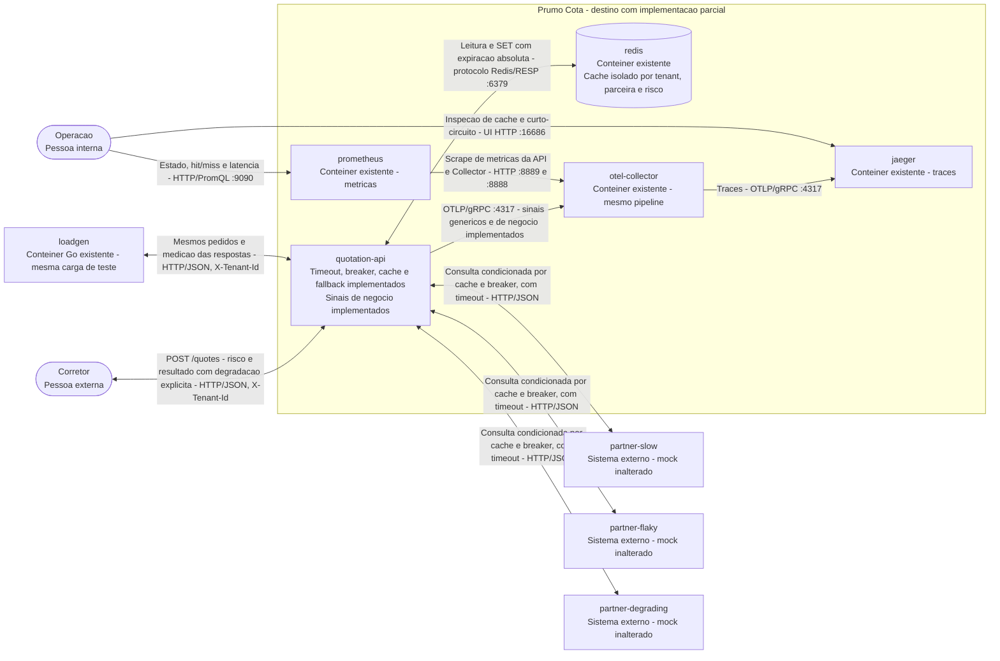
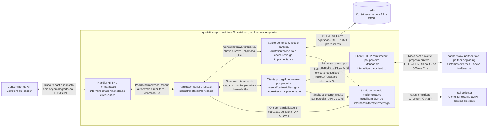

# SAD - Prumo Cota

**Solution Architecture Document | versão 0.9 | 22/11/2026**

**Estado:** seções 1 a 6 elaboradas; timeout, circuit breaker, cache isolado, fallback parcial e sinais de negócio implementados, com provas determinísticas, integração no boot e sete categorias de evidência coletadas. A carga padrão do depois atingiu RNF-01 a RNF-03 nesta execução de laboratório; isso não é SLA nem capacidade sustentada. Hospedagem e operação de produção estão projetadas, não provisionadas. Seções 7 e 8 permanecem pendentes. A arquitetura de produção está **parcialmente implementada**; este documento parcial não declara o desafio concluído.

## 1. Introdução

### 1.1 Propósito e leitores

O Prumo Cota, da empresa fictícia Prumo Tecnologia em Seguros, intermedeia cotações de seguro auto para corretoras. A Prumo não calcula prêmio, não assume risco e não emite apólices: encaminha o risco às três seguradoras e apresenta os valores recebidos. Condições comerciais variam por corretora; a mesma pessoa e o mesmo veículo não autorizam compartilhamento de respostas entre tenants.

Este SAD orienta a extensão da API existente na fronteira com as parceiras. Para o CTO, deve relacionar consultas evitadas a custo e investimento; para a operação, tornar observáveis a lentidão e o modo degradado; para o encarregado de dados, explicitar segregação, origem da cotação e limites da auditoria. As prioridades aparecem nos requisitos da seção 3 e deverão reaparecer nas decisões da seção 4, na operação da seção 6 e nos custos da seção 8.

### 1.2 Fontes e classificação das afirmações

| Referência | Fonte verificável | Uso neste documento |
| --- | --- | --- |
| F-01 | [Enunciado atual na raiz](../README.md), especialmente “As regras não negociáveis” e “O cenário: negócio, custo e regulação” | Restrições, valores comerciais e obrigações regulatórias do cenário |
| F-02 | [Guia das oito seções](guia-sad.md) | Estrutura e critérios do SAD |
| F-03 | `docker-compose.yml`, `internal\partner\client.go`, `internal\quotation\service.go`, `internal\quotation\handler.go` e `internal\quotation\request.go`, a partir da raiz | Topologia e contrato atuais |
| F-04 | [Índice das evidências próprias](evidencias/README.md) e [saída completa do reproduce](evidencias/antes-reproduce.txt) | Baseline medido em 17/11/2026 |
| F-05 | [Contexto da execução](evidencias/antes-contexto.json), [configuração efetiva](evidencias/antes-compose.json) e [metadados da captura](evidencias/antes-captura.json) | Commit, carga, ferramentas, horários e contagens |
| F-06 | `internal\platform\telemetry.go`, `deploy\otel\collector.yaml` e `deploy\prometheus\prometheus.yml` | Caminho real da telemetria, intervalos e destinos |
| F-07 | [gobreaker v2.4.0: código](https://github.com/sony/gobreaker/blob/0ae90251b774f890e7586c96ea82d61eb74d556d/v2/gobreaker.go) e [módulo](https://github.com/sony/gobreaker/blob/0ae90251b774f890e7586c96ea82d61eb74d556d/v2/go.mod), consultados em 22/11/2026 | API e semântica da biblioteca escolhida; dependência adicionada em `go.mod`/`go.sum` |
| F-08 | `cmd\partner-mock\behavior.go`, `cmd\partner-mock\config.go`, `cmd\partner-mock\main.go` e `cmd\partner-mock\feasibility_test.go` | Latência efetiva, validade padrão, cancelamento e sequência determinística das parceiras |
| F-09 | [Sete evidências](evidencias/README.md#depois-da-intervenção), [relatório padrão do depois](evidencias/depois-reproduce.txt), [comparação](evidencias/depois-comparacao.json) e [metadados](evidencias/depois-captura.json) | Medição própria em 22/11/2026, mesmos defaults; estímulo auxiliar explicitamente separado |

**Existente** significa conferido no código ou na configuração. **Medido** significa obtido nas execuções F-04 ou F-09, não copiado de exemplos do enunciado. **Pressuposto** é hipótese com consequência explícita na seção 1.5. **Proposto** é requisito ou desenho para implementação futura. As obrigações atribuídas a SUSEP e LGPD são as premissas fornecidas por F-01 para este exercício, não uma certificação jurídica independente.

O enunciado ainda está no README da raiz; sua futura organização em outro documento não é apresentada como arquivo já existente.

### 1.3 Escopo e fronteiras

O PoC implementado cobre timeout e circuit breaker na chamada às parceiras, cache Redis segregado por corretora, fallback explícito no contrato e instrumentação de negócio sobre OpenTelemetry. A seção 2 mostra essa mudança sem criar novos contêineres. O mapa detalhado e os parâmetros foram decididos na seção 4, antes da implementação.

As seções 5 e 6 projetam hospedagem, auditoria imutável e operação; recuperação e TCO ainda serão concluídos nas seções 7 e 8. **Projetar auditoria não significa persistir registros no PoC**: cache efêmero e traces não cumprem retenção regulatória.

Não fazem parte da implementação: motores das seguradoras, integrações reais, interface do corretor, cadastro, cobrança, relatórios comerciais, persistência de auditoria, retry, bulkhead, rate limiting, filas, autenticação ou Kubernetes. Não serão resolvidas transações entre cache e parceira nem coordenação distribuída de breakers. A agregação paralela é bônus opcional, não premissa para cumprir os requisitos desta versão. Essas exclusões vêm de F-01 e estão relacionadas aos limites operacionais da seção 4.7.

### 1.4 Restrições impostas versus decisões de arquitetura

| Restrição imposta por F-01 | Consequência para a solução |
| --- | --- |
| Go 1.25, Docker Compose v2 e a base existente | Estender a API e preservar os testes; não substituir o projeto |
| Redis e OpenTelemetry, com Jaeger e Prometheus via Collector | Integrar o Redis já disponível e reutilizar o SDK; não substituir o plumbing |
| Diagramas Mermaid no Markdown | Manter o desenho revisável junto ao texto |
| Três mocks e seus perfis padrão imutáveis na evidência; loadgen sem alterações | Demonstrar resiliência contra a falha, não reduzir artificialmente a carga ou a instabilidade |
| Tenant obrigatório na chave; prêmio somente de parceira ou cache rastreável | Nenhuma resposta cruzada entre corretoras e nenhum preço fabricado |
| Teto comercial de 24 h para reaproveitamento | Nunca estender a validade além de 86.400 s; decidir antes disso com justificativa |
| Auditoria de cada cotação apresentada por cinco anos, não regravável | Prever origem e custo inclusive de cache/fallback; implementação durável fica fora do PoC |
| Prumo operadora, corretora controladora; minimização e descarte | Separar cache descartável de auditoria e excluir CPF, placa e `quote_id` de atributos de spans/métricas |
| Ambiente local sem conta cloud e sem gasto obrigatório | Executar o PoC localmente; estimativas de produção não autorizam provisionamento |

As decisões de breaker, timeout, cache e fallback estão fixadas na seção 4 e implementadas nesta versão. Não são restrições externas nem aprovações comerciais: são escolhas técnicas revisáveis com evidência, sob os pressupostos da seção 1.5. A hospedagem de produção é decidida na seção 5 por retenção, residência, segregação e custo, sem provisionamento. Os números de aceitação da seção 3 são metas propostas, não um SLA vendido.

### 1.5 Pressupostos quantificados

As hipóteses abaixo não são medições de produção. Precisam ser validadas com produto, corretoras e operação antes de um compromisso comercial.

| ID | Pressuposto com valor | Origem e como validar | Consequência se falso |
| --- | --- | --- | --- |
| P-01 | Em produção, 20% das oportunidades de consulta a uma parceira, no cenário conservador, ou 40%, no favorável, repetem exatamente o mesmo risco normalizado **na mesma corretora e parceira** antes do vencimento efetivo de até 300 s, contado conservadoramente desde o início da consulta original bem-sucedida | Hipótese de trabalho motivada pela recotação descrita em F-01; 300 s corresponde ao TTL máximo escolhido na seção 4.3 e ao padrão técnico do mock. Validar por estudo agregado das recotações, com minimização e sem incluir dados pessoais na telemetria | Se a repetição ocorrer depois do TTL efetivo, ou mudar corretora, risco ou parceira, ela não é elegível. A seção 8 deve reduzir o hit rate e recalcular economia/payback; não ampliar validade para salvar a conta |
| P-02 | Para o fluxo proposto, pelo menos **uma proposta válida dentre três** já tem utilidade comercial, desde que a corretora consiga identificar origem, ausências e degradação | Hipótese de produto, ainda sem aprovação externa; sustenta a escolha de resposta parcial na seção 4.4. Validar com representante da corretora antes de uso comercial | Se o produto exigir sempre três propostas, a disponibilidade útil do RNF-02 não pode contar resposta parcial. Revisar fallback e metas, sem mascarar recusas como sucesso |
| P-03 | O objetivo inicial de experiência é p95 de até **4 s** sob a carga padrão; a ambição de melhoria é reduzir aproximadamente pela metade os **8,01 s** medidos | Meta de engenharia proposta a partir de F-04, não pesquisa com usuários nem SLA contratual. O melhor caso sequencial observado foi 2,03 s de p95, portanto o alvo não exige paralelizar. Validar com produto e com a execução do depois | Se o negócio exigir menos que a soma saudável das parceiras em cache miss, proteção e cache podem não bastar. Rever escopo e decisões; não afirmar que o bônus de paralelização foi implementado |
| P-04 | A prova local usa **uma réplica da API, dois tenants permitidos e três parceiras** | Topologia e `TENANTS` de F-03; hipótese de representatividade limitada ao PoC, não descrição da escala de produção. Validar separadamente qualquer expansão | Com mais réplicas, breakers locais aprendem falhas separadamente; com mais tenants, há disputa de capacidade. A seção 7 e os custos da seção 8 não podem extrapolar os resultados linearmente |

Para P-01, a unidade é a oportunidade de consulta por parceira, não a cotação agregada. Com o cache por parceira da seção 4.3, as frações elegíveis de 20% e 40% sustentam cenários condicionais de hit rate de até 20% e 40%, sem expulsão nem perda do Redis. O limite de 300 s começa antes do envio HTTP e não se renova no hit; o prazo útil após a resposta é menor. Falhas de preenchimento, validade restante e expiração podem reduzir o acerto. A seção 8 deverá explicitar essas perdas ou tratar esses números como limites de cenários, nunca como medição de produção.

A carga sintética repete cinco riscos em 210 requisições. Seu hit rate medido serve para provar aquecimento e instrumentação, **não para substituir P-01** ou sustentar projeções próximas de 98% em produção.

### 1.6 Parâmetros de negócio fornecidos

F-01 fixa R$ 0,04 por consulta a uma parceira, três consultas potenciais por cotação, 120.000 cotações por dia útil, 22 dias úteis por mês e R$ 0,25 por cotação entregue. Como cenário de referência de **fan-out completo e zero cache**, isso representa 2.640.000 cotações/mês, 7.920.000 consultas/mês e R$ 316.800/mês de consultas, contra R$ 660.000 de receita se todas forem entregues e cobradas.

Essa referência não é uma extrapolação contábil do baseline: o código atual aborta antes da terceira chamada quando a segunda falha. A seção 8 precisará distinguir consultas potenciais de efetivamente compradas, sucesso técnico de entrega comercial e auditoria por cotação apresentada de consultas evitadas. A seção 3 exige preservar exatamente essas distinções.

## 2. Visão geral da arquitetura

### 2.1 Contexto - C4 nível 1

O contexto de negócio permanece o mesmo antes e depois. A corretora é representada pelo corretor que usa o sistema; o canal desenhado é o contrato HTTP existente, não uma interface web implementada. Seguradoras são sistemas externos à Prumo; no laboratório, são representadas pelos três mocks, sem conexão real.


O cabeçalho `X-Tenant-Id` pertence à entrada da API; o código atual envia a identificação às parceiras no campo JSON `broker`, construído em `internal\quotation\service.go`. Nenhum diagrama deve sugerir que a Prumo cria preços ou que o tenant pode ser omitido na reutilização.

### 2.2 Contêineres - C4 nível 2 do antes, existente

Os nomes são os serviços reais de `docker-compose.yml`. A fronteira Prumo contém API e infraestrutura local; os mocks executam na mesma rede Compose, mas continuam dependências externas do ponto de vista de domínio. O Redis está disponível e **não recebe chamadas da API**.


O `loadgen` é uma ferramenta efêmera do perfil `load`, não um nono serviço sempre ativo. A direção Prometheus → Collector representa o scrape HTTP, com as amostras retornando na resposta. A API não expõe um endpoint próprio de métricas.

F-04 mostra por que a intervenção se concentra nessa fronteira: no [trace lento](evidencias/antes-trace-lento.json), as três chamadas não se sobrepõem, e a `partner-degrading` ocupa 6.148,984 ms de uma resposta de 8.049,881 ms. No [trace com erro](evidencias/antes-trace-erro.json), a resposta 503 da segunda parceira vira 502 na API, e não há span da terceira.

### 2.3 Contêineres - C4 nível 2 do depois

**O desenho abaixo representa o recorte local implementado e medido na carga padrão de F-09.** Timeout, breaker, cache, fallback parcial e métricas/eventos de negócio estão ligados no boot. Além da conferência inicial em backends isolados, há evidências do Compose real. A agregação continua sequencial, sem depender do bônus; a aprovação nesta carga não é garantia de produção.



A auditoria durável de produção **não está representada como contêiner entregue**. Seu armazenamento, residência e imutabilidade são projetados na seção 5 para atender RF-10 e RNF-06; recuperação e dimensionamento financeiro permanecem para as seções 7 e 8. Jaeger, Prometheus e Redis não a substituem.

### 2.4 Delta proposto e destinatários

- **Acrescentar na API:** timeout, proteção de chamadas pelo breaker, integração Redis segregada e política explícita de fallback; nenhum novo serviço é necessário para esse recorte (RF-06 a RF-09).
- **Mudar o fluxo e o contrato:** consultar cache por parceira antes de comprar consultas elegíveis, impedir saída HTTP com circuito aberto e tornar degradação/origem visíveis; a resposta parcial e seus metadados estão decididos na seção 4.
- **Acrescentar observabilidade de negócio:** estado/transições do breaker, hit/miss e latência por parceira, mais marcações de cache e curto-circuito, sem atributos pessoais. Reutilizar o pipeline F-06.
- **Retirar o comportamento tudo-ou-nada como única saída:** oferecer a política defendida na seção 4, sem fabricar propostas. Não retirar as validações, a ordenação, o tenant nem os testes que não conflitem com a evolução intencional e documentada do contrato.
- **Preservar:** três parceiras, perfis, gerador, Compose e destinos de telemetria. Paralelização, auditoria persistida e controles de concorrência adicionais não entram silenciosamente no escopo.

O delta serve ao CTO por reduzir consultas pagas quando P-01 se sustentar, à operação por limitar espera e identificar o motivo da degradação e à corretora/encarregado por preservar isolamento e rastreabilidade. As metas da seção 3 deverão limitar o desenho detalhado da seção 4; o desenho não pode usar uma melhoria de latência para esconder ausência de propostas válidas.

## 3. Requisitos funcionais e não funcionais

### 3.1 Contrato de referência e método de aceite

O contrato atual está em `internal\quotation\handler.go` e `internal\quotation\request.go`: `POST /quotes` exige `X-Tenant-Id`; tenants conhecidos vêm da configuração; o corpo carrega motorista, veículo e cobertura. Cobertura vazia assume `comprehensive`; `third_party` também é aceita. `GET /healthz` retorna a saúde do processo e não garante disponibilidade das parceiras, do Redis ou do pipeline de auditoria.

Nos requisitos abaixo, “existente” é comportamento a preservar; “novo” é obrigação proposta para o PoC; “produção proposta” fica fora da implementação local. O contrato degradado da seção 4.4 está implementado na composição usada pelo boot da API.

### 3.2 Requisitos funcionais

| ID | Requisito em forma verificável | Estado, origem e prova de aceite |
| --- | --- | --- |
| RF-01 | Rejeitar `POST /quotes` sem `X-Tenant-Id` com 400 e `X-Tenant-Id is required`, e tenant não habilitado com 403 e `broker not enabled on this platform`, sem chamar parceiras | Existente: `internal\quotation\handler.go` e `internal\quotation\handler_test.go`; preservar testes e verificar ausência de chamadas |
| RF-02 | Rejeitar JSON inválido, campos desconhecidos e campos obrigatórios inválidos com 400; normalizar espaços, placa em maiúsculas e cobertura vazia como `comprehensive`; aceitar somente `comprehensive` ou `third_party` | Existente: `internal\quotation\request.go`, `internal\quotation\request_test.go` e handler; verificar as entradas de teste e o corpo enviado às parceiras |
| RF-03 | Em requisição normal, obter as três propostas, devolver `tenant_id`, `quotes` e `elapsed_ms`, ordenar por `premium_cents` crescente e retornar `X-Tenant-Id` no cabeçalho de sucesso; manter ordenação nos resultados degradados que contenham propostas | **Implementado**: serviço e handler preservam ordenação e cabeçalho também nas respostas parciais. Testes com propostas controladas verificam conteúdo, ordem e contrato HTTP |
| RF-04 | Toda proposta apresentada deve preservar seguradora, identificador e prêmio da resposta original de parceira, inclusive no cache/fallback; nenhum prêmio pode ser calculado pela plataforma | Fonte F-01 e estrutura `partner.Quote` em `internal\partner\client.go`; conferir resposta contra stub de parceira e, futuramente, entrada armazenada e sua origem |
| RF-05 | Encaminhar a corretora no campo `broker` da consulta à parceira e nunca reutilizar, para uma corretora, a entrada de cache de outra, mesmo para o mesmo risco | Encaminhamento existente em `internal\quotation\service.go`; isolamento de cache novo e obrigatório por F-01. Provar com duas corretoras e respostas distintas |
| RF-06 | Para risco normalizado e tenant elegíveis, reutilizar proposta rastreável no Redis dentro da validade decidida; em miss, obter dados de parceira conforme a política, sem registrar resposta inválida como cotação válida | **Implementado**: `internal\quotation\cache.go`, `service.go` e `internal\cache\redis.go`; testes de hit/miss, validade absoluta, entradas incoerentes, isolamento e integração do boot. Chave e TTL conforme seção 4.3 |
| RF-07 | Bloquear chamadas externas abrangidas por um circuito aberto; tornar verificáveis fechado, aberto e meio aberto e limitar espera por timeout conforme parâmetros previamente defendidos | **Implementado**: `internal\partner\client.go`; `internal\partner\resilience_test.go` prova estados, timeout e zero chamadas em aberto com relógio virtual; `cmd\quotation-api\main_test.go` prova ligação do breaker configurado ao boot |
| RF-08 | Ao ocorrer falha, timeout ou curto-circuito, devolver o resultado de negócio definido na seção 4 com degradação identificável pelo consumidor; se apresentar cache anterior, informar origem e idade; se apresentar resposta parcial, identificar ausentes; se recusar, devolver erro de negócio distinguível e orientação | **Implementado** no serviço com cache e handler: parcial 200, ausentes/motivos, origem/idade e recusa 503 `no_valid_quotes` com orientação. Testes determinísticos e integração do boot verificam o contrato; o baseline 502 não descreve a API atual |
| RF-09 | Expor sinais observáveis de estado/transição do breaker, hit/miss de cache e latência por parceira, e marcar no trace resposta de cache e requisição curto-circuitada | **Implementado**: Counters de transições/lookups, histograma HTTP reutilizado e eventos de cache/curto-circuito. Testes e exportações reais do Prometheus/Jaeger na seção 4.6; sem dados pessoais nem novos rótulos ilimitados |
| RF-10 | Para cada cotação efetivamente apresentada, permitir reconstruir seguradora, prêmio, corretora e instante, ligando cache/fallback à consulta original, e prever registro durável imutável | **Produção proposta**, obrigação F-01; mecanismo projetado na seção 5, recuperação e custo pendentes nas seções 7 e 8. Aceite por desenho e dimensionamento; persistência regulatória não é alegada como entregue pelo PoC |

RF-06 a RF-09 foram introduzidos pela arquitetura de intervenção e estão implementados nesta etapa. RF-08 não autoriza chamar toda resposta 200 de sucesso de negócio: RNF-02 exige conteúdo útil e válido. RF-10 não autoriza introduzir CPF, placa ou identificadores de cotação na telemetria para simular auditoria.

### 3.3 Baseline próprio e condições de comparação

O baseline foi executado em 17/11/2026 no commit `cbc3c1ee7f595d066d44fa2825c019c74da8bc6d`, após `make down`, seguido de `make reproduce`, sem `ARGS` e com os perfis padrão. Foram dez requisições sequenciais e depois 200 com 50 em voo, cinco riscos distintos, limite de execução de 2 min e timeout **do loadgen** de 30 s. Este não é um timeout do cliente de parceiras.

| Fase medida | Janela UTC | p95 empírico | Sucesso | Vazão total |
| --- | --- | --- | --- | --- |
| Sequencial: 10 requisições, uma em voo | 21:20:46 a 21:21:05 | 2,03 s | 5/10 = 50% | 0,5 req/s |
| Carga: 200 requisições, 50 em voo | 21:21:05 a 21:21:29 | 8,01 s | 120/200 = 60% | 8,1 req/s |

Fonte: F-04. Os 210 traces preservados confirmam 125 respostas 200 e 85 respostas 502. A disponibilidade útil de produção **não** é inferida desses poucos segundos; “hoje” nos RNFs abaixo significa essa condição de laboratório.

O depois usou a mesma carga, seeds, perfis e versões de ferramentas, no mesmo host, com reset antes da execução. `cmd\loadgen\report.go` calcula percentil por nearest-rank sobre todas as durações completadas e vazão por total completado/tempo da fase. Não misturar essas medidas com histogramas Prometheus nem com vazão somente de sucessos.

**Depois, F-09 — 22/11/2026, commit `c6c4c27c85608b252017cc4041ec93756e1d1133`.** `make down; make reproduce`, sem overrides. Na fase sequencial (20:09:59–20:10:09 UTC), 10/10 sucessos, p95 2,04 s e 1,0 req/s. Na carga padrão (20:10:09–20:10:10 UTC), **200/200 úteis, p95 1,70 s e 114,1 req/s**, com 1,75 s de duração. Em relação ao antes, p95 caiu aproximadamente 78,8%, sucesso aumentou 40 pontos percentuais e vazão foi aproximadamente 14,1 vezes maior. O p95 frio sequencial permaneceu em torno de 2 s.

Os 210 traces preservados confirmam todas as respostas 200 com propostas rastreáveis. A contagem de eventos de cache após composição e chamadas HTTP 200 dos mocks identifica 189 completas/11 parciais na carga e sete completas/três parciais na sequencial; não é uma captura de corpos pelo loadgen. Os testes preservados comprovam o contrato sem 200 vazio e a validade. Fonte e método estão em [depois-comparacao.json](evidencias/depois-comparacao.json). São cinco riscos repetidos e cache aquecido pela fase sequencial, não produção ou capacidade sustentada; as datas diferem e outros consumidores de recursos do host não foram controlados.

### 3.4 Requisitos não funcionais e origem dos alvos

Os alvos foram fixados antes da implementação. **RNF-01 a RNF-03 foram atingidos no cenário padrão de F-09**, não como garantia geral de produção. Os demais requisitos têm provas específicas de código/desenho; retenção regulatória continua proposta de produção. A coluna “Hoje” abaixo preserva o baseline de F-04. Os alvos não representam parâmetros de configuração nem aprovações comerciais já obtidas.

| ID | Requisito e métrica | Hoje | Alvo e unidade | Método de medição/aceite | Origem do alvo e vínculo |
| --- | --- | --- | --- | --- | --- |
| RNF-01 | Latência da cotação: p95 empírico de `POST /quotes` na fase de carga | **8,01 s medidos**, F-04 | **≤ 4,00 s** | Mesmo `make reproduce`; p95 do relatório de 200 requisições, incluindo erros, validado em conjunto com RNF-02 | P-03: aproximadamente metade dos 8,01 s atuais, com margem sobre o melhor caso sequencial observado de 2,03 s; reduzir a espera causada pela terceira parceira, não impor paralelismo |
| RNF-02 | Disponibilidade útil sob a carga: respostas bem-sucedidas com pelo menos uma proposta válida / requisições completadas | **60% medidos: 120/200**, F-04; os sucessos atuais possuem as três propostas | **≥ 95%**, pelo menos **190/200** respostas úteis | Taxa de sucesso do mesmo relatório, mais inspeção dos corpos/traces e teste controlado que exclua 200 vazio, preço inválido e recusa de negócio do numerador | P-02 e instabilidade F-03: uma parceira saudável deve permitir entrega útil mesmo se outra falhar. Reserva de até dez falhas na amostra é um critério inicial de engenharia, não promessa de disponibilidade mensal |
| RNF-03 | Capacidade observada: vazão total sob 50 em voo | **8,1 req/s medidos**, F-04 | **≥ 16,2 req/s**, sem violar RNF-01 e RNF-02 | Requisições completadas / duração da fase de carga, no relatório padrão; não substituir por taxa instantânea PromQL | Meta de dobrar a referência própria, coerente com reduzir espera, via cache e chamadas evitadas. É objetivo a comprovar, não capacidade garantida por uma fórmula ou por P-01 |
| RNF-04 | Isolamento: reutilizações cruzadas de cache entre tenants | **Não medido; cache inexistente** | **0 respostas cruzadas** | Testes determinísticos com duas corretoras, mesmo risco e valores de parceira distintos; conferir retorno e chave efetiva sem expor dados em spans/métricas | F-01: contrato de operadora e preços específicos por corretora; falha não pode ser compensada por latência ou economia |
| RNF-05 | Minimização: atributos de span ou rótulos de métrica com CPF, placa ou `quote_id` | **Não aferido como inventário exaustivo nesta etapa** | **0 atributos proibidos** | Inspeção estática da instrumentação e busca nos exports de traces e séries emitidas nos cenários de RF-06 a RF-09; verificar chaves e valores, não só nomes de métricas | F-01: minimização e cardinalidade limitada. Identificadores podem integrar o dado de negócio/auditoria apropriado, mas não o canal de telemetria |
| RNF-06 | Retenção regulatória e imutabilidade do registro de cotação apresentada | **Não implementado; não medido**; cache e traces são efêmeros | **5 anos** de retenção e **0 sobrescritas** de registros no projeto de produção | Revisar política de retenção e bloqueio de alteração/exclusão antecipada, rastreabilidade de RF-10 e dimensionamento por cotação apresentada nos anos 1 e 5. Comprovação operacional dependerá da futura implantação, fora deste PoC | Obrigação do cenário F-01; requisitos de infraestrutura, recuperação e custo para seções 5, 7 e 8, não uma capacidade atribuída ao Redis/Jaeger |
| RNF-07 | Validade: idade máxima das propostas reutilizadas e violações da validade efetiva | **Não medido; cache inexistente** | **≤ 300 s** de idade, também limitada pela validade da parceira, e **0 propostas além da validade efetiva** | Testes com relógio controlado imediatamente antes/no vencimento; verificar origem e idade da entrada. Seção 4.3: prazo absoluto, sem renovação no hit nem stale | TTL de 300 s escolhido abaixo do teto comercial de 86.400 s de F-01 e limitado a `valid_for_seconds`; não transformar os 300 s do mock em licença de reutilização por 24 h |

Resposta parcial foi escolhida sob P-02. Se o produto passar a exigir três propostas, revisar P-02, RNF-02 e a seção 4 antes de alterar o contrato. A seção 4.3 proíbe servir entrada vencida; o teto comercial de 24 h não estende o prazo técnico escolhido.

### 3.5 Medição operacional e limites da prova

O [gráfico preservado](evidencias/antes-p95.png) usa a métrica **já emitida** `http_server_request_duration_seconds_bucket`:

```promql
histogram_quantile(
  0.95,
  sum by (le) (
    rate(http_server_request_duration_seconds_bucket{
      service_name="quotation-api",
      http_request_method="POST",
      http_route="/quotes"
    }[1m])
  )
)
```

A janela absoluta foi `2026-11-17T21:20:31Z` a `2026-11-17T21:21:50Z`, com passo de 5 s e eixo Y de 0 a 10 s. O máximo estimado da série foi **9,702 s**, não os 8,01 s do RNF-01: histogramas interpolam buckets e a consulta usa janela móvel. Manter a mesma consulta e escala para o gráfico do depois; usar o relatório empírico como método de aceite do RNF-01.

O [gráfico do depois](evidencias/depois-p95.png), capturado com o Compose ativo, usa a mesma PromQL, passo, janela móvel, escala e intervalo absoluto de 79 s, deslocado para **2026-11-22T20:09:44Z–20:11:03Z**. O pico estimado foi **2,007 s**, distinto dos 1,70 s empíricos; [amostras e `NaN` originais](evidencias/depois-p95-prometheus.json). As sete categorias, comandos, legendas e limites estão no [índice de evidências](evidencias/README.md#as-sete-evidências).

O SDK exporta métricas a cada 10 s e o Prometheus raspa o Collector a cada 5 s (F-06); a carga é curta e há defasagem entre a requisição e sua observação. Não preencher lacunas como zero. Os arquivos exportados de F-04 permanecem a fonte do antes mesmo após expirar a retenção ou derrubar o Compose.

As métricas de breaker/cache estão implementadas e sua chegada aos backends está comprovada na seção 4.6; a seção 6 associa esses sinais a limiares e ações propostos. Timeout, breaker e validade de cache possuem provas determinísticas próprias. Não são demonstrados apenas por um p95 menor numa carga que repete riscos.

### 3.6 Rastreabilidade para as próximas seções

| Necessidade estabelecida | Decisão a desenvolver | Verificação e impacto a completar |
| --- | --- | --- |
| RF-01 a RF-05, RNF-04 e RNF-05 | Seção 4: chave, isolamento, contrato e minimização; seção 5: arquivos reais | Seção 6: diagnóstico sem dados pessoais; seção 8: custo de segregação e retenção |
| RF-06 a RF-09, RNF-01 a RNF-03 e RNF-07 | Seção 4: parâmetros e políticas; seção 5: composição e testes | Seção 6: alertas/runbook; seção 7: Redis perdido e parceira indisponível; seção 8: cenários condicionados a P-01 |
| RF-10 e RNF-06 | Seção 5: hospedagem e auditoria como proposta, fora do PoC | Seção 7: RTO/RPO por classe de dado; seção 8: acervo imutável por cotação apresentada |

## 4. Detalhamento da arquitetura

**D-01 a D-03 e sinais de negócio implementados.** As decisões D-01 a D-03 atendem RF-05 a RF-09 sob P-01 a P-04. As provas estão nas seções 3.3, 4.6 e 4.8, incluindo a carga padrão do depois. Os parâmetros continuam escolhas defendidas por código do cenário e baseline; não foram afinados para esta coleta. Antes de alterá-los, atualizar a justificativa aqui e, se necessário, as metas da seção 3.

### 4.1 Sequência de atendimento e orçamento de espera

Manter a ordem configurada das três parceiras, sem paralelizar. Depois de validar tenant e normalizar o risco:

1. Para cada parceira, procurar sua entrada de cache isolada. Se válida, reutilizar sem chamar a parceira e sem registrar sucesso no breaker.
2. Em miss ou falha do Redis, pedir admissão ao breaker daquela parceira. Se aberto, ou se a única sondagem em meio aberto já estiver ocupada, registrar indisponibilidade sem sair por HTTP.
3. Se admitido, executar uma consulta com timeout próprio. Apenas resposta válida vira proposta e tentativa de preenchimento do cache. Erro de cache não altera os contadores do breaker da seguradora.
4. Continuar nas demais parceiras mesmo após falha. Ao compor a resposta, conferir novamente a validade de todas as propostas, ordenar por prêmio e aplicar D-03.

Não há retry, renovação de TTL no hit, busca de preço fabricado nem chamada de atualização em segundo plano. O cancelamento da requisição pelo consumidor encerra o trabalho; não é motivo para continuar comprando consultas.

| Parâmetro decidido | Valor padrão e local de aplicação | Justificativa e custo da escolha |
| --- | --- | --- |
| Timeout HTTP da `partner-slow` | **2 s**, no `http.Client.Timeout` usado por essa parceira | F-08 aplica 1.500 ms mais jitter de 0 a menos de 200 ms, não ±200 ms. Há cerca de 300 ms de margem sobre 1.700 ms; o trace próprio de 1.699,726 ms cabe. A margem é orçamento, não p99 de rede medido |
| Timeout HTTP da `partner-flaky` | **500 ms**, no cliente dessa parceira | F-08 aplica 150 ms mais até 50 ms de jitter; sobra aproximadamente 300 ms para transporte. A falha 503 é sinal imediato, sem esperar o teto |
| Timeout HTTP da `partner-degrading` | **1 s**, no cliente dessa parceira | Em repouso, 120 a menos de 160 ms; em oito simultâneas, soma 900 ms e ultrapassa 1 s mesmo no piso. A lentidão se torna falha antes dos 6.148,984 ms medidos sob carga |
| Prazo total por operação Redis | **20 ms** por GET ou SET, incluindo espera por conexão, rede e resposta | Orçamento local proposto; no pior caminho são três leituras e três escritas: 120 ms. Não é uma medição de RTT nem timeout apenas do socket; o cliente deve respeitar o prazo total e não fazer retries internos |

O teto de tempo externo orçado para um miss nas três parceiras é `2 + 0,5 + 1 + 6 × 0,020 = 3,620 s`, deixando aproximadamente 380 ms até RNF-01 para normalização, serialização, escalonamento e transporte da API. Isso **não garante** p95 de 4 s: filas de CPU, GC e infraestrutura não são limitadas por essa soma; a prova continua sendo o depois. Hits ou curto-circuitos evitam partes desse orçamento.

O teto de 6.000 ms do cenário limita o **acréscimo** de degradação, não toda a latência: F-08 soma base, jitter e acréscimo. Esse detalhe explica por que o trace supera 6 s. O timeout de 1 s corta esse caminho sem alterar o mock.

As configurações **implementadas** em `internal\platform\config.go` são `PARTNER_TIMEOUTS="partner-slow=2s,partner-flaky=500ms,partner-degrading=1s"`, `BREAKER_FAILURE_THRESHOLD=3`, `BREAKER_INTERVAL=10s`, `BREAKER_OPEN_TIMEOUT=5s` e `BREAKER_MAX_REQUESTS=1`, também expostas no serviço da API no Compose. Durações e contadores devem ser positivos. A lista de timeouts deve corresponder exatamente aos nomes em `PARTNER_ENDPOINTS`, sem duplicatas: ao personalizar a lista de parceiras, fornecer a lista completa em `PARTNER_TIMEOUTS`. Configuração inválida impede o boot, sem proteção silenciosamente desativada.

**Cache implementado:** `CACHE_TTL=300s`, `REDIS_OPERATION_TIMEOUT=20ms` e `REDIS_ADDR`, padrão `127.0.0.1:6379` no processo local e `redis:6379` no Compose. TTL deve ser positivo e não pode exceder 300 s; endereço e prazo da operação são validados no boot. O cliente conecta sob demanda: Redis fora do ar não impede a inicialização nem transforma `/healthz` em teste de dependência.

O timeout HTTP cobre conexão e leitura do corpo; a validação da resposta ocorre dentro da execução protegida. Redirecionamentos de consultas de preço não são seguidos: resposta diferente de 200 é falha, sem comprar outra consulta implicitamente. O Redis usa `github.com/redis/go-redis/v9` **v9.12.1**, compatível com Go 1.25, RESP2 e `MaxRetries=-1`. Cada GET/SET cria um contexto com prazo total; `ContextTimeoutEnabled=true` e limites de dial/read/write/pool fazem as fases respeitarem esse prazo, inclusive quando o contexto do consumidor vence antes. Não há instrumentação automática Redis que exponha chaves/valores.

### 4.2 D-01 - Circuit breaker por parceira, com timeout

**Contexto.** A `partner-flaky` falha deterministamente em 40% das chamadas; a `partner-degrading` nunca precisa devolver erro para bloquear a cotação. Uma delas não pode interromper as outras duas. O timeout definido na seção 4.1 transforma espera excessiva em sinal de falha; o breaker evita continuar pagando e esperando por chamadas provavelmente inúteis.

**Opções consideradas.** Um único breaker global é simples, mas faria uma falha bloquear todas as seguradoras. Um breaker por par (parceira, tenant) isola observações comerciais, porém duplica aprendizagem da mesma indisponibilidade e multiplica estado por corretora. Um breaker por parceira compartilha a percepção de saúde da dependência e mantém as outras independentes. Implementar máquina de estados própria facilitaria injetar relógio, mas acrescentaria manutenção de admissões concorrentes, gerações e callbacks. Política percentual exigiria amostra mínima e poderia oscilar junto dos 40% esperados.

**Escolha.** Usar **`github.com/sony/gobreaker/v2`, versão v2.4.0**, um `CircuitBreaker[partner.Quote]` por nome de parceira e por processo, compartilhado pelos tenants, criado no boot e reutilizado. O módulo e a API foram verificados em F-07: estados explícitos, exclusão de erros, callback de transição e proteção concorrente. O módulo exige Go 1.22, compatível com Go 1.25. A dependência está fixada em `go.mod`/`go.sum`.

| Regra escolhida | Parametrização exata | Razão e efeito |
| --- | --- | --- |
| Estado inicial | `StateClosed` | Permitir conhecer a dependência após boot; reiniciar não preserva aprendizagem |
| Abertura | `ReadyToTrip: ConsecutiveFailures >= 3` | Reagir à rajada em vez de exigir seis falhas, que é o default da biblioteca (`> 5`). Três é menos vulnerável ao embaralhamento de conclusões que cinco; pode abrir por falhas transitórias |
| Janela de contagem fechada | `Interval=10s`, `BucketPeriod=0`: **janela fixa**, não deslizante | Descartar falhas antigas. Três timeouts seguidos cabem em 6 s na lenta e 3 s na degradante, se admitidos na mesma geração. Na borda de 10 s, zeram-se contadores; erros que atravessam mudança de geração podem ser desconsiderados pela biblioteca |
| Sucesso em fechado | Resposta HTTP 200, JSON legível e proposta de domínio válida | Zera a sequência de falhas; 200 vazio/inválido não é recuperação |
| Tempo aberto | `Timeout=5s` | Conter chamadas por alguns segundos e permitir recuperação observável em uma sessão de dezenas de segundos; o default de 60 s poderia ocultá-la durante a carga. Cinco segundos é hipótese operacional a validar, não tempo de recuperação medido da seguradora |
| Meio aberto | `MaxRequests=1` | Uma única sondagem em voo por parceira; concorrentes recebem `ErrTooManyRequests`, não esperam em fila nem chamam HTTP |
| Fechamento | **Uma** sondagem válida em meio aberto fecha | Sem acumular duas sondagens para fechar; corresponde à semântica de `MaxRequests=1` em F-07 |
| Reabertura | Uma falha ou timeout na sondagem reabre por mais **5 s** | Não manter em meio aberto uma dependência que continua indisponível |

Contar como falha de parceira: erro de transporte, estouro do timeout próprio, qualquer status diferente de 200 e resposta ilegível ou sem proposta válida. Validade mínima de domínio: `quote_id` presente, prêmio e cobertura positivos, moeda BRL e `valid_for_seconds` positivo. A identidade usada é a parceira configurada, não uma string livre recebida na resposta.

Erros locais de normalização/serialização devem ser detectados **antes** da admissão. Cancelamento ou vencimento do contexto **do consumidor** não contam como sucesso nem falha; usar `IsExcluded` com causa tipada preservada. Não excluir todo `context.DeadlineExceeded`: se o contexto do consumidor ainda estiver válido, o estouro de `http.Client.Timeout` é falha da parceira. A exclusão de uma sondagem libera sua admissão sem fechar nem reabrir por falsa evidência. Hits, falhas de Redis e rejeições `ErrOpenState`/`ErrTooManyRequests` não realimentam o contador de falhas.

No estado aberto, a função que faz HTTP **não é executada**. Chamadas já admitidas antes da abertura podem terminar; a biblioteca ignora conclusões de gerações antigas para não fechar o circuito com resultado atrasado. Não se promete cancelar essas chamadas nem evitar seu custo. O callback `OnStateChange` deve apenas registrar a transição, sem rede e sem chamar `State()` recursivamente sob o lock da biblioteca.

**Defesa determinística.** F-08 prende as nove falhas nas sequências **49 a 57**; a terceira falha da rajada já basta quando observada sem sucesso intermediário dentro da janela. `docs\smoke-test-factibilidade.md` e o teste de factibilidade mostram abertura na requisição 9 para uma política de três consecutivas, e uma simulação de cinco abre na 42. São referências do cenário, **não prova de que esta configuração temporal abriu**: a simulação original conta cooldown por requisições e exige duas recuperações, enquanto esta decisão usa 5 s e uma sondagem. Cache também pode impedir que a API chegue à sequência 49. Com concorrência, ordem de conclusão e ordem da semente diferem; não prometer um número de requisição exato para o PoC.

O teste `internal\partner\resilience_test.go` provoca três falhas em sequência por transporte controlado, verifica abertura, ausência de uma quarta chamada e recuperação/reabertura após o prazo. Janela e cooldown usam o relógio virtual de `testing/synctest` do Go 1.25 com transporte em memória e timers; `time.Sleep` avança apenas tempo virtual, sem calibrar espera real nem abrir sockets. A integração da composição usada pelo boot tem teste próprio; a prova contra os mocks com seus perfis padrão permanece separada e pendente, conforme seção 4.8.

**Consequências, inclusive negativas.** A `partner-slow` saudável continua acessível quando a instável abre; cada chamada realmente evitada representa até R$ 0,04 não comprado. Em contrapartida, três falhas podem bloquear por 5 s chamadas que teriam sucesso; uma única sondagem bem-sucedida pode fechar cedo e voltar a oscilar. A janela fixa perde histórico na borda. Sem tráfego elegível, não há sondagem ativa: a transição temporal é avaliada na próxima admissão/consulta de estado. Todos os tenants compartilham o efeito de abertura de uma parceira. Esses custos integram operação, DR e TCO futuros, não justificam adicionar retry ou coordenação distribuída.

### 4.3 D-02 - Cache por parceira, tenant e risco, sem stale

**Contexto.** Uma cotação agregada completa depende das três respostas, e a falha de uma não deve inutilizar as outras. Preços diferem por corretora. O Redis já existe, mas é efêmero. O teto comercial é 24 h; o mock informa validade técnica padrão de 300 s e não fornece um instante absoluto de emissão.

**Opções consideradas.** Cache agregado exige menos operações por cotação, mas perde a unidade inteira no vencimento e dificulta reaproveitar duas seguradoras quando a terceira falha. Cache apenas por placa ou risco sem tenant é descartado por violar isolamento. Stale de até 24 h favoreceria disponibilidade, mas estenderia a validade técnica sem prova de que o preço continua praticável. Cache por parceira exige mais operações e metadados, mas permite reaproveitamento independente.

**Escolha.** Cache-aside **por parceira**, com GET antes do breaker e SET somente de resposta de parceira válida. A chave literal é:

```text
prumo:quotes:v1:<tenant_b64url>:<partner_b64url>:<risk_sha256_hex>
```

`tenant_b64url` e `partner_b64url` são Base64 URL-safe sem padding dos bytes UTF-8 do tenant já autorizado e do nome configurado da parceira. Os delimitadores `:` não aparecem nesses segmentos. Não trocar caixa ou remover espaços do tenant para aceitar outra identidade: usar exatamente o valor aceito pela lista de tenants, obtido de `X-Tenant-Id`, **não do corpo**.

`risk_sha256_hex` é SHA-256, em hexadecimal minúsculo, do JSON canônico abaixo após `Request.Normalize()`. A ordem dos campos é a da struct `Request` atual; serializar structs, não mapa com representação livre. Inteiros ficam decimais, sem espaços de formatação. O corpo de exemplo define o **formato**, não dados de uma cotação medida:

```text
{"driver":{"document":<document_json>,"birth_year":<birth_year_int>},"vehicle":{"plate":<plate_json>,"model":<model_json>,"year":<year_int>,"value_cents":<value_cents_int>},"coverage":<coverage_json>}
```

Incluir **todos os sete campos**: documento e ano de nascimento; placa, modelo, ano e valor do veículo; cobertura. Aplicar somente a normalização existente: TrimSpace em documento/modelo/cobertura, placa com TrimSpace e maiúsculas, cobertura vazia como `comprehensive`; não eliminar pontuação do documento nem mudar caixa do modelo sem alterar explicitamente o contrato. Campos string devem ser escapados pelo encoder JSON; não concatenar valores manualmente. A versão `v1` identifica essa codificação e deve mudar se o contrato do risco mudar.

Base64 é codificação, não proteção, e hash de risco não anonimiza um dado vinculável à corretora. Não registrar chave, hash, CPF, placa ou `quote_id` na telemetria nem usar hash como rótulo de métrica. Armazenar apenas proposta original, identidade da parceira/tenant para conferir coerência, versão e instantes de origem/vencimento; não duplicar o pedido bruto no valor do cache.

**TTL e validade absoluta.** Fixar `CACHE_TTL=300s`. Para uma resposta válida, tomar `quoted_at=t0`, o instante UTC imediatamente anterior ao envio HTTP, e:

```text
expires_at = t0 + min(CACHE_TTL, valid_for_seconds_original, 86400s)
redis_ttl = expires_at - instante_do_SET
valid_for_seconds_da_resposta = floor(expires_at - instante_da_composicao)
```

Gravar valor e prazo em **uma operação SET com expiração**, somente se o prazo restante for positivo. Não redefinir `quoted_at` como hora do SET nem conceder outros 300 s depois de esperar a parceira. A origem antecipada é conservadora porque o mock não fornece emissão absoluta: a proposta lenta perde cerca de 1,7 s de reutilização após recebida. Preservar `valid_for_seconds_original` no envelope; o campo público `valid_for_seconds` passa a representar **validade restante**, nunca a duração original integral em um hit.

Não servir se `agora >= expires_at` ou se a validade inteira restante for menor que 1 s. Verificar também ao compor a resposta: uma proposta pode vencer enquanto outras são consultadas. Nesse caso, removê-la e declarar `expired`, sem nova consulta na mesma requisição. `age_seconds=floor(agora-quoted_at)` informa idade, sem alterar prêmio ou `quote_id`.

**Estado desta etapa:** cache, metadados e descarte individual com composição parcial estão implementados. Se uma proposta vencer durante a composição, o serviço a remove, declara a parceira ausente com motivo `expired` e preserva as demais, sem servi-la nem consultá-la novamente. Sem propostas sobreviventes, aplica a recusa 503 de D-03. Stale continua proibido.

O envelope JSON implementado contém `version`, `tenant_id`, `quote`, `quoted_at` e `expires_at`; `quote.partner` confere a parceira e `quote.valid_for_seconds` conserva a duração **original**, antes de calcular o campo público restante. No caminho HTTP, `partner.Quote.RequestedAt` é capturado imediatamente antes de `http.Client.Do` e não é serializado; a origem fica no envelope. O SET usa **`PXAT`** em milissegundos absolutos, arredondados para baixo, em uma operação com o valor. Assim, atraso de envio não concede vida extra; a precisão Redis pode antecipar a remoção em menos de 1 ms. Entradas de versão/tenant/parceira incoerentes, origem futura, preço inválido ou expiração maior que o prazo permitido viram miss.

Por que 300 s e não 24 h: respeita o sinal técnico que o fornecedor realmente entrega e a hipótese de recotação curta P-01; 24 h é teto, não garantia de atualização. Por que não 60 s: descartaria parte das repetições de até cinco minutos pressupostas em P-01 e exigiria refazer o caso financeiro. **Não foi medido que 300 s seja o ótimo**. Se a parceira devolver validade menor, ela prevalece e os hit rates de P-01 devem ser reduzidos; não aumentar o TTL para preservar a economia estimada.

**Abertura do breaker, invalidação e descarte.**

| Evento | Comportamento decidido |
| --- | --- |
| Breaker abre | Não apagar entrada válida; hits continuam possíveis, sem sondar nem renovar prazo. Em miss/expiração, a parceira fica ausente se não houver admissão |
| Entrada vence | **Stale permitido: 0 s.** Nunca servir vencida, nem com breaker aberto. Redis aplica expiração lógica; a aplicação também confere o prazo absoluto. Liberação física depende do ciclo de expiração do Redis, não é uma promessa de apagamento de RAM no milissegundo do vencimento |
| Mesma requisição é repetida | Apenas leitura; não usar TTL deslizante nem regravar o valor de um hit |
| Risco, tenant ou parceira mudam | Gerar outra chave. A anterior não é apagada antecipadamente; expira no máximo em 300 s desde sua origem |
| Valor inválido ou incoerente | Tratar como miss, não apresentar a proposta. Preencher novamente somente após resposta válida; a expiração existente limita a permanência da entrada anterior |
| Redis falha ou excede 20 ms | Tratar leitura como indisponibilidade de cache e seguir para breaker/parceira; falha de escrita não descarta proposta fresca válida. Sinalizar `cache_status=unavailable`; não adicionar breaker de Redis |
| Revogação de preço ou pedido de eliminação antes do TTL | **Não há invalidação antecipada de negócio no PoC**. TTL é a única política implementável neste recorte; documentar limitação e, em produção, projetar atendimento de revogação/eliminação. Não declarar conformidade plena por usar Redis efêmero |

Sem AOF/RDB nem backups de cache no Compose. O prazo lógico máximo desta decisão é 300 s; cópias em resposta ao consumidor ou futura auditoria têm finalidades e retenções distintas, e precisam de política própria. A auditoria imutável não é motivo para guardar indefinidamente o cache. Mudança de versão de chave não remove entradas antigas: elas continuam sujeitas ao prazo original.

**Consequências, inclusive negativas.** Hit válido evita uma consulta de R$ 0,04 e protege outras propostas quando uma parceira cai. Em compensação, são até seis operações Redis por cotação fria, e respostas podem misturar instantes de precificação. Não há eliminação de preenchimentos concorrentes: dois misses podem comprar a mesma consulta. Cache perdido aumenta custo e concorrência nas parceiras, a tratar na seção 7.

Para a seção 8, com `N` oportunidades de consulta, fração efetivamente atendida por cache `h=hits/N` e `B` oportunidades sem hit rejeitadas antes de sair por HTTP, usar `consultas_compradas = N × (1-h) - B`, sem descontar duas vezes hits ou circuitos abertos. `N` inclui erros de leitura: o hit rate operacional que exclui erros, na seção 4.6, não pode ser aplicado diretamente a essa conta se houver indisponibilidade do Redis. Para o cenário comparável de fan-out completo, `N=7.920.000/mês`; com `B=0`, h=20% corresponde a 6.336.000 consultas/R$ 253.440 e h=40% a 4.752.000/R$ 190.080. São **cenários condicionais**, não resultados medidos nem a contagem real da base tudo-ou-nada. Sem resposta parcial útil, economia por bloquear serviço pode ser perda de receita, não benefício.

### 4.4 D-03 - Resposta parcial explícita, com origem e validade

**Contexto.** No baseline, 80 de 200 requisições da carga viraram 502 pela `partner-flaky`, descartando respostas já recebidas. P-02 permite uma proposta válida como resultado útil. Cache por parceira já oferece reaproveitamento independente; não é necessário fabricar preço nem manter um segundo acervo de propostas vencidas.

**Opções consideradas.** Recusa de toda cotação incompleta preservaria o comportamento tudo-ou-nada, mas manteria a dependência comercial das três respostas. Usar última cotação vencida aumenta cobertura aparente, porém contradiz a validade escolhida. Entregar as propostas válidas e declarar ausências preserva trabalho útil, embora reduza a comparabilidade de seguradoras.

**Escolha.** Após considerar todas as parceiras, responder **HTTP 200** se houver ao menos uma proposta válida, de parceira ou cache não vencido. Resposta parcial é o fallback; cache válido é o caminho normal de reutilização, não uma autorização de stale. Sem nenhuma proposta válida, responder **HTTP 503** com recusa explícita de negócio. Não usar HTTP 206: não é uma transferência parcial de bytes.

O contrato implementado de `Response`, em `internal\quotation\request.go`, mantém `tenant_id`, `quotes` e `elapsed_ms`, acrescentando os campos abaixo. Aplica-se ao fluxo com cache usado pelo boot; o handler traduz o resultado de negócio `unavailable` em HTTP 503, sem descartar o envelope de recusa. Nenhuma lista é serializada como `null`: propostas/ausentes são arrays, inclusive quando vazios.

| Campo implementado | Semântica obrigatória |
| --- | --- |
| `status` | `complete` se todas as parceiras configuradas têm proposta válida (três no padrão); `partial` se há ao menos uma, mas não todas; `unavailable` se nenhuma |
| `degraded` | `true` para `partial`/`unavailable` ou falha de acesso ao cache; não marcar somente porque a fonte foi cache |
| `cache_status` | `available` quando os acessos Redis necessários funcionaram, inclusive miss normal; `unavailable` se algum GET/SET falhou ou excedeu prazo |
| `unavailable_partners` | Array de objetos `{partner, reason}` para as ausentes, vazio em `complete`; motivos estáveis: `timeout`, `circuit_open`, `half_open_limit`, `upstream_error`, `invalid_response` ou `expired` |
| Metadados em cada item de `quotes` | Manter os campos existentes e acrescentar `source` (`partner` ou `cache`), `quoted_at` e `expires_at` UTC/RFC3339 e `age_seconds`; recalcular apenas `valid_for_seconds` restante, nunca prêmio, cobertura ou identidade da proposta |
| `error` e `action`, somente na recusa | `error="no_valid_quotes"` e `action="Solicite uma nova cotação mais tarde ou contate o suporte da corretora."`; `quotes=[]`, `status=unavailable`, `degraded=true` e razões das três ausências |

`cache_status=unavailable` com três propostas frescas pode resultar em `status=complete` e `degraded=true`: há cobertura completa, mas a operação está degradada e comprando consultas. Uma cotação completa com cache válido e sem falha operacional é `complete`/`degraded=false`, mesmo se o breaker de uma parceira estiver aberto; o preço servido continua válido e nenhuma chamada foi tentada. O estado atual do breaker é informação operacional, não prova de que a cotação apresentada está incompleta.

Não incluir mensagens internas, URLs ou dados do risco nos motivos. `source`, origem e idade são obrigatórios também em resposta completa, para não tornar a rastreabilidade dependente de ocorrência de erro. Ao ordenar por `premium_cents`, manter os metadados ligados à mesma proposta. O instante de apresentação é distinto de `quoted_at` e deverá ser registrado por apresentação na auditoria futura de RF-10, inclusive quando o mesmo `quote_id` for servido várias vezes.

Mantidos os erros 400/403 e respectivas mensagens de validação, `GET /healthz` e o cabeçalho `X-Tenant-Id` de sucesso. A recusa resiliente 503 substitui o 502 de indisponibilidade das parceiras no fluxo novo; o [README](../README.md#contrato-atual-do-poc) comunica essa mudança e a validade restante, preservando o enunciado original. Cancelamento/prazo do consumidor interrompe a agregação e não vira resposta parcial; timeouts próprios das parceiras permitem continuar nas demais. O contrato não contém recomendação de retry automático: esse mecanismo continua fora de escopo.

**Consequências, inclusive negativas.** Atende RF-08 e permite medir RNF-02 sem chamar 200 vazio de sucesso. O corretor pode receber apenas a proposta mais cara entre as sobreviventes; ausência de seguradora não equivale a ausência de oferta no mercado. P-02 continua hipótese não aprovada comercialmente. A interpretação de `valid_for_seconds` muda para prazo restante, e consumidores que assumem sempre três propostas precisam adaptar-se. Nenhuma anotação no JSON substitui auditoria imutável por cinco anos.

### 4.5 Componentes - C4 nível 3 da fatia decidida

Os componentes internos deste recorte estão implementados: timeout, breaker, cache, composição parcial e sinais de negócio. Somente a fatia protegida é decomposta; Redis, Collector e parceiras ficam fora da fronteira do contêiner API. O boot e a leitura de parâmetros permanecem em `cmd\quotation-api\main.go` e `internal\platform\config.go`.



A chave e o envelope são responsabilidade de `internal\quotation\cache.go`; o adaptador RESP está em `internal\cache\redis.go`. Não introduzir um serviço de resiliência remoto, pool com admissão limitada, fila ou mecanismo de auditoria para concretizar esse desenho.

### 4.6 Instrumentação decidida como método de prova

Os exportadores e o pipeline existentes são reutilizados, sem alteração de `internal\platform\telemetry.go`. Os três sinais abaixo são **emitidos e verificados**: dois novos Counters e o histograma HTTP existente. A integração do boot comprova a ligação ao caminho real; a conferência auxiliar comprova a chegada ao Prometheus/Jaeger, sem alegar desempenho na carga padrão.

| Sinal | Nome e atributos decididos | Método de prova |
| --- | --- | --- |
| Transições do breaker | Novo Counter OTel `prumo_breaker_transitions`, exportado como `prumo_breaker_transitions_total`; atributos `partner`, `from`, `to`; estados `closed`, `open`, `half_open` | Callback registra cada mudança. Plotar séries de transição e cruzar com traces; transições rápidas permanecem contadas mesmo se o estado meio aberto durar menos que os 10 s entre exports |
| Consultas ao cache | Novo Counter OTel `prumo_cache_lookups`, exportado como `prumo_cache_lookups_total`; atributos `partner`, `result=hit\|miss\|error` | Uma observação por lookup; entrada vencida/inválida conta como miss. Erro é categoria separada, nunca falso hit; write failure usa `cache_status`/evento de trace, não outro lookup |
| Latência por parceira | Reutilizar `http_client_request_duration_seconds_bucket` com `server_address`; sem histograma duplicado | Somente chamadas HTTP efetivas; cache e curto-circuito não viram latências artificiais de zero segundo |
| Marcações no span da cotação | Eventos `quotation.cache_hit` e `partner.short_circuit`, com `partner`; no curto-circuito, `reason=circuit_open\|half_open_limit` | Hit só é marcado se a proposta sobreviver à composição final. Trace com todos os hits não contém spans HTTP de saída; requisição rejeitada após abertura não cria span HTTP para a parceira bloqueada |

Não habilitar sufixo de unidade nos novos Counters para preservar os nomes de exportação declarados. Não usar tenant como rótulo de métrica: `partner`, estados e resultados têm cardinalidade limitada. CPF, placa, `quote_id`, risco, hash e chave de cache ficam fora de spans/métricas. `source` e idade podem compor o contrato de negócio sem serem rótulos.

`quotation.cache_error`, com `partner` e `operation=get|set`, registra falha Redis sem mensagem interna. Uma falha de SET não incrementa lookups nem descarta a proposta fresca. Os Counters usam os meters `prumo/partner` e `prumo/quotation`; sem unidade adicional, seus nomes reais no Prometheus coincidem com os decididos acima.

Consultas para os Counters emitidos (o README acrescenta o filtro `service_name="quotation-api"`):

```promql
sum by (partner, from, to) (
  increase(prumo_breaker_transitions_total[1m])
)
```

```promql
sum by (partner) (rate(prumo_cache_lookups_total{result="hit"}[1m]))
/
sum by (partner) (rate(prumo_cache_lookups_total{result=~"hit|miss"}[1m]))
```

Denominador zero significa “sem lookups bem-sucedidos na janela”, não 0% nem 100%. Erros de Redis precisam ser apresentados separadamente; excluí-los do denominador não pode esconder indisponibilidade. Para estimar economia global, ponderar por quantidade de oportunidades de cada parceira, não fazer média simples de percentuais.

Consulta existente reaproveitada para latência:

```promql
histogram_quantile(
  0.95,
  sum by (server_address, le) (
    rate(http_client_request_duration_seconds_bucket{
      service_name="quotation-api",
      server_address=~"partner-slow|partner-flaky|partner-degrading"
    }[1m])
  )
)
```

O Counter de transições, não um gauge amostrado esporadicamente, é a prova mínima dos três estados. Sua exportação pode agrupar mudanças no mesmo scrape: os testes com relógio virtual confirmam a ordem, sem alongar artificialmente o meio aberto nem inventar patamares no gráfico. Foram observadas `closed→open`, `open→half_open` e `half_open→closed`; os testes de resiliência também cobrem `half_open→open` após falha da sondagem. Não há evento de transição adicionado ao trace pelo callback sem contexto.

**Conferência auxiliar real — 22/11/2026, 16:46:45Z a 16:47:06Z.** [Condições e verificações](evidencias/202611221350/verification.json), [respostas PromQL da coleta 1](evidencias/202611221350/metrics-phase-1.json), [coleta 2](evidencias/202611221350/metrics-phase-2.json) e [oito traces do Jaeger](evidencias/202611221350/traces.json). Os totais passaram de 1/4/0 para 2/5/1 em hit/miss/erro de leitura; zero aqui significa ausência da categoria de erro na primeira coleta, não amostra inventada. Transições passaram de 1 para 3, incluindo abertura, sondagem e fechamento. O histograma passou de 3 para 5 chamadas, exatamente as chamadas ao upstream. Dois traces de cache e um curto-circuito têm as marcações e zero spans HTTP cliente; chamadas efetivas têm um span cliente. Marcadores privados do pedido/proposta não aparecem nos spans exportados.

Como o daemon Docker não respondeu, foram usados processos Windows isolados, em loopback, de Jaeger 1.65.0, Collector 0.116.1 e Prometheus 3.1.0, com binários oficiais verificados por SHA-256. A composição Go usa os mesmos cliente protegido, serviço com cache, handler e SDK/exportadores; o teste de integração verifica separadamente o `newAPI` real. O estímulo auxiliar usa upstream HTTP controlado e miniredis, sem alterar os mocks oficiais. Collector recebe OTLP em 14317 e expõe métricas em 18889; Jaeger consulta em 26686 e Prometheus em 19090. O scrape auxiliar é de 1 s, mantendo o export do SDK em 10 s. Os processos foram encerrados sem reiniciar serviços compartilhados. **Não é execução do Compose padrão, comparação antes/depois nem comprovação de RNF-01 a RNF-03.**

**Coleta posterior no Compose real — F-09.** O Docker voltou a responder. A carga padrão gerou 561 hits, 38 misses e **31 erros de GET** em 630 oportunidades, zero erros de SET nos traces, 67 chamadas HTTP e dois curtos-circuitos. O hit rate que exclui erros é 93,66%, contra 89,05% das oportunidades efetivamente servidas por cache; não ocultar os erros do prazo Redis de 20 ms nem aplicar a primeira razão à conta de economia. O [trace padrão bloqueado](evidencias/depois-trace-breaker.json) responde em 0,832 ms, com cache das outras duas parceiras e nenhum span HTTP; o [trace padrão de cache](evidencias/depois-trace-cache.json) responde em 0,589 ms, com três eventos de hit e nenhum span HTTP.

Após exportar a execução padrão, o mesmo Compose foi reiniciado sem alterações para um **auxiliar separado de 40 requisições**. A janela foi 20:11:45–20:13:27 UTC, passo 5 s, export 10 s/scrape 5 s. Vinte e cinco pedidos iguais, a cada 2 s, mostraram [hit rate acumulado](evidencias/auxiliar-cache-hit-rate.png) de 50% na primeira amostra até 95,45%; a onda posterior de riscos novos reduziu esse percentual. A curva usa hits/(hits+misses) acumulados, não a consulta móvel por rate, cujo [export separado](evidencias/auxiliar-cache-hit-rate-prometheus.json) também foi preservado. Não é hit rate de produção.

As transições da `partner-flaky` foram registradas em 20:12:54,026342 UTC (abertura), 20:13:01,345122 UTC (meio aberto) e 20:13:01,532460 UTC (fechamento). O [gráfico de estado reconstruído dos logs](evidencias/auxiliar-breaker-state.png) e o [Counter por direção](evidencias/auxiliar-breaker-transitions.png) distinguem prova de estado de um gauge inexistente; os aproximadamente 187 ms de meio aberto não foram alongados. [Logs](evidencias/auxiliar-api.log), [PromQL/valores](evidencias/auxiliar-breaker-transitions-prometheus.json), [traces](evidencias/auxiliar-traces.json), [estímulos e janelas](evidencias/auxiliar-captura.json) permitem verificar a ordem. Nenhum mock, seed, perfil ou parâmetro de resiliência foi alterado. O [índice](evidencias/README.md#experimento-auxiliar-separado-da-comparação-padrão) mantém esse estímulo fora da comparação quantitativa padrão.

### 4.7 Limites conhecidos e riscos aceitos do recorte

| Limite não resolvido | Gatilho que o expõe | Efeito para a corretora e encaminhamento arquitetural, sem implementar |
| --- | --- | --- |
| Sem limite de chamadas simultâneas por parceira | Onda de misses, especialmente após perda do Redis | A `partner-degrading` pode saturar antes de três timeouts abrirem o breaker; faltam propostas e há custo de chamadas já admitidas. Seção 7 deverá tratar o reaquecimento e a seção 6 orientar diagnóstico; não adicionar bulkhead |
| Breaker na memória de cada processo, sem coordenação entre réplicas | Reinício da API ou aumento de réplicas | Cada processo começa fechado e compra suas próprias falhas de aprendizagem; uma corretora pode receber respostas diferentes conforme réplica. Hospedagem e DR deverão assumir isso, não desenhar breaker distribuído entregue |
| TTL como única invalidação de negócio | Seguradora revoga condição antes de 300 s, ou surge pedido de descarte antecipado | Uma proposta ainda tecnicamente válida pode persistir até o prazo original. A produção necessita processo de revogação/eliminação e revisão contratual; o PoC não garante invalidação imediata |
| Uma corretora pode consumir capacidade das outras | Um tenant gera rajada de riscos inéditos | Redis, CPU e parceiras são compartilhados, inclusive aprendizagem do breaker; outras corretoras veem maior latência e parcialidade. Sem rate limiting ou isolamento de capacidade neste recorte |
| Sem transação entre cache e parceira nem deduplicação de misses | Duas requisições simultâneas para o mesmo risco e tenant | Uma pode receber cache e outra resposta externa com prêmio diferente em integração real; duas podem comprar a mesma consulta e sobrescrever a entrada. Cada proposta mantém sua origem; não implementar lock distribuído ou singleflight |
| Sem autenticação do chamador | Cliente declara um `X-Tenant-Id` conhecido de outra corretora | A allowlist não prova identidade nem autorização de produção; a chave evita colisão entre tenants, mas não impede falsificação do cabeçalho. Autenticação continua fora do PoC; condição obrigatória de uma futura exposição comercial |

A mistura de preços/instantes não é observada necessariamente no mock: F-08 calcula preço deterministicamente a partir de parceira e corpo. Ela é uma limitação real para motores externos, não uma afirmação de que o mesmo mock alterou prêmio sem mudar o pedido.

### 4.8 Escopo implementável e provas pendentes

**Até esta versão:** base, evidências do antes/depois, D-01 a D-03 e instrumentação de negócio estão implementados. O boot liga `partner.NewResilientClient`, `cache.NewRedis` e `quotation.NewCachedService`; configuração inválida falha na inicialização. A conexão Redis é preguiçosa e seu fechamento ocorre após o encerramento das requisições HTTP. O callback do breaker registra transições em log e no Counter em memória do SDK, sem I/O de rede nem consulta recursiva de estado; o exportador periódico faz o envio. A API agrega em série, continua após falha de parceira, descarta propostas que venceram e entrega resultado completo/parcial 200 ou recusa 503. A carga padrão do depois e o auxiliar separado têm exports persistidos em F-09.

`internal\partner\resilience_test.go` cobre abertura e curto-circuito, uma sondagem em meio aberto, fechamento/reabertura, reset por sucesso e janela fixa, timeout de cabeçalhos/corpo, exclusão de cancelamento/prazo do consumidor, liberação da sondagem excluída, isolamento entre parceiras e conclusões tardias. Respostas inválidas e erros locais são diferenciados. `internal\partner\client_test.go` verifica também ausência de redirecionamento; `internal\platform\config_test.go` verifica configuração válida/inválida. `cmd\quotation-api\main_test.go` exercita a composição efetivamente chamada por `main` através de `POST /quotes`, incluindo o limiar personalizado e compartilhamento entre tenants.

`internal\quotation\cache_test.go` prova chave canônica e seus sete campos, hit sem renovação, duas corretoras com preços distintos, validade menor da parceira, TTL configurado, original preservado, entradas inválidas, Redis indisponível e vencimento durante consulta/composição. Usa transporte/cache controlados e relógio virtual. `internal\cache\redis_test.go` integra o cliente RESP ao **miniredis v2.35.0**, somente em testes, e prova SET com expiração absoluta; testes em `net.Pipe`/`synctest` verificam o prazo total de 20 ms nas fases de conexão, handshake, comando e espera por pool, sem retries de comando. O teste do boot cobre duas parceiras/duas corretoras via HTTP, hits com breaker aberto e sucesso fresco com cache indisponível.

O serviço/handler já implementam composição parcial, ausentes e recusa de D-03. Os testes de serviço/handler cobrem todos os motivos públicos, falha na primeira parceira sem abortar as seguintes, descarte individual por expiração, ordenação com origem, recusa vazia, Redis indisponível, cancelamento e validações/coberturas preservadas. A integração HTTP da composição do boot verifica também parcialidade com propostas de cache, curto-circuito sem HTTP e transição para recusa em risco sem cache.

A suíte original permanece. `NewClient`/`NewService` conservam o caminho básico dos testes legados, incluindo o tudo-ou-nada do baseline; o boot usa **exclusivamente** o cliente protegido e `NewCachedService`, que aplica cache e fallback parcial. Não há flag de produção que selecione o modo legado.

`internal\partner\telemetry_test.go` verifica contagem de abertura/sondagem/fechamento e os dois motivos de curto-circuito com relógio virtual. `internal\quotation\telemetry_test.go` diferencia hit/miss/entrada inválida/vencida/erro de GET e SET sem lookup duplicado. `cmd\quotation-api\telemetry_test.go` captura o SDK no boot real, confere os três sinais, prova ausência de spans/observações HTTP nos caminhos evitados e busca valores privados nos atributos/eventos. A conferência em backends reais está na seção 4.6.

**Validação consolidada, 22/11/2026, 19:56:44Z–19:57:14Z.** `make fmt`, `make vet`, `make test`, `make smoke` e `make build` passaram no commit `98e455389cd70da617d6e6912395ef514d61891f`, com Go 1.25.14/windows-amd64. A suíte completa foi executada sem cache de resultados (`GOFLAGS="-count=1 -v"`): 7 pacotes, 96 testes principais, 262 testes/subtestes, zero falhas/skips. [Saída integral dos testes](evidencias/202611221600-make-test.txt), [cinco comandos e códigos de saída](evidencias/202611221600-validacao.txt), [contexto/hashes](evidencias/202611221600-contexto.json) e [comparação AST dos 64 testes originais](evidencias/202611221600-preservacao-testes.json) estão persistidos. A comparação normaliza apenas a extensão de fixture de `PARTNER_TIMEOUTS` já necessária para os endpoints personalizados `a`/`b`; nenhuma asserção original foi retirada. Mocks, loadgen, template/perfis das parceiras e evidências anteriores foram preservados. Os únicos efeitos de `make fmt` eram terminadores/newline final; esses bytes preexistentes foram mantidos para evitar alterações alheias ao escopo. Nenhuma correção funcional foi necessária. Nessa validação não houve execução de carga; a coleta posterior de F-09 é distinta e reutiliza a prova da suíte, pois nenhum fonte Go ou dependência mudou.

| Prova a produzir nas tarefas de código/evidência | Condição de aceite específica |
| --- | --- |
| Breaker com relógio virtual — implementada | Três falhas em janela abrem; tentativa seguinte não executa transporte; após 5 s uma sondagem é admitida; sucesso fecha e falha reabre; cancelamento do consumidor não altera saúde |
| Timeout com transporte controlado — implementada | Prazo próprio expira e conta como falha; diferenciar de cancelamento do consumidor e provar timeout da degradante sem esperar teto de 6 s |
| Cache e isolamento — implementada | Duas corretoras, mesmo risco, não compartilham entrada; alterar qualquer campo relevante altera a chave; hit não chama HTTP nem estende expiração; vencimento não serve stale |
| Redis indisponível — implementada | Erro/timeout de GET permite consulta externa protegida; SET falho não descarta proposta fresca; `cache_status=unavailable` e `degraded=true` aparecem no sucesso |
| Fallback parcial — implementada | Parceira indisponível não apaga propostas válidas das demais; ausentes/motivos aparecem; zero válidas gera 503, não 200 vazio; cancelamento do consumidor interrompe o trabalho |
| Sinais de negócio — implementada e conferida | Dois Counters e histograma HTTP com valores variando no Prometheus; eventos de cache/curto-circuito no Jaeger, sem spans HTTP evitados nem marcadores privados |
| Validação consolidada e preservação da base — concluída | Cinco comandos aprovados; suíte completa sem cache ou skips; logs íntegros, testes originais e perfis preservados |
| Execução padrão do depois — coletada | `make down` e `make reproduce`, mesmos defaults e carga; 210 traces, relatórios completos e p95 na mesma consulta/escala, conforme seção 3; só ela serve de comparação quantitativa |
| Estímulo auxiliar de transições — coletado | 40 pedidos separados da carga padrão; aquecimento, riscos inéditos, bloqueio rápido e recuperação real, com comando/janela declarados; mocks e perfis inalterados |

A carga auxiliar pode variar o número de riscos/concorrência via argumentos já oferecidos pelo loadgen, sem editar seu código. Não há garantia de que o cache aquecido na execução padrão permita observar todas as transições. O ambiente e seus contadores precisam de reset para uma prova auxiliar reproduzível, mas só depois de exportar as evidências da execução padrão.

Ficam **apenas como propostas de produção**: auditoria imutável e seus cinco anos de retenção, autenticação, coordenação entre réplicas, controles de capacidade, hospedagem resiliente e recuperação de região. As seções 5 e 6 registram hospedagem e alertas/runbook; as seções 7 e 8 ainda definirão RTO/RPO e custos/pessoal. Nenhuma dessas extensões será implementada para compensar os limites da seção 4.7.

## 5. Implementação

### 5.1 Mecanismo, arquivo e prova

Os caminhos abaixo partem da raiz. A seção 4 justifica os parâmetros; este mapa identifica o caminho realmente executado, não uma arquitetura substituta.

| Mecanismo / requisito | Arquivos reais e responsabilidade | Biblioteca e prova |
| --- | --- | --- |
| Composição e encerramento | `cmd\quotation-api\main.go`: `LoadConfig` → `StartTelemetry` → `newAPI`; cliente protegido → Redis → serviço com cache → handler. Drena HTTP por até 10 s, tenta exportar telemetria e fecha Redis ao sair | `cmd\quotation-api\main_test.go` e `telemetry_test.go` exercitam o boot real; Redis é conexão preguiçosa, não dependência de inicialização saudável |
| Configuração validada / RNF-07 | `internal\platform\config.go`: endpoints, tenants, timeouts por parceira, limiar/janela/sondagem do breaker, endereço Redis, TTL e prazo de operação | `config_test.go`; inválidos falham antes de servir. Mudanças são por ambiente e recriação do processo; não há hot reload |
| Timeout, breaker e resposta válida / RF-06, RNF-01 a RNF-03 | `internal\partner\client.go`: cliente reutilizado por parceira/processo, timeout cobrindo corpo, classificação de falhas, exclusão de cancelamento do consumidor, bloqueio antes do transporte e Counter de transições | `sony/gobreaker/v2 v2.4.0`: três estados explícitos, janela fixa e admissão limitada no meio aberto; `resilience_test.go`, `client_test.go` e `telemetry_test.go` |
| Cache-aside isolado e validade / RF-01 a RF-05 | `internal\quotation\cache.go`: chave canônica, envelope, GET antes do breaker, validação por tenant/parceira, expiração original e eventos. `internal\cache\redis.go`: RESP2, GET e SET PXAT absoluto, prazo total e zero retries | `go-redis/v9 v9.12.1`: cliente RESP/pool consolidado, compatível com o prazo e os testes. `cache_test.go` e `redis_test.go`; `miniredis/v2 v2.35.0` é somente teste |
| Fallback e contrato / RF-07 a RF-09 | `internal\quotation\service.go`: sequência preservada, sobreviventes válidas ordenadas e ausências; `request.go`: normalização/DTOs/origem; `handler.go`: allowlist e 200 completo/parcial ou 503 sem válidas | Testes de serviço, handler, cache e boot cobrem todos os motivos, validade final e cancelamento. `NewService`/`NewClient` básicos permanecem para compatibilidade dos testes originais, não são o boot |
| Observabilidade / RNF-04 e RNF-05 | Counters/eventos nos arquivos de parceiro/cache/serviço; `internal\platform\telemetry.go` conserva SDK e instrumentação HTTP; `deploy\otel\collector.yaml` roteia OTLP; `deploy\prometheus\prometheus.yml` raspa Collector | OpenTelemetry já existente, sem segundo SDK ou backend novo. Testes `telemetry_test.go`, exports e traces da seção 4.6 demonstram entrega real e ausência de dados privados nos sinais de negócio |
| Empacotamento e execução | `go.mod`/`go.sum`, `Dockerfile`, `Makefile` e `docker-compose.yml`: imagem multi-stage e oito serviços do laboratório, com `loadgen` efêmero no perfil `load` | Compilação, suíte, smoke e preservação da base comprovados na seção 4.8; antes/depois em F-04/F-09 |

O downgrade de go-redis em relação à tentativa inicial evitou um ticker global que não encerrava nos testes com `synctest`; a versão escolhida preserva o orçamento total e a integração RESP, sem mudar a versão Go exigida. Não foi criado breaker próprio para substituir a biblioteca; o adaptador só trata as exclusões e a instrumentação necessárias à política D-01.

As provas de falha/tempo usam `testing/synctest`, transportes controlados, `net.Pipe` e miniredis; não dependem de sorte, de dormir até uma falha aleatória nem da disponibilidade do Docker. O smoke original conserva seed/perfis determinísticos. A execução real F-09 complementa, não substitui, essas provas.

### 5.2 Construir, executar e conferir o contrato

**Laboratório existente, sem cloud:** Go 1.25 e Make para os alvos Go; Docker com Compose v2 para a integração. Na raiz, em PowerShell:

```powershell
make vet
make test
make smoke
make build
docker compose up -d --build --wait
docker compose ps
Invoke-RestMethod -Uri http://127.0.0.1:8080/healthz
$pedido = @{
    driver = @{ document = 'teste-sintetico'; birth_year = 1985 }
    vehicle = @{ plate = 'TESTE01'; model = 'Modelo teste'; year = 2020; value_cents = 6000000 }
    coverage = 'comprehensive'
} | ConvertTo-Json -Depth 3
$resposta = Invoke-RestMethod -Method Post -Uri http://127.0.0.1:8080/quotes `
    -Headers @{ 'X-Tenant-Id' = 'corretora-a' } -ContentType 'application/json' -Body $pedido
$resposta | Select-Object status, cache_status, degraded, unavailable_partners
$resposta.quotes | Select-Object partner, source, age_seconds, valid_for_seconds, expires_at
```

Usar somente dados sintéticos; não colar respostas com dados reais em chamados. `/healthz` é **liveness**: não verifica Redis, parceiros nem entrega OTLP. Um 200 não garante três propostas, e sucesso pode ter `degraded=true`. A segunda consulta idêntica pode aproveitar o cache válido; falha inicial de uma parceira não garante hit para ela. Uma recusa 503 vem com `status=unavailable`, `error=no_valid_quotes` e orientação; no PowerShell ela gera exceção HTTP, cujo corpo deve ser inspecionado sem repetir automaticamente a consulta paga.

A API usa `http://127.0.0.1:8080`, Jaeger `http://127.0.0.1:16686` e Prometheus `http://127.0.0.1:9090`; métricas da API são expostas pelo **Collector** em `http://127.0.0.1:8889/metrics`, não pela API. As publicações Compose não estão restritas a loopback: executar em rede local controlada, nunca expor esses serviços sem proteção. Não são endpoints públicos seguros.

`make run` executa somente a API no host; iniciar antes Redis, três mocks e Collector pelo Compose, sem a API Compose ocupando 8080. Os defaults do host usam parceiros em localhost:9001/9002/9003, Redis em 127.0.0.1:6379 e Collector em localhost:4317. Para construir só a imagem da API: `docker compose build quotation-api`.

Para repetir a comparação, reservar janela isolada, exportar o estado anterior e usar `make reproduce` com defaults, preservando mocks/loadgen/perfis. `make down` remove serviços/volumes **deste projeto** e perde cache/telemetria efêmera: somente ao encerrar laboratório ou preparar prova autorizada após exportar, não como mitigação de incidente. Não executar os comandos de carga indiscriminadamente em ambiente compartilhado. A prova já persistida é F-09; esta etapa documental não a reexecuta.

### 5.3 D-04 — Hospedagem de produção, proposta e não provisionada

**Contexto.** RF-10/RNF-06 exigem cinco anos não regraváveis para cada apresentação, inclusive cache/fallback; RF-01/RNF-04 exigem segregação e minimização. F-01 **não fixa um país obrigatório nem comprova datacenter próprio**. Adota-se como política proposta, sujeita à aprovação da controladora/encarregado, residência no Brasil para payload, cache, auditoria, chaves, logs, traces e suas cópias. Não se atribui à LGPD uma proibição genérica de cloud ou transferência internacional. Localização de suporte, subprocessadores e acesso remoto também precisam de análise contratual; escolher uma região não resolve isso sozinho.

| Opção | Atendimento e custo de compliance | Decisão |
| --- | --- | --- |
| On-premise no Brasil | Pode cumprir residência e WORM com equipamento, chaves e procedimentos adequados, mas exige comprar/operar capacidade, segundo local, proteção física e prova de retenção. Não há ativo ou equipe existente comprovados para amortizar esse custo | Descartada como primeira implantação; controle físico não garante segregação lógica nem imutabilidade e o investimento fixo não se justifica sem inventário/cotação |
| Cloud com região brasileira e serviços elegíveis | Contrato deve garantir localização de dados/cópias, isolamento de contas/redes, acesso e armazenamento com retenção bloqueada por cinco anos. Paga capacidade recorrente, armazenamento crescente, operações, chaves e eventuais transferências; evita presumir investimento em datacenter próprio | **Escolhida**, condicionada às evidências contratuais/técnicas abaixo; provedor comercial será selecionado por esses critérios, não está contratado |
| Híbrido: API/cache cloud e auditoria on-premise | Só atende se os dois lados e o vínculo forem auditáveis; adiciona dois domínios de acesso, transferência e dependência de rede no caminho da confirmação durável. Mantém custo fixo local e custo cloud | Descartada: não há obrigação de manter acervo local comprovada que compense duplicar operação e superfície de falha |

**Escolha e fronteiras.** Projetar API/Redis/Collector em rede privada numa região brasileira, com ingresso autenticado e TLS; somente o ingresso recebe tráfego das corretoras. Redis e backends não têm porta pública; saída da API restrita às seguradoras/telemetria. Separar produção/homologação e a conta/cofre de auditoria; privilégios distintos para implantação, operação, leitura por corretora e gestão da retenção. A identidade autenticada deve autorizar o tenant, sem confiar apenas em `X-Tenant-Id`. Criptografia de armazenamento/transporte, chaves com acesso segregado e trilha de acesso são condições de implantação: o cliente Redis e o Compose atuais **não entregam TLS/credenciais/ACLs de produção**.

Para orçamento inicial, partir de **1 instância API de 2 vCPU/4 GiB, 1 Redis de 2 vCPU/4 GiB e 1 nó de observabilidade de 4 vCPU/8 GiB**, mais armazenamento imutável separado. São unidades de dimensionamento a validar, não capacidade certificada para 120.000 cotações/dia ou topologia altamente disponível. Perda de cada nó continua sendo ponto de falha; redundância, custos associados e RTO/RPO precisam da seção 7 antes da entrada comercial. Ao introduzir réplicas, cada API terá breaker frio independente e será necessário identificar instâncias nos recursos OTel para não colidir streams cumulativos no Collector; isso não está configurado no PoC.

**Auditoria proposta, não implementada.** Antes de disponibilizar propostas ao canal, a futura aplicação deve obter confirmação durável de um registro por apresentação, contendo corretora autorizada, instante, seguradoras/prêmios apresentados, origem e referência à consulta original. Uma resposta com três propostas precisa reconstituir as três; recotação servida de cache gera **nova apresentação**, ligada à origem, não reaproveita o registro anterior como se não houvesse entrega. Objetos com identificadores não reutilizáveis, retenção WORM bloqueada por cinco anos e proibição de sobrescrita/exclusão antecipada devem ficar em armazenamento separado do cache. Operação normal não pode remover bloqueios; verificação de integridade e restauração precisam de prova antes do go-live.

Sem confirmação durável, a produção proposta deve recusar a apresentação e sinalizar incidente, não responder primeiro para “auditar depois”. Isso introduz disponibilidade/custo/latência no caminho crítico e exige novo contrato/testes na futura solução; **não descreve o comportamento da API atual**. Minimizar o registro: não copiar CPF/placa sem necessidade legal aprovada; referências sensíveis ficam sob autorização da corretora e controle do encarregado, não em métricas. Controladora/encarregado aprovam base, prazo, acesso e descarte após cinco anos ou suspensão legal documentada. Exclusão antecipada de dado não sujeito à retenção precisa de procedimento próprio; o limite de invalidação apenas por TTL do PoC continua.

**Consequências negativas e revisão.** Há dependência do provedor/região, custo acumulado do acervo que cache não reduz, cobrança por operação/retrieval/saída e necessidade de capacitação/plantão. Bloqueio imutável dificulta corrigir excesso de dados pessoais: corrigir por novo registro minimizado, nunca regravar o original; prevenir excesso antes da gravação. Política de residência pode limitar opções de recuperação, a resolver na seção 7. A proposta deve ser revista se contratos exigirem outra localização ou se nenhum fornecedor comprovar retenção/cópias/acesso compatíveis; nesse caso reabrir D-04, não usar região estrangeira por preço.

**Entradas financeiras para a seção 8.** Contabilizar as três unidades de compute acima, memória Redis descartável, disco/ingestão da seção 6.4, rede/ingresso/saída, chaves, armazenamento WORM e operações **por apresentação**, cópias/recuperação e pessoal. Como hipótese interna, API e Redis a R$ 0,60/h cada × 730 h somam R$ 876/mês; com os R$ 936 de compute/disco de telemetria de 6.4, o subtotal é **R$ 1.812/mês**, ou R$ 2.174,40 com contingência de 20%. Isso exclui auditoria, demais discos, rede, redundância e pessoal, portanto **não é TCO nem aprovação financeira**. Não há cotação comercial nem economia líquida aprovada; são preços hipotéticos, não tabela oficial de fornecedor. O TCO completo e o crescimento do acervo nos anos 1/5 permanecem pendentes, sem gasto autorizado.

**Portões de entrada em produção:** contrato de localização/subprocessadores e descarte aprovado por controladora/encarregado; autorização real do tenant; isolamento/TLS/chaves; auditoria confirmada e teste de bloqueio/recuperação; alertas/retentores implantados; decisão de DR/TCO e capacidade validadas. Nenhum desses portões é satisfeito apenas por `make reproduce`.

## 6. Operação e gestão de mudanças

### 6.1 Sinais, alertas e responsabilidade

**Estado:** sinais existem (seção 4.6); regras, avaliador e notificações abaixo são **política proposta**, não configuração entregue. O Prometheus atual tem apenas scrapes, sem `rule_files` ou Alertmanager. Na implantação futura, operação deve instalar as expressões como regras, avaliação a cada 15 s, roteamento ao plantão e teste de disparo/recuperação. Não há Grafana ou estado contínuo do breaker entregues.

| ID / severidade / requisito | Expressão abaixo e limiar; duração `for` | Ação exigida e responsável |
| --- | --- | --- |
| A-01 / crítica / RNF-01 | p95 de `POST /quotes` > **4 s** em 5 min, com pelo menos **100 respostas** na janela; `for: 5m` | Plantão de aplicação inicia runbook, separa miss/erro Redis de HTTP lento por parceira e verifica mudança recente; produto acompanha impacto |
| A-02 / crítica / RF-09, RNF-02 | Respostas **5xx > 5%** em 5 min, mínimo **100 respostas**; `for: 2m` | Plantão verifica 503 sem válidas versus 502/cancelamentos, preserva fallback e comunica corretoras; líder técnico assume incidente. Não contar 200 parcial como recusa |
| A-03 / aviso / RF-02, RNF-03 | Erros de **GET Redis > 1%** por parceira em 5 min, mínimo **100 lookups** por parceira; `for: 5m` | Plantão de plataforma verifica rede/pool/CPU/memória e prazo total de 20 ms, restaura dependência e acompanha chamadas pagas; acionar aplicação se o erro coincide com release |
| A-04 / aviso / RF-06, RNF-05 | **≥ 3 transições para aberto** por parceira em 10 min; `for: 1m` | Plantão de aplicação verifica churn nos logs/traces e abre chamado com a seguradora; não reinicia API para fechar circuito. Escala conforme 6.2 |
| A-05 / crítica / RNF-05 | Scrape de qualquer um dos dois jobs do Collector falha ou job esperado desaparece; `for: 2m` | Plataforma restaura caminho de coleta, confronta saúde da API e entregas OTLP; não interpreta ausência de dado como recuperação |

Os limiares são iniciais de engenharia, revisáveis após sete dias úteis de tráfego representativo, não SLAs aprovados. A-01 deriva de P-03; 5% em A-02 preserva margem frente ao objetivo de disponibilidade útil da seção 3; 1% em A-03 detectaria erro sustentado como os **31/630 = 4,92%** do laboratório, mas F-09 é curto demais para satisfazer seu `for`. A-04 detecta reaberturas repetidas, não uma única indisponibilidade longa. Instabilidade de 40% do mock não é baseline de alerta aceitável de uma seguradora real.

**PromQL A-01 — segundos; agregar buckets antes de calcular o quantil:**

```promql
(
  histogram_quantile(0.95, sum by (le) (
    rate(http_server_request_duration_seconds_bucket{
      service_name="quotation-api",http_request_method="POST",http_route="/quotes"
    }[5m])
  )) > 4
)
and on ()
(
  sum(increase(http_server_request_duration_seconds_count{
    service_name="quotation-api",http_request_method="POST",http_route="/quotes"
  }[5m])) >= 100
)
```

**PromQL A-02 — fração, não percentual multiplicado por 100:**

```promql
(
  sum(rate(http_server_request_duration_seconds_count{
    service_name="quotation-api",http_request_method="POST",http_route="/quotes",
    http_response_status_code=~"5.."
  }[5m]))
  /
  sum(rate(http_server_request_duration_seconds_count{
    service_name="quotation-api",http_request_method="POST",http_route="/quotes"
  }[5m])) > 0.05
)
and on ()
(
  sum(increase(http_server_request_duration_seconds_count{
    service_name="quotation-api",http_request_method="POST",http_route="/quotes"
  }[5m])) >= 100
)
```

**PromQL A-03 — denominador inclui hit, miss e erro, sem dupla contagem de SET:**

```promql
(
  sum by (partner) (rate(prumo_cache_lookups_total{
    service_name="quotation-api",result="error"
  }[5m]))
  /
  sum by (partner) (rate(prumo_cache_lookups_total{
    service_name="quotation-api"
  }[5m])) > 0.01
)
and on (partner)
(
  sum by (partner) (increase(prumo_cache_lookups_total{
    service_name="quotation-api"
  }[5m])) >= 100
)
```

**PromQL A-04 — conta aberturas, não mede “aberto há dez minutos”:**

```promql
sum by (partner) (
  increase(prumo_breaker_transitions_total{
    service_name="quotation-api",to="open"
  }[10m])
) >= 3
```

**PromQL A-05 — saúde do scrape, não da API nem da exportação ponta a ponta:**

```promql
(up{job=~"quotation-api|otel-collector"} == 0)
or absent(up{job="quotation-api"})
or absent(up{job="otel-collector"})
```

Os labels/números das métricas da aplicação estão em [depois-metricas.prom](evidencias/depois-metricas.prom); `up` é produzido pelo Prometheus para os jobs reais de F-06. Aplicar `rate`/`increase` **antes** de somar, para tratar resets por processo. Séries de erro/transição podem ainda não existir; ausência de numerador não vira zero inventado. Divisão sem denominador/volume suficiente significa **sem avaliação conclusiva**, não 100% de sucesso. As regras não detectam todo problema em tráfego baixo; o plantão usa o runbook e consulta sintética autorizada nesse caso.

O job chamado `quotation-api` raspa o Collector: `up=1` não demonstra que o SDK está exportando dados novos. Comparar deltas dos Counters e novas consultas/traces com relógio da aplicação, e inspecionar logs/endpoint de métricas próprias do Collector (`:8888`) se faltarem sinais. Checagem sintética periódica ponta a ponta e alerta de frescor devem ser entregues antes de produção; não existem no Compose atual. Não há Counter de parcialidade/recusa de negócio, métrica de erro de SET ou gauge de estado: diagnosticar pelo contrato, eventos `quotation.cache_error` com `operation=set` e logs. Não criar dashboard que renomeie último Counter como estado atual.

### 6.2 Runbook — Redis falha e `partner-degrading` deixa de contribuir

**Sintoma e entrada:** A-03 acompanhado de A-01/A-02/A-04, ou corretora relata parcialidade por dez minutos mesmo sem alarme. Onda de misses também pode sobrecarregar a parceira com Redis saudável. Registro do incidente contém início UTC, release/configuração, alarmes, contagens agregadas e IDs de traces; nunca corpo real, CPF, placa ou chave Redis.

| Etapa | Procedimento e critério |
| --- | --- |
| 1. Assumir / até 5 min | Plantonista de aplicação reconhece, abre incidente e chama plataforma se há erro Redis/coleta. Confirma impacto pelo contrato: 200 parcial não é indisponibilidade total; 503 com zero válidas é recusa. Verifica A-05 e relógios antes de confiar em gráficos. Não presume que `/healthz=200` significa dependências prontas |
| 2. Delimitar / até 10 min | Consultar A-01/A-02 e A-03 por parceira; comparar hit/miss/erro e latência cliente da seção 4.6, quantidades HTTP e transições da A-04 na mesma janela. Erro de GET com subida de HTTP sugere perda de cache; miss sem erro após TTL/release/risco novo sugere reaquecimento, não falha Redis. p95 de chamadas externas exclui cache/bloqueio, portanto volume baixo de HTTP pode ser proteção funcionando |
| 3. Confirmar causa | Inspecionar logs da API para `partner breaker:`, direções e reinícios; no Jaeger buscar `service=quotation-api`, janela UTC e evento `partner.short_circuit`/`quotation.cache_error`. Em amostra sintética controlada, conferir `unavailable_partners.reason`, origem, `expires_at` e `cache_status`. No Redis, verificar processo, rede API→Redis, CPU/memória/conexões e prazo de 20 ms; PING isolado não prova GET dentro do orçamento completo |
| 4. Mitigar | Restaurar a dependência/rede/capacidade Redis se diagnosticada, ou reverter release/configuração causador pelo procedimento 6.3. Manter timeout, cache válido e breaker/fallback ligados; acionar suporte da seguradora se só ela falha. Solicitar ao cliente responsável que suspenda a rajada não essencial; não há mecanismo implementado que imponha essa redução. Se houver suspeita de cruzamento de tenant, interromper acesso afetado no ingresso autorizado e acionar encarregado imediatamente, mesmo que latência normalize |
| 5. Conferir recuperação | Exigir 10 min consecutivos com GET < 1%, 5xx ≤ 5% e p95 ≤ 4 s sob volume suficiente, sem novas aberturas repetidas; comparar volume/mix ao período anterior. Com tráfego baixo, declarar amostra insuficiente e verificar consultas sintéticas de forma espaçada. Verificar de fato GET/SET e cache-hit, propostas dentro do prazo e retorno da parceira em consulta não atendida pelo cache. Registrar `open→half_open→closed` e HTTP válido, não apenas fim do alarme |
| 6. Escalonar / encerrar | Se não há mitigação em 15 min, líder técnico assume coordenação; se recusas persistem ou parceiro não recupera em 30 min, acionar gestão da seguradora/produto e comunicar corretoras com próxima atualização em 15 min, sem prometer SLA não aprovado. Suspeita de exposição de dados ou falha da auditoria proposta é imediata ao encarregado/segurança e controladora, que conduzem avaliação/notificação. Encerrar só após prova de recuperação e registrar causa, custo incremental, decisão e ações com dono |

**Comandos de diagnóstico no laboratório existente** (somente se já estiver em execução; não reiniciar a composição para investigar):

```powershell
docker compose ps
docker compose logs --no-color --since 15m --tail 500 quotation-api redis otel-collector
docker compose exec -T redis redis-cli PING
docker compose exec -T redis redis-cli INFO memory
docker compose exec -T redis redis-cli INFO clients
$q = 'sum by (partner,result) (increase(prumo_cache_lookups_total{service_name="quotation-api"}[5m]))'
(Invoke-RestMethod -Uri ('http://127.0.0.1:9090/api/v1/query?query=' +
    [uri]::EscapeDataString($q))).data.result
```

Na produção proposta, usar ferramentas equivalentes sob acesso autenticado, TLS e escopo mínimo; esses comandos locais sem credencial não são procedimento de acesso à cloud. Não usar `KEYS`, dumps de payload ou `MONITOR` como diagnóstico rotineiro.

**Interpretação do breaker:** depois de 5 s aberto, **a próxima tentativa que chegou ao breaker** admite uma sondagem; cache hit ocorre antes e não sonda. Ausência de fechamento durante dez minutos não prova dez minutos de falha contínua. Se não há tráfego elegível, fazer no máximo uma consulta sintética autorizada por vez, com risco de teste sem cache, aguardando a resposta e pelo menos 5 s antes de outra; contabilizar chamadas e não fabricar risco de cliente para forçar miss. Sem proposta válida, manter 503 e orientação, nunca stale ou preço inventado. F-09 demonstra essa verificação no [trace de recuperação](evidencias/auxiliar-trace-recuperacao.json) e logs da seção 4.6.

**Não fazer:** `FLUSHALL`, `make down`, reiniciar todas as réplicas, elevar concorrência, desativar breaker ou elevar TTL/timeout para esconder falha. Não há botão de reset/sondagem administrativa; reiniciar a API esquece a proteção e pode piorar custo/saturação. Perda completa de Redis ou site sai deste runbook inicial para o plano da seção 7, ainda pendente; não alegar recuperação de desastre aprovada.

### 6.3 Mudança e reversão de TTL

**Dono e aprovação.** Produto/corretora controladora aprovam janela comercial e aceitação de preço; encarregado revisa minimização/descarte; engenharia estima chamadas/validade; plataforma agenda implantação e guarda configuração anterior. Registrar motivo, TTL anterior/novo, release, aprovadores, janela, critérios de sucesso/reversão e responsável. `0 < CACHE_TTL ≤ 300s` é o limite implementado; **24 h é teto comercial, não valor aceito nesta configuração**.

**Impacto antes da mudança.** Comparar períodos de mesmo volume e mix, sem usar o hit rate sintético de F-09 como previsão. Acompanhar simultaneamente hits/(hits+misses), erros/(hits+misses+erros), chamadas HTTP efetivas e custo confirmado pelo parceiro. Erros Redis não podem melhorar artificialmente a economia estimada. Como sensibilidade máxima de fan-out completo, perder **10 pontos percentuais** de cache nas 7.920.000 oportunidades/mês pode acrescentar 792.000 chamadas, **R$ 31.680/mês**; breaker, falhas e chamadas não faturadas mudam o realizado. Refazer P-01 para a nova janela: diminuir TTL tende a reduzir elegibilidade/custo de armazenamento, mas aumentar chamadas e latência; aumentar TTL tende a aumentar reúso e risco de condição revogada antes do prazo.

**Semântica real de entradas existentes**, conforme `cacheEntry.valid` em `internal\quotation\cache.go`: diminuir 300→120 s **não recorta** a entrada antiga para 120 s; se seu `expires_at` ultrapassa `quoted_at + min(120s, validade original)`, ela é tratada como miss, mesmo se recém-criada. O byte antigo fica até PXAT ou sobrescrita. Aumentar 120→300 s **não estende** a expiração já gravada; apenas novas entradas podem aproveitar o prazo maior. Em ambos os sentidos, a validade original e o teto de 24 h continuam limitantes, não há renovação no hit e a apresentação exige pelo menos um segundo restante.

**Implantar em janela controlada.** Revisar configuração efetiva, testar os casos determinísticos de cache/configuração com a mesma versão e comparar amostras sintéticas. Começar com 300→120 s apenas como exemplo de mudança aprovada, não recomendação de produção. No laboratório já ativo, a forma de aplicar seria:

```powershell
# Registrar previamente o CACHE_TTL efetivo e guardar seu valor para reversão.
$env:CACHE_TTL = '120s'
docker compose config --format json
docker compose up -d --no-deps --force-recreate quotation-api
docker compose ps quotation-api
```

Inspecionar no JSON `services.quotation-api.environment.CACHE_TTL` **antes** da recriação. `docker compose restart` sozinho não aplica ambiente novo. Não repetir `make reproduce` nem recriar Redis/parceiros para essa mudança. Na produção proposta, versionar o ambiente no mecanismo de implantação aprovado, drenar requisições e aplicar por instância; a réplica única do PoC terá interrupção durante recriação. Toda recriação esfria o breaker. Em rollout de múltiplas réplicas há janela com TTLs divergentes: a configuração maior ainda pode aceitar entradas que a menor rejeita; se o motivo for restrição comercial urgente, drenar todas as instâncias antigas antes de permitir novas apresentações, aceitando interrupção controlada.

**Verificar e decidir.** Desde a primeira resposta, confirmar `expires_at - quoted_at` limitado pelo novo TTL e origem, validade restante e nenhuma proposta vencida; não exportar corpos reais. Observar pelo menos 15 min de tráfego representativo após a aplicação (mais de duas vezes 300 s), comparando A-01 a A-04, chamadas/1.000 requisições e hit rate/erros separadamente. Reverter imediatamente por violação de validade/isolamento; reverter por A-01/A-02 sustentados ou se custo projetado superar em 10% o orçamento específico aprovado para a mudança. Ausência de volume torna o resultado inconclusivo, não aprova a mudança.

**Reverter.** Restaurar o valor exato anterior no ambiente versionado e recriar **somente a API**, com o mesmo comando e janela/drenagem; no exemplo, `$env:CACHE_TTL = '300s'` antes do `docker compose up -d --no-deps --force-recreate quotation-api`. Confirmar ambiente e repetir verificação por 15 min. Não executar purge: uma entrada curta não ganha prazo ao voltar para 300 s; ao voltar para um TTL menor, entradas longas viram miss. A queda de hit rate e o breaker reiniciado exigem acompanhamento de chamadas até estabilizar. Restaurar também o valor da variável no shell ao fim da janela conforme seu estado anterior, para não contaminar execuções futuras. Registrar resultado/rollback sem alterar validade para recuperar economia.

### 6.4 Donos, retenção e limites financeiros dos sinais

| Sinal | Responsável e rotina proposta | Existente versus retenção proposta para produção |
| --- | --- | --- |
| Latência, 5xx, GETs e transições | Plantão de aplicação a cada alarme; plataforma cuida da entrega. Produto/finanças revisam semanalmente chamadas e hit rate com mix/volume; parceiro participa da causa externa | Métricas atuais: export 10 s, scrape 5 s, Prometheus com retenção **1 h**, sem persistência gerida pelo projeto. Proposta: scrape 15 s, 15 dias de métricas detalhadas, orçamento de 20 GiB; não coletar CPF/placa/chave/risco/tenant como labels |
| Traces e eventos de cache/curto-circuito | Engenharia investiga incidentes; plataforma controla acesso/volume; encarregado revisa atributos antes de novas instrumentações | Hoje `AlwaysSample` no SDK e Jaeger em memória, sem retenção durável garantida. Proposta: 7 dias, até 50 GiB, amostra normal de 10% e retenção dos erros/traces lentos por política no Collector, com limite total de ingestão. Sampling/persistência **ainda não configurados** |
| Logs operacionais e acesso à observabilidade | Plataforma mantém, aplicação interpreta transições, encarregado aprova acesso/descarte; revisão mensal de custo e permissões | Hoje stdout dos processos/containers, retenção pelo host, não uma política do projeto. Proposta: 30 dias, até 20 GiB, redigir campos sensíveis antes da exportação. Logs de aplicação/transições não são auditoria regulatória |
| Auditoria de apresentações | Controladora/encarregado aprovam política; operação segregada do cofre comprova retenção e acesso | **Não implementada**. Cinco anos não regraváveis, armazenamento/orçamento próprios de 5.3/8, nunca sujeito a sampling ou ao descarte da telemetria |

Na proposta de traces, o SDK continua gerando os spans; sampling no Collector reduz armazenamento/exportação ao backend, **não** o custo de gerar/enviar todos os spans até ele. Para preservar erros/latência, a política precisa de tail sampling, limites de memória/filas e teste de completude/pressão antes do go-live; não basta configurar uma variável de ambiente, pois o sampler atual é explícito. Toda captura a 100% deve ser temporária (até 30 min), aprovada pelo plantão, sem acrescentar dados pessoais. Limite de ingestão pode descartar telemetria operacional; nunca apresentações de auditoria.

**Hipóteses de capacidade, não medições.** Para 2.640.000 requisições/mês, admitir até 8 spans/requisição e 1 KiB/span: cerca de 20,14 GiB/mês a 100%, ou 2,01 GiB/mês a 10% **antes** do acréscimo por erros/lentos e índices. Reservar 50 GiB de traces cobre variação/índices, não garante qualquer volume. Para métricas, limite inicial de 2.000 séries ativas, scrape 15 s e 16 bytes/amostra implica aproximadamente 2,57 GiB em 15 dias antes de índices/WAL; reservar 20 GiB. Logs a 500 bytes/requisição resultam em 1,23 GiB/mês antes de índices/infra; reservar 20 GiB. Somar 10 GiB de folga operacional: **100 GiB de disco de telemetria**. Validar bytes reais e bursts na homologação; limite de séries deve alertar, não truncar silenciosamente labels de negócio.

**Reserva financeira de planejamento para 8:** nó de observabilidade de 4 vCPU/8 GiB a **R$ 1,20/h × 730 h = R$ 876/mês**, mais **100 GiB × R$ 0,60/GiB-mês = R$ 60/mês**; subtotal R$ 936, contingência 20% R$ 187,20, reserva arredondada **R$ 1.125/mês**. São preços unitários internos **hipotéticos**, não pesquisa/tabela de provedor nem gasto realizado. Não duplicar esse nó no TCO. Rede, cópias, licenças opcionais, impostos e pessoal serão somados separadamente na seção 8; os R$ 1.125 não são TCO total nem custo de auditoria.

Plataforma e finanças estabelecem teto inicial de **R$ 1.200/mês para esse compute/disco**: aviso em 80% (R$ 960 projetados), revisão obrigatória ao atingir 100%; teto não derruba API nem apaga auditoria. Para armazenamento, avisar a 70%/agir a 85% de cada quota, e para cardinalidade avisar acima de 1.600 séries/agir em 2.000. Essas verificações de consumo/faturamento são controles propostos adicionais, não métricas de negócio ou alertas já implantados. Primeiro restringir captura temporária e atributos indevidos; depois ajustar sampling/retenção operacional com aprovação e anotar perda diagnóstica, ou aprovar expansão de capacidade. Aplicação mantém export assíncrono sem dependência de disponibilidade do backend; falha de telemetria requer A-05/investigação, não falha intencional da cotação. Nenhum limite autoriza reduzir os cinco anos de auditoria.

## 7. Recuperação de desastres

**Pendente.** Definir RTO/RPO por classe de dado e os cenários Redis perdido, parceira fora por seis horas e perda de site/região, com impacto no cliente, custo e recuperação. Não há metas de DR aprovadas nem recuperação multi-região implementada.

## 8. Tecnologias, custos e pessoal (TCO)

**Pendente.** Calcular consultas por cenário de hit rate coerente com P-01 e a seção 4.3; infraestrutura, pessoal, auditoria nos anos 1 e 5 e payback. Os valores de referência das seções 1.6 e 4.3 não são veredito de viabilidade nem economia realizada.